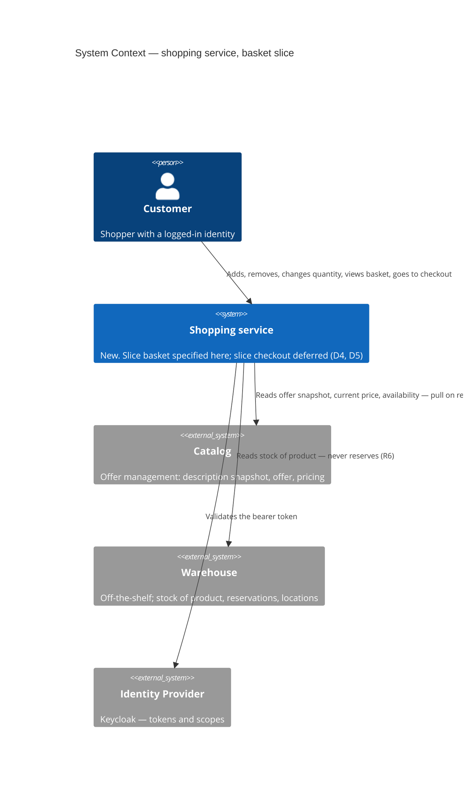

# basket — shopping basket

## Goal

- **We build:** the basket vertical slice — content, quantities, price with discounts, delivery estimate.
- **For whom:** the customer, before checkout.
- **Because:** the basket is where the purchase first shows its real price and delivery time.
- **Success looks like:** no target, baseline or volume number exists in any material — DoV rows must be stated as hypotheses with an explicit "baseline absent" (R10), not invented percentages.

## Capabilities

1. `AddToBasket` — add an offer with a quantity.
2. `RemoveFromBasket` — one item, a shipment's items, or the whole basket.
3. `ChangeBasketQuantity` — ± stepper; **not on the board**, required by transcript 63 and `basket.json` (R4).
4. `BasketContent` — per-seller shipment groups; item = title, one picture, price, attributes.
5. `BasketPriceCalculation` — "current price of basket including discounts" (board policy).
6. `BasketDeliveryEstimate` — "delivery time calculation policy"; hardcoded `now + 2 … now + 4` days (D36), no out-of-stock range.
7. `OfferAvailabilityDecision` — `available` / `outOfStock` / `unavailable`; every non-available status blocks handover (D33).
8. `BasketSelection` — per item / per shipment / whole basket, used by remove and by checkout.
9. `CheckoutHandover` — `go to checkout` passes the selected content to the checkout slice (D4).
10. `OfferChangeEvents` — product and stock changes reach the basket as events (D25).

## Properties

- No stock reservation on any command (R6).
- Read-dominant, must stay available under browsing traffic.
- Prices come from the offer snapshot, never recomputed from input.
- PLN, 2 decimals, `pl-PL` format (`99,89 zł`).
- Basket is owned by a customer identity.

## Input materials

Visual board: `board.excalidraw` (in this folder) — every material below is attached to it.

| # | Source | Type | What it is | Use for | Status |
|---|---|---|---|---|---|
| 1 | `docs/raw/basket.png` | screenshot | Allegro basket page: one seller shipment, 2 items, per-item + whole-basket checkbox, ± quantity stepper, item price, delete icon, item attribute summary, `RAZEM`, delivery line, right panel `Wartość produktów` / `Dostawa od` / `Razem z dostawą`, CTAs, 2 cross-sell boxes | UI view, display rules, price composition | fact |
| 2 | `docs/raw/ecommerce-eventstorming.jpg` | diagram | board: 5 lanes; basket lane = F4 | actors, commands, events, read models, policies, boundaries | fact |
| 3 | `docs/raw/materials/eventstorming.json` | data | machine transcription of #2 (`lanes[2]`, `boundaries[1..2]`, `verbatimTypos[1,4]`) | same, citable | fact |
| 4 | `docs/raw/ecommerce-eventstorming.improved.srt` + `materials/transcript.json` | transcript | 153 timed segments; basket 61–75, checkout 76–108; gap after 71 | verbatim behaviour, failure rules, checkout dependency | fact |
| 5 | `docs/raw/ecommerce-eventstorming.md` | doc | narrative summary generated from #4 | cross-check only, not authority | fact |
| 6 | `docs/raw/materials/offer-lego.json` | data | published offer page field-by-field (price, availability, delivery, seller) | what the basket reads from the offer | fact |
| 9 | `README.md:26` → `raw/shopping.md` | doc (referenced) | shopping feature brief | goal/scope | **missing** |
| 10 | segment stretch `00:14:50–00:16:01` | transcript | delivery-time & price estimation rules | calculations | **missing** |
| 11 | discount rules, reservation policy detail | — | only "may have some reservations, not on that scale" | decisions | **missing** |
| 12 | `docs/raw/materials/basket.json` | data | field-by-field transcription of #1 (`basket`, `pageFurniture`, `derivedChecks`, `notPresent`) | UI view, price composition, ambiguities | fact |

## Strategic architecture

Not applicable — the operator deliberately skipped initialising `docs/adr/01-strategic-software-architecture.md` (D12). The architecture instructions this spec does follow are the codebase's own: `docs/arch/microservice-java-spring/code-structure.md` (F10).

## Context

Names fixed for the rest of the spec: `Customer`, `Shopping service`, `Basket` (slice), `Checkout` (slice, deferred), `Catalog`, `Warehouse`, `Identity Provider`.

Deliberately absent at this level: `Fulfillment`, `CRM`, `Payment provider`, `DHL` — they belong to the deferred checkout slice (D4).

### Current code (Step 3)

| Area | Status | Where | Reuse |
|---|---|---|---|
| Offer price / availability / description snapshot read | **missing** | no controller at all under `services/catalog/src/main`; only `AppConfiguration.java:26` | build new — F13 |
| Aggregate port + JSONB document snapshot | exists fully | `parcel/ParcelRepository.java:20`, `parcel/DocumentParcelRepository.java:40` | reuse as-is |
| Projection + its controller | exists fully | `parcel/ParcelLabelProjection.java:30` + `ParcelLabelController.java:18` | reuse as-is |
| Optimistic locking | exists fully | `DocumentParcelRepository.java:143` (`@Version`) | reuse as-is |
| Error advice (status from an enum, never from a message) | exists fully | `FulfillmentErrorAdvice.java:30,59-73` | reuse as-is |
| Auth chain + per-route authority | exists fully | `AppConfiguration.java:50-60,75` | reuse as-is |
| Idempotency | **partial** | content hash `kernel/Order.java:86`, `OrderIntakeService.java:38-50`; no `Idempotency-Key` header | extend — F16 |
| Money / amounts | **missing** | `kernel/Payment.java:10`, `ProcessingSnapshot.java:27` assert none exists | build new — R11, D14 |
| Quantity | partial | `kernel/OrderLine.java:12` `int`, `< 1` refused | extend |
| Test layers (unit, ArchUnit, Testcontainers IT, MockMvc, hurl e2e) | exists fully | `ArchitectureTest.java:32`, `IntegrationConfiguration.java:13-26`, `e2e/fulfillment-api.hurl:26` | reuse as-is |
| HTTP port for a shopping service | exists fully | `POST /orders` — `processing/OrderIntakeController.java:28`, authority `shopping-service` | reuse as-is (checkout slice) |
| Anything basket/cart/discount | **missing** | `grep -rni "basket\|cart\|discount" services/*/src` → 0 hits | build new |

## Scope

**In scope** — the ten elements listed below: the basket view, the basket concept, money, the price calculation, the two interfaces, the basket HTTP API, the offer/stock read and the checkout handover.

**Deferred** (detached):

- `Checkout` slice — its own spec, same microservice (D4).
- HTTP shape of the offer read — belongs to the browsing slice (D13).
- Implementation of `BasketDeliveryEstimate` (D16) — issue [#71](https://github.com/michal-michaluk/ecommerce-eval/issues/71).
- Implementation of `OfferAvailabilityDecision` (D16) — issue [#72](https://github.com/michal-michaluk/ecommerce-eval/issues/72).
- Warehouse **stock bands** (high / medium / last *n*) and the basket rules that respect them — later increment (D20, R14).
- The **transport** of element 10 — no Kafka listener, no producer, no topic in this increment (D39, operator: "there is no events emitted on kafka … do not focus on integration now"); the in-process application of an observation **is** in scope.
- The **HTTP client** behind `OfferCatalog` and the real catalogue read — the shape belongs to the browsing slice (D13) and today only a fixture adapter exists (D38).
- **Several active baskets** per customer — one active basket is enforced now (D42); the plural reading of D29 is deferred.
- Any **contract with another service** — no Pact, no simulator service, no CLI (D45); the two `prove` scenarios are the contract of record.

**Out of scope** — browsing and search, payment and delivery-method filtering, order creation, warehouse reservation, fulfilment and carrier contracts (D2).

## Elements

| # | Element | Type | File |
|---|---|---|---|
| 1 | Basket view | UI view | [01-basket-view.md](01-basket-view.md) |
| 2 | Basket | business concept | [02-basket.md](02-basket.md) |
| 3 | Money | business concept | [03-money.md](03-money.md) |
| 4 | BasketPriceCalculation | calculation | [04-basket-price-calculation.md](04-basket-price-calculation.md) |
| 5 | BasketDeliveryEstimate | calculation — interface only | [05-basket-delivery-estimate.md](05-basket-delivery-estimate.md) |
| 6 | OfferAvailabilityDecision | decision — interface only | [06-offer-availability-decision.md](06-offer-availability-decision.md) |
| 7 | Basket HTTP API | new API | [07-basket-http-api.md](07-basket-http-api.md) |
| 8 | OfferCatalog + Warehouse read | integration | [08-offer-stock-port.md](08-offer-stock-port.md) |
| 9 | Checkout handover | integration | [09-checkout-handover.md](09-checkout-handover.md) |
| 10 | Offer change events | integration — event channel | [10-offer-change-events.md](10-offer-change-events.md) |

## Prove Definition of Done

Rows are the acceptance contract for the **implementation** (this spec stops at the specification). One row = one trigger + one observable expectation. `scenario:<n>` means step *n* of `prototypes/basket-api.prove.md`; `05:I<n>` and `06:I<n>` mean the interface scenarios of elements 05 and 06.

| # | Facet | Check (executable) | Expected |
|---|---|---|---|
| DoD1 | Artifact | `cd docs/specs/basket/prototypes/.storybook && npm run build-storybook` | `storybook-static/index.json` holds 8 entries |
| DoD2 | Artifact | `cd docs/specs/basket/prototypes/.storybook && npm run verify` | CDP gate prints `QUALITY GATE PASSED`, exit `0` |
| DoD3 | Artifact | every link in `index.md` §Elements resolves: `test -f` on each target | exit `0`, 10 files |
| DoD3b | Artifact | `prove validate prototypes/*.prove.md` | exit `0`, empty stdout |
| DoD3c | Artifact | `prove explain prototypes/basket-api.prove.md --format json` | `status` `success`, `24` steps |
| DoD3bN | Failure | `sed 's/- est_from:/- est_gone:/' prototypes/basket-api.prove.md > /tmp/b.md; prove validate /tmp/b.md` | exit `3`, `var.undefined` per step carrying `{{est_from}}` |
| DoD4 | Artifact | `cd services/shopping && ./gradlew build` | exit `0` |
| DoD5 | Contract | scenario step 4 (two items in one shipment) | `totals.totalWithDelivery.amount == 174870` |
| DoD6 | Contract | scenario step 5 (same `PATCH` twice) | `totalWithDelivery.amount == 174870` — quantity did not double |
| DoD7 | Contract | scenario step 6 (`quantity: 2`) | `items[OF-1001].lineTotal.amount == 199780` |
| DoD8 | Contract | unit test: `Money` addition `99890 + 64990` | `164880`, exact `long` |
| DoD8b | Contract | unit test: `currentPrice 99890 × quantity 2` | `199780`, exact `long` |
| DoD9 | Contract | unit test: `round_half_up(33333)` | exactly `3333` |
| DoD10 | Contract | scenario step 9 (EUR offer into a PLN basket) | `422 CURRENCY_MISMATCH` |
| DoD11 | Failure | scenario step 8 (`quantity: 0`) | `422 QUANTITY_NOT_POSITIVE` |
| DoD12 | Failure | scenario step 16 (out-of-stock selected) | `422 BLOCKED_BY_ITEMS` |
| DoD13 | Failure | scenario steps 17–18 (deselect the blocked row, then checkout) | `200`, `totalWithDelivery.amount == 109880` |
| DoD14 | Failure | scenario step 21 (unavailable item selected) | `422` with `reasons[].status == "unavailable"` |
| DoD14a | Failure | scenario step 10 (offer unknown to catalog) | `404 OFFER_NOT_FOUND` |
| DoD14b | Failure | scenario step 14 (handover with an empty selection) | `422 NOTHING_SELECTED` |
| DoD15 | Failure | scenario step 23 (no token) | `401`, empty body |
| DoD16 | Failure | scenario step 24 (service token on a customer route) | `403`, empty body |
| DoD17 | No false green | ArchUnit rule: no `reserve*` operation on any port of `shop.shopping`; the fixture `OfferCatalog` records its calls | `0` reservation operations declared and `0` recorded after scenario step 6 |
| DoD18 | No false green | offer read forced to `503`, then `GET /baskets/{id}` | `items[].availability.stale == true` |
| DoD19 | No false green | same read failure, then `PATCH … /checkout` | `422 BLOCKED_BY_ITEMS` — the row is `unavailable`, which blocks; a `stale` row that is still `available` would not (element 06 A5) |
| DoD20 | No false green | apply the same `OfferObservation` twice through the ingestion command (element 10, D39) | basket state unchanged after the second |
| DoD21 | No false green | apply an `OfferObservation` whose `readAt` is older than the item's | basket state unchanged |
| DoD22 | No false green | two concurrent `GET /baskets` for a customer with none | exactly `1` basket exists |
| DoD23 | Gate | `./gradlew test` | `jacocoTestCoverageVerification` passes at the blueprint's **80 % INSTRUCTION** — the DoD's 0.70 is satisfied, and the architecture rule forbids lowering the gate (D45) |
| DoD24 | Gate | `sqt check` in `services/shopping` | exit `0`, no violation reported |
| DoD25 | Gate | ArchUnit slice-isolation test | the `basket` slice references no `checkout` type; exit `0` |
| DoD26 | Contract | `05:I1–I7` as a table test with a fixed clock | each row's `kind`/`from`/`to` matches element 05 |
| DoD27 | Contract | `06:I1–I7` as a table test | each row's `status`/`reason`/`stale` matches element 06 |
| DoD28 | Integration | restart the service, then scenario step 22 | basket content survives; `items` count `2` |
| DoD29 | Integration | scenario step 18 handover | `handoverId == basketId` |
| DoD30 | Integration | scenario step 19 (repeat handover, compares against the captured `revision`) | `revision` equals `revA` |

**Facets not claimed:** no SLO, latency or volume row — no material carries such a number (R10); inventing one would make the gate a guess.

## Prove Definition of Value

No material contains a conversion, volume or latency baseline (**R10**), so every row is a hypothesis with the baseline explicitly absent. They are measurable, and the first task that touches production data must replace "baseline absent" with the recorded number.

| # | Dimension | Metric | Hypothesis (baseline absent → target) | Timeframe |
|---|---|---|---|---|
| DoV1 | User | share of non-empty baskets that reach `go to checkout` | baseline absent → establish it, then +10 % relative | 60 days after release |
| DoV2 | Operational | share of handovers where checkout reports a price difference (D31) | baseline absent → below 0.5 % of handovers | 60 days |
| DoV3 | Safeguard | share of handed-over baskets containing a row that turned `unavailable` after the handover | baseline absent → 0 by construction, monitored | continuous |
| DoV4 | Safeguard | share of baskets whose delivery estimate differs from the delivered date by more than the 2–4 day range | baseline absent → recorded, not targeted | 90 days |
| DoV5 | User (leading) | share of non-empty baskets showing an estimate at all (D36 guarantees one) | baseline absent → 100 % | first week |
