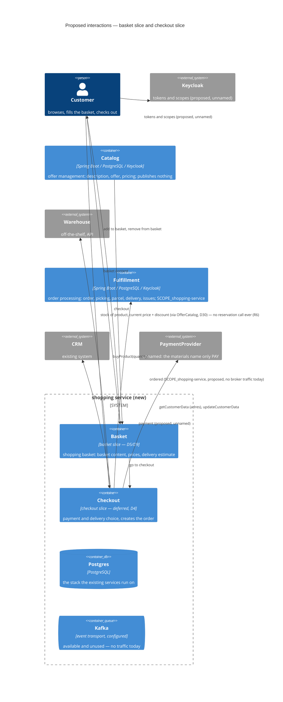
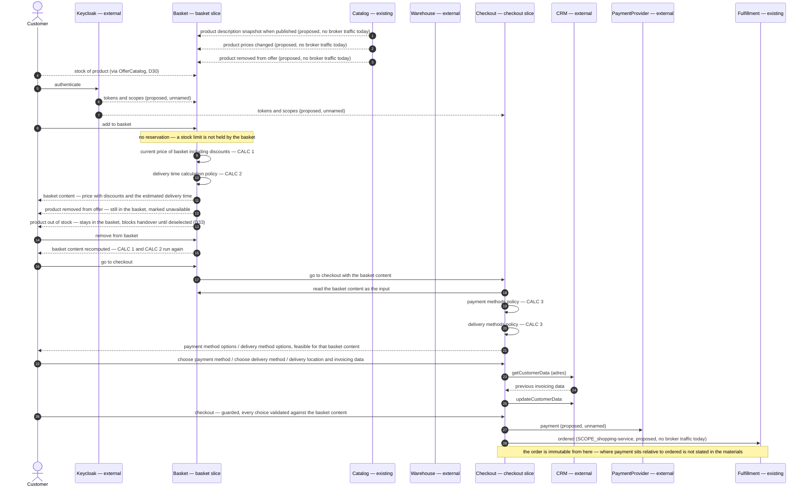

# Basket and checkout — proposed communications and interactions

Status: proposal — Step 4 input, not accepted

Legend: **existing service** = a C4 `Container` outside every boundary · **new service** = a slice inside the boundary `shopping service (new)` · **external system** = `System_Ext`, `ContainerDb` or `ContainerQueue` · **open decision** = the word `proposal` or an id (`Q2`, `Q4`, `Q6`, `Q7`, `Q8`, `D2`) in a label.

Nothing below adds a contract: every name is quoted from `docs/raw/materials/eventstorming.json`, `docs/raw/materials/basket.json` or `docs/raw/materials/transcript.json`, and every name that exists in no material is written `(proposed, unnamed)` — no path, topic, payload or table is invented. Two facts bound the whole picture (`log.md` `F11`, `F12`): no Kafka traffic exists anywhere in the repo today — `spring-kafka` is on the classpath and `kafka-bootstrap-servers` is set (`services/fulfillment/k8s/base/configmap.yaml:8`), but `services/*/src` holds no producer, no listener and no topic name, and events are in-process `ApplicationEventPublisher` only — and `catalog` publishes nothing at all. Every cross-service event arrow is therefore marked `(proposed, no broker traffic today)`.

## 1. Interaction view

Read the spine first: `Customer → Basket → Checkout → Fulfillment` — the only path that crosses both bands. Catalog and Warehouse only feed it: Catalog carries the three product events and publishes nothing today, so Q8 decides how the basket learns of them; Warehouse answers `stock of product` and exposes `reserveProductQuantity` (which the basket does not call when adding, segment 66) and `buyProduct(quantity)`. Postgres and Kafka sit inside the boundary as the stack the existing services already run on: no table and no topic is named in any material, Kafka carries no traffic today, so neither gets an arrow. `ordered` is drawn as the one direct crossing Checkout → Fulfillment, carrying the existing `SCOPE_shopping-service`. Each direction is its own `Rel` because mermaid 11.17.2 keeps only the last label for two relations declared between the same ordered pair.

Mermaid 11.17.2 renders a `C4Container` in fixed horizontal rows and rejects a `direction` statement (a parse error, not a layout choice), so the spine cannot be drawn as one left-to-right line; it reads Customer (top left) → Basket (bottom left) → Checkout (bottom centre) → Fulfillment (top right), with Catalog and Warehouse in the band above, feeding the basket.

## 2. One basket lifecycle

## 3. Interactions

`#` | Interaction | Direction | Intent | Name source | Status
---|---|---|---|---|---
1 | add to basket | Customer → Basket | put an offer in the basket; no stock is reserved (segment 66) | `eventstorming.json` `lanes[2].commands` | fact
2 | remove from basket | Customer → Basket | take a line out; the basket survives the offer being withdrawn (segment 69) | `eventstorming.json` `lanes[2].commands` | fact
3 | change the amount | Customer → Basket | increase or decrease a line, quantity 1 is the floor (`basket.json` stepper, segment 63) | `transcript.json` `63` — no command on the board | fact
4 | basket content | Basket → Customer | product title, one picture, price (`basket.json`), estimated delivery time, discounts, blocking issues (segments 74, 75) | `eventstorming.json` `lanes[2].readModels` | fact
5 | current price of basket including discounts (spelled `dyscounts` on the board) | Basket → Basket | CALC 1, rerun on every change in the basket (segment 75) | `eventstorming.json` `lanes[2].policies` | fact
6 | delivery time calculation policy | Basket → Basket | CALC 2, the estimate the basket displays (segment 74) | `eventstorming.json` `lanes[2].policies` | fact
7 | product out of stock (non blocking) | Warehouse → (browsing) → Basket → Customer | the line stays, marked out of stock, and **blocks handover** until the customer deselects it (D33 — overrides the board's "non blocking" wording)
8 | product removed from offer | Catalog → (browsing) → Basket → Customer | the line stays, marked unavailable, never silently dropped (segment 69); the carrier is undecided — catalog publishes nothing today | `eventstorming.json` `boundaries[0]` | blocked by Q8
9 | product prices changed | Catalog → (browsing) → Basket | the basket re-prices against the offer, not against a copy taken at add time; the carrier is undecided | `eventstorming.json` `boundaries[0]` | blocked by Q8
10 | product description snapshot when published | Catalog → (browsing) → Basket | what the basket displays as title and attributes is the published snapshot; the carrier is undecided | `eventstorming.json` `boundaries[0]` | blocked by Q8
11 | stock of product | Warehouse → Basket | the availability read behind interaction 7 | `eventstorming.json` `lanes[1].readModels`, `externalSystems` | fact
12 | reserveProductQuantity | Basket → Warehouse | never called when adding to the basket; reservations exist "to some degree" but not at that scale (segments 66, 68) — who calls it and when is not stated | `eventstorming.json` `lanes[1].annotations` | proposal
13 | buyProduct(quantity) | Checkout → Warehouse | the purchase call named on the Warehouse boundary; timing and owner are not stated in the materials | `eventstorming.json` `lanes[1].annotations` | proposal
14 | go to checkout | Basket → Checkout | hand the basket content over as the checkout input; both sides are slices of the same service (D5), so this is a call, not a crossing | `eventstorming.json` `boundaries[2]`, `lanes[2].commands` | fact
15 | choose payment method | Customer → Checkout | pick from the options interaction 17 leaves available (segment 82) | `eventstorming.json` `lanes[3].commands` | fact
16 | choose delivery method (board: `choose delery method`) | Customer → Checkout | pick from the options interaction 18 leaves available; a parcel locker cannot take a washing machine (segment 79) | `eventstorming.json` `lanes[3].commands` | fact
17 | payment methods policy | Checkout → Checkout | CALC 3a, options depend on the basket content and on customer restrictions (segments 77, 80) | `eventstorming.json` `lanes[3].policies` | fact
18 | delivery methods policy | Checkout → Checkout | CALC 3b, options depend on the basket content (segments 78, 79) | `eventstorming.json` `lanes[3].policies` | fact
19 | checkout | Customer → Checkout | terminal and guarded: every choice feasible for the basket content, every datum present (segments 85–91); deferred to its own spec (D4) | `eventstorming.json` `lanes[3].commands` | fact
20 | getCustomerData (adres) | Checkout → CRM | previous invoicing data to prefill, possibly several (segments 76, 83, 92) | `eventstorming.json` `lanes[3].annotations` | fact
21 | updateCustomerData | Checkout → CRM | save the new contact and invoicing data (segment 93) | `eventstorming.json` `lanes[3].annotations` | fact
22 | ordered | Checkout → Fulfillment | the order exists and, from that point, is an immutable document — nothing is added to it (segments 98, 99); the CRM also learns of it (segment 95); delivered under the existing `SCOPE_shopping-service`, over a transport that does not exist yet (`proposed, no broker traffic today`) | `eventstorming.json` `boundaries[3]` | fact
23 | token validation | Basket, Checkout → Keycloak | both services validate a token by `issuer-uri` (`services/*/src/main/resources/application.yml:20-21`); `catalog` defines no scopes, `fulfillment` defines `SCOPE_fulfillment-employee`, `SCOPE_fulfillment-resolver`, `SCOPE_fulfillment-customer` and already carries `SCOPE_shopping-service`; any basket scope is `(proposed, unnamed)` | existing code | proposal
24 | persistence and event transport | Basket, Checkout → PostgreSQL, Kafka (no arrow drawn, see §1) | basket content and checkout state in Postgres; Kafka is configured (`kafka-bootstrap-servers`) but carries no traffic today and no topic is named in the materials | existing code | proposal
25 | payment authorisation | Checkout → PaymentProvider | charge the method picked in interaction 15; the only provider the materials name is `PAY` (`offer-lego.json` `offer.pricing.deferredPayment.provider`), so the actor stays generic and unnamed | **proposal** | proposal
26 | displayed item price = unit price or line total | Basket → Customer | answered by **D8**: a shown price is the **line total** for its quantity
27 | delivery priced per shipment or for the basket | Basket → Customer | answered by **D8**: delivery is priced **per seller shipment**

Rows 7–10 carry the names `eventstorming.json` records; the intermediate `browsing` lane and the step from it into the basket are the crossings `boundaries[0]` and `boundaries[1]` describe, drawn here as one arrow each so the diagram stays readable — the step itself is this document's reading, not a material fact, and its carrier is Q8.

## 4. Open decisions

- `Q2` — is the scope the basket lane only, or the whole shopping area (browsing + basket + checkout)? **Answered by `D4`**: this spec covers the basket vertical slice only; checkout is a separate slice, deferred to its own spec.
- `Q4` — is this a business-area spec that becomes a new `services/basket` microservice, or a spec of an existing system? **Answered by `D5`**: basket and checkout live in one new microservice, each as a separate vertical slice — hence one boundary with two slices above, not two services.
- `Q6` **answered (D8)** — is a displayed item price the unit price or the line total, and is delivery priced per shipment or for the basket? Interactions 26 and 27 cannot be specified until this is answered.
- `D2` — catalog and fulfillment contracts are not specified here; they appear only as external actors.
- `Q7` **answered (D9)** — what is the new microservice called and where does it live — `services/shopping` with slices `basket` and `checkout`? The boundary above carries the plain label `shopping service (new)` until this is answered.
- `Q8` **answered (D10/D25)** — how does an item learn that its offer was removed or its price changed — HTTP read on demand, catalog pushing to the shopping service, or a new Kafka topic? Answered: pull on read (D10) **plus** an event channel (D25, element 10) — interactions 8–10 are served by both, and the event carrier is a `plan` decision (EVT-1).
