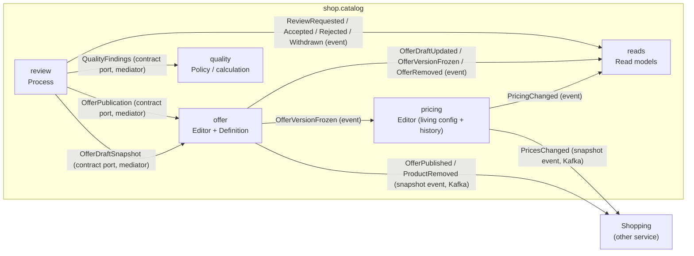

# 17 — Contexts inside catalog

Element 17 · type: decomposition · scope: one bounded context (catalog) · accepted.

Five contexts inside the service, cut so that each owns one reason to change and every pair talks only through the two mechanisms the
architecture already allows: a **published record** (in-process event) or a **contract port** implemented by a **mediator**
(`docs/arch/microservice-java-spring/context-boundaries.md`). A context is a package directly under `shop.catalog`; the boundary is the
pair of allow-lists in `ArchitectureOf{Context}Test`, so an edge cannot appear without editing two tests.

## Subdomain: offer

**Responsibilities:** owns the offer document — the mutable draft (description content, media, availability start), the immutable
frozen versions, and the product's lifecycle state. It is the only writer of description and media, and the only producer of published
offers.

**Core capabilities:** create offer · edit description draft · attach/reorder media · set availability start · publish a version (invoked
by `review` through the port) · revert · remove.

**Integrations**

| Direction | Counterpart | Type | What crosses |
|---|---|---|---|
| → | `reads` | event | `OfferDraftUpdated`, `OfferVersionFrozen`, `OfferRemoved` |
| → | `pricing` | event | `OfferVersionFrozen` (pricing keeps a local "offer exists" fact) |
| ← | `review` | contract port + mediator | `OfferDraftSnapshot` (read), `OfferPublication` (command) |
| → | Shopping | snapshot event | `OfferPublished`, `ProductRemoved` (13) |
| → | `tools` | dependency | `Clock`, JSON mapper |

**Actors:** ContentAuthor, ContentReviewer (revert, removal), Photographer (media component only).

**Components:** *Editor* `OfferEditor` (aggregate, package-private); *Value Object in the shared kernel* `ProductDescription` (+ `Draft`, nested components); *Snapshot* `Offer`; *Definition* `OfferVersion`;
*Invariant* the offer aggregate — one primary image, contiguous positions, availability date shape, immutable versions (02 RULE-1…11).

`ProductDescription` is exported from this context and listed in `sharedKernelExposed`; it carries no identity or lifecycle, so `pricing`,
`review`, `quality` and `reads` may all hold it as a value without an edge beyond the shared-kernel list.

## Subdomain: pricing

**Responsibilities:** owns every price and discount of an offer, current and scheduled, and the history that must never be overwritten.
Answers "what does it cost at instant t".

**Core capabilities:** set/close a price entry · schedule a price · add/remove discounts (percentage, fixed) · keep history ·
compute the active price.

**Integrations**

| Direction | Counterpart | Type | What crosses |
|---|---|---|---|
| ← | `offer` | event | `OfferVersionFrozen` → local `KnownOffer` fact, so a price cannot be set for an unknown offer |
| → | `reads` | event | `PricingChanged` |
| → | Shopping | snapshot event | `PricesChanged` (13) |
| → | `tools` | dependency | `Clock` (activation moments) |

**Actors:** Sales.

**Components:** *Editor* `PricingModelEditor` (aggregate, package-private; living configuration with history); *Snapshot* `PricingModel`; *Policy* `ActivePriceCalculation` (10) — the only place
where stacking (D3) and currency precision (D1) live.

## Subdomain: review

**Responsibilities:** owns the review lifecycle of a candidate — freezes what is being reviewed, records the decision, and triggers
publication on acceptance. It is the pivot: responsibility for the offer moves from authoring to the shop at this point.

**Core capabilities:** request review (freeze candidate) · read pending reviews · accept (publishes) · reject with reason · withdraw.

**Integrations**

| Direction | Counterpart | Type | What crosses |
|---|---|---|---|
| → | `offer` | contract port + mediator | `OfferDraftSnapshot` (read the draft), `OfferPublication` (freeze a version) |
| → | `quality` | contract port + mediator | `QualityFindings` (frozen with the candidate, and for the screen) |
| → | `reads` | event | `ReviewRequested`, `ReviewAccepted`, `ReviewRejected`, `ReviewWithdrawn` |
| → | `offer` | event | `ReviewAccepted` also lets `offer` mark its state without a second write |

**Actors:** ContentAuthor (request, withdraw own), ContentReviewer (read, decide).

**Components:** *Process* `ReviewProcess` (04); *Policy* `PublishDecision` (09).

## Subdomain: quality

**Responsibilities:** answers "what is wrong with this draft" — no persistence of business facts except the per-category configuration.
It is a calculation context, so it answers through a contract port and never reaches into another context's model.

**Core capabilities:** evaluate QP-1…QP-8 universally · evaluate QP-10…QP-12 for the matched category · report findings with severity.

**Integrations**

| Direction | Counterpart | Type | What crosses |
|---|---|---|---|
| ← | `review` | contract port + mediator | draft + media + categoryPath in, `findings[]` out |
| ← | `offer` | contract port + mediator | same port, consulted while editing (14) |
| → | `tools` | dependency | configuration reader |

**Actors:** none directly (ContentAuthor sees its output in 14).

**Components:** *Policy* `QualityPolicy` (08). Deliberately **no** aggregate: a calculation with configuration only.

## Subdomain: reads

**Responsibilities:** serves every `GET` of 12 with denormalized rows — the draft screen, the pending-reviews list, the pricing view.
Also the single owner of the visibility rule (11), because "is it visible today" changes with the clock and must be answered where the
rows live.

**Core capabilities:** offer draft read model · pending reviews read model · pricing read model · visibility evaluation.

**Integrations**

| Direction | Counterpart | Type | What crosses |
|---|---|---|---|
| ← | `offer` | event | `OfferDraftUpdated`, `OfferVersionFrozen`, `OfferRemoved` |
| ← | `review` | event | `ReviewRequested`, `ReviewAccepted`, `ReviewRejected`, `ReviewWithdrawn` |
| ← | `pricing` | event | `PricingChanged` |
| → | `tools` | dependency | `Clock` (visibility), clock for waiting time in 15 |

**Actors:** read side of all four roles (12 matrix).

**Components:** *Read model* `OfferDraftReads`, `PendingReviewsReads`, `PricingReads`; *Policy* `OfferVisibility` (11).

## Event design strategy

| Kind | Events | Scope | Why |
|---|---|---|---|
| **Domain event** | `OfferDraftUpdated`, `PricingChanged`, `ReviewRequested` | in-process, inside catalog | consequences of a single business action, too granular for another service |
| **Pivotal event** | `ReviewAccepted` | in-process, drives publication | the moment responsibility transfers from authoring to the shop |
| **Snapshot event** (event-carried state transfer) | `OfferPublished`, `PricesChanged`, `ProductRemoved` | Kafka, to Shopping | the shop must render an offer without calling back; aligns with 13 R1 |

## Rules that follow from the cut

- **RULE-1** only `mediators/` may name two contexts; every other edge is an event or a port (`context-boundaries.md`).
- **RULE-2** `quality` and `reads` own no aggregate and never write another context's tables.
- **RULE-3** `review` never mutates the offer directly — it asks through `OfferPublication`, so the version is frozen by the owner.
- **RULE-4** `pricing` learns that an offer exists from `OfferVersionFrozen`, never by querying `offer` (RULE-1 consequence).
- **RULE-5** the draft screen's read-your-writes is guaranteed by the in-process listener: `OfferDraftUpdated` is handled inside the
  producer's transaction, so the projection cannot lag behind a `PATCH` reply (`integration.listener-joins-transaction`).
- **RULE-6** visibility (11) is computed only in `reads`; `offer` carries `availabilityStart` and state, nothing else.

## Risks and assumptions

- **R4 → D34 (resolved)** `review` calls `offer` through a mediator inside **one** transaction: acceptance, the `publishedOfferVersion`
  record and the freeze commit or roll back together, so an accepted review always has its version. The retry is safe because the
  publication is idempotent per `reviewId` (09 R6). No compensating action, no saga, no second write path.
- **R5** the visibility rule must stay in one context (RULE-6); duplicating it in `offer`'s query path would drift.
- **A4** `quality` is a separate context rather than a policy inside `offer`, because it carries per-category configuration and two
  consumers (14 and 04) — worth the port.
- **A5** `reads` serves all three views from one context instead of one per view: they share the same event sources and the same deployable;
  splitting later is a package move, not a boundary change.

## What this does not change

The external surface stays exactly as specified: 12 (HTTP), 13 (Kafka events), 14/15/16 (views), and the four business concepts of 01–04.
This element only fixes who inside the service owns what.
