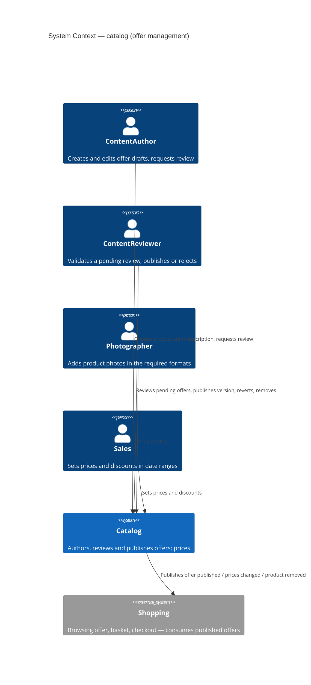

# catalog — offer management

Session anchor: [issue #1](https://github.com/michal-michaluk/ecommerce-eval/issues/1) · process: `specification` steps 0–7 · folder landed step by step.

## Purpose

Author, review and publish product offers, and set their prices, so the shop can show high-quality
product content. The context owns the offer document; it does not own customers, orders or stock.

## Materials index

| Source | Machine-readable form | Role |
| --- | --- | --- |
| `docs/raw/ecommerce-eventstorming.jpg` | `../../raw/materials/eventstorming.json` (lane `offer-management`) | board: actors, commands, events, read models, policy, hot spots |
| `docs/raw/ecommerce-eventstorming.improved.srt` | `../../raw/materials/transcript.json` (segments 1–48, 51) | narration: goals, privacy invariant, gates, availability date, pricing |
| `docs/raw/offer-lego.png` | `../../raw/materials/offer-lego.json` | field-level shape of the published offer |
| `docs/api/warehouse-api.md` | — | boundary evidence: stock is not catalog's |
| `docs/arch/microservice-java-spring/*` | — | build constraints for `services/catalog` |

## Intake register (Step 1, accepted)

| # | Source | Type | What it is | Use for | Status |
| --- | --- | --- | --- | --- | --- |
| 1 | `eventstorming.json` lane `offer-management` | diagram | 8 commands, 7 events, 2 read models, 1 policy, 3 hot spots, 4 actor roles | actors, commands, events, views | fact |
| 2 | `transcript.json` segments 1–48, 51 | transcript | goals, private drafts, review gate, availability date, pricing by sales | goals, rules, decisions | fact |
| 3 | `offer-lego.json` | screenshot | published offer, every field | field-level shape of the offer | fact |
| 4 | `docs/api/warehouse-api.md` | API contract | warehouse stock/issue port | boundary, not our data | fact |
| 5 | `docs/arch/microservice-java-spring/*` | arch docs | mandatory service patterns | constraints | fact |
| 6 | commit `d16a219` deleting `raw/product-catalog.md` + `raw/product-description.json` | dropped docs | earlier derived field-level spec | superseded by rows 1–3 | missing |
| 7 | `services/catalog` | code | generated skeleton only, no domain model | Step 3 baseline | fact |

## Scope

- **In scope:** authoring, photos, review, publication with availability date, version revert, removal, pricing with scheduled discounts.
- **Out of scope:** customer browsing/search views, basket, checkout, order, stock, reservations, goods issue, payments, delivery.
- **Deferred / detached:** none yet.

## Registers

| ID | Type | Statement | Status | Decision |
| --- | --- | --- | --- | --- |
| F1 | Fact | `services/catalog` is a 7-file generated skeleton, package `shop.catalog`; no aggregate, versioning, pricing, review states, read models or published events exist | accepted | greenfield context, nothing to reconcile |
| F2 | Fact | drafts are private until published; a scheduled price change is not emitted until it becomes active | accepted | privacy + activation are invariants, not options |
| F3 | Fact | publication may carry a future availability start date; an accepted offer is not immediately visible | accepted | model availability separately from publication |
| D1 | Decision | any currency; the currency defines precision; two discount kinds — percentage and fixed amount — each effective in a date range | accepted | `Money{amountMinor,currency}`; discount = kind + value + date range |
| R1 | Risk | board hot spot `Event (?): PordutUpdated (całość informacji o produkcie)` — one event with whole product vs incrementals | **closed** | D6: snapshot events, `OfferPublished` carries the whole frozen version (13 RULE-2) |
| R2 | Risk | board hot spot `product description snapshot when published` + `revert to previous version` imply versioning and snapshots | **closed** | D9: frozen versions + `descriptionVersion` pin + candidate frozen at request (01 RULE-3, 02 RULE-4, 04 RULE-3) |
| R3 | Risk | segment 45 emits on price change, segment 47 waits days before activation — activation timing contradiction | **closed** | D1 date ranges + 03 RULE-4: scheduling is silent, the event fires at `validFrom` |
| Q1 | Question | which fields of the description are mandatory for the quality gate, and what "grammar/AI validation" means | **closed** | D10: QP-1…QP-8 universal; D11 `minProseChars = 1000` derived from the LEGO sample (1 626 chars prose); D12 per-category required parameters via config, only `LEGO` configured; grammar out of scope |
| Q2 | Question | who may override the quality gate at review request, and is the override audited | **closed** | D8: only the accepting reviewer; override records actor + timestamp + the findings it ignores (04 RULE-8, 09 R2/R4) |
| Q3 | Question | "some IDs" in segment 5 — which identifiers, and their lifecycle | **closed** | default accepted: `productNumber` + `eanGtin` + `setName` (01 A1) |
| Q4 | Question | "right formats" for photos — the board names the rule, no formats given | **closed** | default accepted: JPG/PNG/WebP, no size limit (02 RULE-1, D17) |
| Q5 | Question | ratings and reviews (60 ocen / 11 recenzji) — inside catalog or a separate context | **closed** | default accepted: out of catalog, DF1 deferred to its own context |
| Q6 | Question | `parameters` — fixed typed schema or attribute list | **closed** | default accepted: attribute list `code/label/value/valueType` (01 A2) |
| Q7 | Question | `description` — structured blocks or one HTML/markdown document | **closed** | default accepted: structured blocks (01 A3) |
| Q8 | Question | 1 product : 1 offer, or 1 product : N offers (offer-lego.json shows 23 offers) | **closed** | default accepted: 1 product : 1 offer; DF2 (marketplace offers) stays out |
| Q9 | Question | `docs/adr/01-strategic-software-architecture.md` absent for this SUD — initialize or proceed without | parked | out of this spec's scope (catalog only); workspace-level artifact, decided separately |
| Q10 | Question | what a customer sees between publication and the availability date | **closed** | D7: hidden until `availabilityStart`; `announce` variant renders "dostępne od <date>" (11) |
| Q11 | Question | after removal, may the same product be offered again, and does version numbering continue | **closed** | default accepted: removal is terminal (02 RULE-6) |
| Q12 | Question | media formats and minimum quality | **closed** | default accepted with Q4: JPG/PNG/WebP, no size limit |
| D24 | Decision | `ProductDescription` is a **value object** published in the **shared kernel** — no identity, no lifecycle; equality by content, deduplicated by `descriptionHash` (01 RULE-7) | accepted | supersedes the earlier "own aggregate with descriptionId" proposal |
| D25 | Decision | `Offer` is the **editor aggregate**: it holds the draft in builder form and embeds the description **by value** in each frozen version (02 RULE-4/7) | accepted | a later edit cannot republish an already-frozen offer |
| D26 | Decision | population rules a value object cannot enforce — unique `productNumber`/`eanGtin` across offers — belong to the offer aggregate (02 RULE-11) | accepted | value stays identity-free |
| F13 | Fact | `specification/references/verify-storybook.cdp.js` fails every story on Storybook 8 — it reads `#storybook-root` from the manager page while SB8 renders the preview in an `iframe` | open | local adaptation `services/catalog/.storybook/verify-storybook.frames.cjs` resolves the preview frame; upstream fix worthwhile |
| F14 | Fact | port 6006 is held by another project's Storybook (`/Users/michal/workspace/hamster-games`) | accepted | the catalog gallery runs on 6010 in this session |

## Step 2 — Goals, actors, capabilities, properties (accepted)

- **We build:** the catalog context — authoring, reviewing and publishing product offers, with prices.
- **For whom:** content managers, photographers, sales.
- **Because:** offers must be created fast and must be high quality (board goals: `straeamline creation process`, `high quality content`).
- **Success looks like:** shorter offer-creation cycle; no offer published while the quality policy reports a failure.
- **Capabilities:**
  1. create a draft product from title + identifiers, title editable later
  2. edit the description privately, many times
  3. attach photos in the required formats
  4. request review; reviewers work from a pending-reviews view
  5. validate the description against the quality policy from the first blank draft
  6. publish a version to the offer, with an availability start date
  7. revert to a previous version
  8. remove the product from the offer
  9. set prices and discounts (percentage or fixed) effective in date ranges, scheduled ahead
  10. emit public events only when a change becomes active
- **Properties:** draft privacy until publication · published version immutable (snapshot) · scheduled changes silent until activation · money precision from currency (D1) · override audit — Q2 · latency/volume — not stated in the materials.

**Actor names, fixed for the rest of the spec:** `content manager` → **ContentAuthor** · `other content manager` → **ContentReviewer** · `photographer` → **Photographer** · `sales` → **Sales**.

| ID | Type | Statement | Status | Decision |
| --- | --- | --- | --- | --- |
| F4 | Fact | board labels `publish version to offer` with `other content manager`; segment 34 has the reviewer decide, then the version is published | accepted | ContentReviewer publishes; ContentAuthor only requests review |
| F5 | Fact | `stock of product` view and `reserveProductQuantity / buyProduct` notes sit in the `browsing offer` lane, not `offer management` | accepted | Warehouse is not a catalog actor; stock is consumed by shopping |
| F6 | Fact | `services/catalog/src/test/java/shop/catalog/ArchitectureTest.java` is deleted in the working tree | open | uncommitted deletion, unrelated to this spec; restore or commit deliberately |

## Step 3 — Current code exploration (accepted)

`services/catalog`, package root `shop.catalog`, 7 source files total.

| Area (Step-2 name) | Status | Where | Reuse |
| --- | --- | --- | --- |
| app bootstrap + config (clock, security, scheduling) | exists fully | `AppRunner.java:9`, `AppConfiguration.java:14-23` | reuse as-is |
| shared kernel — JSON format mapper, event types, last-events | exists fully | `tools/EventTypes.java:8`, `tools/LegacyDomainEvent.java:3`, `tools/LastEvents.java:12`, `tools/Jackson3JsonFormatMapper.java` | reuse as-is |
| feature flags store | exists fully | `tools/FeatureConfiguration.java:41-76`, `src/main/resources/db/db.changelog.yaml:8` | reuse as-is |
| mediator layer | empty — package-info only | `mediators/package-info.java:1` | build new |
| offer aggregate + description model (Capabilities 1–2) | missing | — | build new |
| photos (Capability 3) | missing | — | build new |
| review workflow + quality policy (4–5) | missing | — | build new |
| versioning, snapshot, revert (6–7) | missing | — | build new |
| removal from offer (8) | missing | — | build new |
| pricing + discounts + scheduling (9) | missing | — | build new |
| public events on activation (10) | scaffolding only, no domain events | `tools/LegacyDomainEvent.java:3` | build new on existing types |
| persistence | one table `features_configuration`; changeset `0002-template-placeholder` is an empty tag | `db/db.changelog.yaml:8`, `:22-27` | extend with new changesets |
| architecture tests | suffix-based predicates only; `ArchitectureTest.java` deleted in working tree | `src/test/java/shop/catalog/ArchitectureDescription.java:16-28` | extend |

Supporting evidence of emptiness: the sqt rules file states "the skeleton ships none: there is no context to name yet" (`src/main/java/.sqt.yaml:1205-1207`).

Only product-shaped model in the repo, and not usable here: `docs/api/inventree-openapi.json:49668` `Part` (55 props, `name` ≤100, `description` ≤250, `IPN`, `revision`, `variant_of`, `active`, `units`), `PartPricing:50280`, `PartSalePrice:50568` — a third-party warehouse contract with no draft/review/publish/revert lifecycle.

| ID | Type | Statement | Status | Decision |
| --- | --- | --- | --- | --- |
| F7 | Fact | capabilities 1–10 are 100 % greenfield in this service | accepted | the spec carries the domain model, versioning and event contract, not integration work |

## Definition of done / of value

- DoV: shorter offer-creation cycle, and no low-quality offer reaches the shop.
- DoD: every element file accepted, consistency review clean, `cd services/catalog && ./gradlew build` green after implementation.

## Step 4 — Key elements (accepted)

**Business concepts** — independent concepts only; every other role collapsed into them.

| # | Element | Role | One-liner |
| --- | --- | --- | --- |
| 01 | **ProductDescription** | Definition | immutable, versioned content of one product: identity, title, identifiers, parameters, description blocks |
| 02 | **Offer** | Editor + Definition | draft surface per product — description reference, media, availability start; publishing freezes a version |
| 03 | **PricingModel** | Editor (living configuration + history) | current price, scheduled future prices and discounts, historical prices kept apart from the current one |
| 04 | **ReviewProcess** | Process | owns the review lifecycle of an offer version: requested → in review → accepted / rejected |
| ~~05~~ | ~~ReviewRequest~~ | — | collapsed into 04 ReviewProcess |
| ~~06~~ | ~~PriceList~~ | — | collapsed into 03 PricingModel |
| ~~07~~ | ~~AvailabilityStart~~ | — | collapsed into 02 Offer |

**Calculations and decisions**

| # | Element | One-liner |
| --- | --- | --- |
| 08 | **QualityPolicy** | ProductDescription → findings[] (missing mandatory fields, grammar), from the first blank draft |
| 09 | **PublishDecision** | review outcome + findings + override? → `publish` \| `block` |
| 10 | **ActivePriceCalculation** | (PricingModel, clock) → price and active discounts; scheduled change activates silently, event only at activation |
| 11 | **OfferVisibility** | (published offer version, availability start, clock) → `visible` \| `hidden` |

**APIs we expose**

| # | Element | One-liner |
| --- | --- | --- |
| 12 | **CatalogHttpApi** | commands + queries for ContentAuthor, ContentReviewer, Photographer, Sales |
| 13 | **ShoppingEvents** | outbound integration events: offer published, prices changed, product removed |

**UI views**

| # | Element | One-liner |
| --- | --- | --- |
| 14 | **DraftDescriptionView** | ContentAuthor → editor showing the draft and what is missing |
| 15 | **PendingReviewsView** | ContentReviewer → pending list plus review screen with findings |
| 16 | **PricingView** | Sales → set price and discounts in date ranges, see scheduled changes |

**Decomposition**

| # | Element | One-liner |
| --- | --- | --- |
| 17 | **Contexts inside catalog** | five packages — `offer`, `pricing`, `review`, `quality`, `reads` — wired only by events and contract ports + mediators |

**Deferred (cut from this spec)**

| ID | Scope | Reason |
| --- | --- | --- |
| DF1 | ratings and reviews (60 ocen / 11 recenzji in `offer-lego.json`) | separate context fed by orders — Q5 |
| DF2 | other-sellers / 23-offers marketplace view | depends on Q8; if 1 product : 1 offer wins it is not our business |

Step-5 files land as `NN-<element>.md` in this folder.

## Step 5 — progress

| # | Element | File | Status |
| --- | --- | --- | --- |
| 01 | ProductDescription | [01-product-description.md](01-product-description.md) | accepted |
| 02 | Offer | [02-offer.md](02-offer.md) | accepted |
| 03 | PricingModel | [03-pricing-model.md](03-pricing-model.md) | accepted |
| 04 | ReviewProcess | [04-review-process.md](04-review-process.md) | accepted |
| 08 | QualityPolicy | [08-quality-policy.md](08-quality-policy.md) | accepted |
| 09 | PublishDecision | [09-publish-decision.md](09-publish-decision.md) | accepted |
| 10 | ActivePriceCalculation | [10-active-price-calculation.md](10-active-price-calculation.md) | accepted |
| 11 | OfferVisibility | [11-offer-visibility.md](11-offer-visibility.md) | accepted |
| 12 | CatalogHttpApi | [12-catalog-http-api.md](12-catalog-http-api.md) + [prototypes/catalog-http-api.hurl](prototypes/catalog-http-api.hurl) | accepted |
| 13 | ShoppingEvents | [13-shopping-events.md](13-shopping-events.md) | accepted |
| 14 | DraftDescriptionView | [14-draft-description-view.md](14-draft-description-view.md) + [prototypes/draft-description-view.html](prototypes/draft-description-view.html) | accepted |
| 15 | PendingReviewsView | [15-pending-reviews-view.md](15-pending-reviews-view.md) | accepted |
| 16 | PricingView | [16-pricing-view.md](16-pricing-view.md) | accepted |
| 17 | Contexts inside catalog | [17-contexts-inside.md](17-contexts-inside.md) | accepted |

## Tickets

Anchor: [#1](https://github.com/michal-michaluk/ecommerce-eval/issues/1) (closed at spec close-out; one child issue per accepted element).

| # | Element | Issue |
| --- | --- | --- |
| 01 | ProductDescription | [#4](https://github.com/michal-michaluk/ecommerce-eval/issues/4) |
| 02 | Offer | [#5](https://github.com/michal-michaluk/ecommerce-eval/issues/5) |
| 03 | PricingModel | [#6](https://github.com/michal-michaluk/ecommerce-eval/issues/6) |
| 04 | ReviewProcess | [#7](https://github.com/michal-michaluk/ecommerce-eval/issues/7) |
| 08 | QualityPolicy | [#8](https://github.com/michal-michaluk/ecommerce-eval/issues/8) |
| 09 | PublishDecision | [#9](https://github.com/michal-michaluk/ecommerce-eval/issues/9) |
| 10 | ActivePriceCalculation | [#10](https://github.com/michal-michaluk/ecommerce-eval/issues/10) |
| 11 | OfferVisibility | [#11](https://github.com/michal-michaluk/ecommerce-eval/issues/11) |
| 12 | CatalogHttpApi | [#12](https://github.com/michal-michaluk/ecommerce-eval/issues/12) |
| 13 | ShoppingEvents | [#13](https://github.com/michal-michaluk/ecommerce-eval/issues/13) |
| 14 | DraftDescriptionView | [#15](https://github.com/michal-michaluk/ecommerce-eval/issues/15) |
| 15 | PendingReviewsView | [#16](https://github.com/michal-michaluk/ecommerce-eval/issues/16) |
| 16 | PricingView | [#17](https://github.com/michal-michaluk/ecommerce-eval/issues/17) |
| 17 | Contexts inside catalog | [#18](https://github.com/michal-michaluk/ecommerce-eval/issues/18) |

