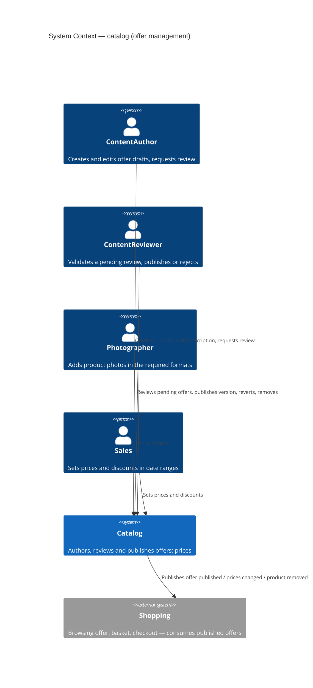

# catalog — offer management

Session anchor: [issue #1](https://github.com/michal-michaluk/ecommerce-eval/issues/1) · process: `specification` steps 0–7 · folder landed step by step.

## Purpose

Author, review and publish product offers, and set their prices, so the shop can show high-quality
product content. The context owns the offer document; it does not own customers, orders or stock.

## Materials index

| Source | Machine-readable form | Role |
| --- | --- | --- |
| `docs/raw/ecommerce-eventstorming.jpg` | `../../raw/materials/eventstorming.json` (lane `offer-management`) | board: actors, commands, events, read models, policy, hot spots |
| `docs/raw/ecommerce-eventstorming.improved.srt` | `../../raw/materials/transcript.json` (segments 1–48, 51) | narration: goals, privacy invariant, gates, availability date, pricing |
| `docs/raw/offer-lego.png` | `../../raw/materials/offer-lego.json` | field-level shape of the published offer |
| `docs/api/warehouse-api.md` | — | boundary evidence: stock is not catalog's |
| `docs/arch/microservice-java-spring/*` | — | build constraints for `services/catalog` |

## Intake register (Step 1, accepted)

| # | Source | Type | What it is | Use for | Status |
| --- | --- | --- | --- | --- | --- |
| 1 | `eventstorming.json` lane `offer-management` | diagram | 8 commands, 7 events, 2 read models, 1 policy, 3 hot spots, 4 actor roles | actors, commands, events, views | fact |
| 2 | `transcript.json` segments 1–48, 51 | transcript | goals, private drafts, review gate, availability date, pricing by sales | goals, rules, decisions | fact |
| 3 | `offer-lego.json` | screenshot | published offer, every field | field-level shape of the offer | fact |
| 4 | `docs/api/warehouse-api.md` | API contract | warehouse stock/issue port | boundary, not our data | fact |
| 5 | `docs/arch/microservice-java-spring/*` | arch docs | mandatory service patterns | constraints | fact |
| 6 | commit `d16a219` deleting `raw/product-catalog.md` + `raw/product-description.json` | dropped docs | earlier derived field-level spec | superseded by rows 1–3 | missing |
| 7 | `services/catalog` | code | generated skeleton only, no domain model | Step 3 baseline | fact |

## Scope

- **In scope:** authoring, photos, review, publication with availability date, version revert, removal, pricing with scheduled discounts.
- **Out of scope:** customer browsing/search views, basket, checkout, order, stock, reservations, goods issue, payments, delivery.
- **Deferred / detached:** none yet.

## Registers

| ID | Type | Statement | Status | Decision |
| --- | --- | --- | --- | --- |
| F1 | Fact | `services/catalog` is a 7-file generated skeleton, package `shop.catalog`; no aggregate, versioning, pricing, review states, read models or published events exist | accepted | greenfield context, nothing to reconcile |
| F2 | Fact | drafts are private until published; a scheduled price change is not emitted until it becomes active | accepted | privacy + activation are invariants, not options |
| F3 | Fact | publication may carry a future availability start date; an accepted offer is not immediately visible | accepted | model availability separately from publication |
| D1 | Decision | any currency; the currency defines precision; two discount kinds — percentage and fixed amount — each effective in a date range | accepted | `Money{amountMinor,currency}`; discount = kind + value + date range |
| R1 | Risk | board hot spot `Event (?): PordutUpdated (całość informacji o produkcie)` — one event with whole product vs incrementals | **closed** | D6: snapshot events, `OfferPublished` carries the whole frozen version (13 RULE-2) |
| R2 | Risk | board hot spot `product description snapshot when published` + `revert to previous version` imply versioning and snapshots | **closed** | D9: frozen versions embed the description **by value** + candidate frozen at request (01 RULE-3, 02 RULE-4/7, 04 RULE-3) — no `descriptionVersion` pointer exists (D24) |
| R3 | Risk | segment 45 emits on price change, segment 47 waits days before activation — activation timing contradiction | **closed** | D1 date ranges + 03 RULE-4: scheduling is silent, the event fires at `validFrom` |
| Q1 | Question | which fields of the description are mandatory for the quality gate, and what "grammar/AI validation" means | **closed** | D10: QP-1…QP-8 universal; D11 `minProseChars = 1000` derived from the LEGO sample (1 626 chars prose); D12 per-category required parameters via config, only `LEGO` configured; grammar out of scope |
| Q2 | Question | who may override the quality gate at review request, and is the override audited | **closed** | D8: only the accepting reviewer; override records actor + timestamp + the findings it ignores (04 RULE-8, 09 R2/R4) |
| Q3 | Question | "some IDs" in segment 5 — which identifiers, and their lifecycle | **closed** | default accepted: `productNumber` + `eanGtin` + `setName` (01 A1) |
| Q4 | Question | "right formats" for photos — the board names the rule, no formats given | **closed** | default accepted: JPG/PNG/WebP, no size limit (02 RULE-1, D17) |
| Q5 | Question | ratings and reviews (60 ocen / 11 recenzji) — inside catalog or a separate context | **closed** | default accepted: out of catalog, DF1 deferred to its own context |
| Q6 | Question | `parameters` — fixed typed schema or attribute list | **closed** | default accepted: attribute list `code/label/value/valueType` (01 A2) |
| Q7 | Question | `description` — structured blocks or one HTML/markdown document | **closed** | default accepted: structured blocks (01 A3) |
| Q8 | Question | 1 product : 1 offer, or 1 product : N offers (offer-lego.json shows 23 offers) | **closed** | default accepted: 1 product : 1 offer; DF2 (marketplace offers) stays out |
| Q9 | Question | `docs/adr/01-strategic-software-architecture.md` absent for this SUD — initialize or proceed without | parked | out of this spec's scope (catalog only); workspace-level artifact, decided separately |
| Q10 | Question | what a customer sees between publication and the availability date | **closed** | D7: hidden until `availabilityStart`; `announce` variant renders "dostępne od <date>" (11) |
| Q11 | Question | after removal, may the same product be offered again, and does version numbering continue | **closed** | default accepted: removal is terminal (02 RULE-6) |
| Q12 | Question | media formats and minimum quality | **closed** | default accepted with Q4: JPG/PNG/WebP, no size limit |
| D24 | Decision | `ProductDescription` is a **value object** published in the **shared kernel** — no identity, no lifecycle; equality by content, deduplicated by `descriptionHash` (01 RULE-7) | accepted | supersedes the earlier "own aggregate with descriptionId" proposal |
| D25 | Decision | `Offer` is the **editor aggregate**: it holds the draft in builder form and embeds the description **by value** in each frozen version (02 RULE-4/7) | accepted | a later edit cannot republish an already-frozen offer |
| D26 | Decision | population rules a value object cannot enforce — unique `productNumber`/`eanGtin` across offers — belong to the offer aggregate (02 RULE-11) | accepted | value stays identity-free |
| F13 | Fact | `specification/references/verify-storybook.cdp.js` fails every story on Storybook 8 — it reads `#storybook-root` from the manager page while SB8 renders the preview in an `iframe` | open | local adaptation `services/catalog/.storybook/verify-storybook.frames.cjs` resolves the preview frame; upstream fix worthwhile |
| F14 | Fact | port 6006 is held by another project's Storybook (`/Users/michal/workspace/hamster-games`) | accepted | the catalog gallery runs on 6010 in this session |
| F15 | Fact | the flow has exactly one override — at the review *request* (04 RULE-8); acceptance cannot be forced (transcript seg. 33) | accepted | 09's S2/S4/S10 contradicted it; D27 rewrites 09 |
| F16 | Fact | `prototypes/catalog-http-api.hurl` reads ten variables it never captures (`offer_id`, `offer_with_findings`, `offer_without_media`, `offer_without_review`, `scheduled_price_id`, `started_price_id`, four tokens), so `hurl --test` cannot run it as shipped | accepted | the e2e node adds `[Captures]` + three fixture offers and recomputes 12's count |
| F17 | Fact | 12 declared the offer resource carries "publish history" but exposed no route for it, while revert takes a version number | accepted | D31 adds `GET /offers/{offerId}/versions` |
| F18 | Fact | `09` referenced "R1–R9" with seven rules, put `override` into acceptance scenarios and required `offerState = published` in R1 while S1 said `published` — the decision table was not implementable as written | accepted | D27 rewrites the rules, the variant row and the scenarios |
| D27 | Decision | the override exists **only** at the review request; acceptance is BLOCKed by any blocking finding, always — `catalog.publish.override.enabled` governs 04 (may a request carry findings), never 09 | accepted | F15; 09 has no variant of its own |
| D28 | Decision | one authoritative outbound transport: in-process Spring events inside the five contexts, Kafka for the three public types, published in-transaction by a publisher adapter (`catalog.offer.events.v1`, key = offer id, at-least-once) | accepted | `integration.single-transport`; 13 gains a "Transport decision" section |
| D29 | Decision | every 08/10/11/13 variant except `grammar-enabled` is a bound config property with a covering scenario; `grammar-enabled` stays a documented key with no behaviour | accepted | Q1 resolved by judgement (no external grammar service in scope) |
| D30 | Decision | `brand {name, verified}`, `condition` and `categoryPath` are components of the `ProductDescription` value, frozen with the version and published in `OfferPublished` | accepted | 13 published them, 01 owned none of them |
| D31 | Decision | one identifier per offer: `offerId` over HTTP (`OFR-` + 8 alphanumerics), the same value called `productId` in 01/02/03/13; `GET /offers/{offerId}/versions` is the publish-history read | accepted | U1/U2 closed |
| D32 | Decision | the HTTP contract is proven by a Gradle task that boots the app against testcontainers (Postgres + Keycloak realm `catalog` + Kafka) and runs the hurl with run-relative dates and captured variables | accepted | Q5/F9/F16 closed; no k3d, no manual run |
| D33 | Decision | quality configuration binds as `catalog.quality.required-parameters` — a **list** of `{prefix, parameters}`, because a category path is a list and a map key cannot carry one | accepted | 08 loses its map-key syntax |
| D34 | Decision | acceptance, the `publishedOfferVersion` record and the offer freeze commit in one transaction through the mediator; a failure rolls the acceptance back and the retry is idempotent per `reviewId` | accepted | 17 R4 closed; no saga, no compensating action |
| D35 | Decision | `Clock` is the only source of "now"; the business date is derived with `catalog.timezone`; tests and the hurl never depend on the wall clock | accepted | F9 closed; 11 and 12 state it |

## Step 2 — Goals, actors, capabilities, properties (accepted)

- **We build:** the catalog context — authoring, reviewing and publishing product offers, with prices.
- **For whom:** content managers, photographers, sales.
- **Because:** offers must be created fast and must be high quality (board goals: `straeamline creation process`, `high quality content`).
- **Success looks like:** shorter offer-creation cycle; no offer published while the quality policy reports a failure.
- **Capabilities:**
  1. create a draft product from title + identifiers, title editable later
  2. edit the description privately, many times
  3. attach photos in the required formats
  4. request review; reviewers work from a pending-reviews view
  5. validate the description against the quality policy from the first blank draft
  6. publish a version to the offer, with an availability start date
  7. revert to a previous version
  8. remove the product from the offer
  9. set prices and discounts (percentage or fixed) effective in date ranges, scheduled ahead
  10. emit public events only when a change becomes active
- **Properties:** draft privacy until publication · published version immutable (snapshot) · scheduled changes silent until activation · money precision from currency (D1) · override audit — Q2 · latency/volume — not stated in the materials.

**Actor names, fixed for the rest of the spec:** `content manager` → **ContentAuthor** · `other content manager` → **ContentReviewer** · `photographer` → **Photographer** · `sales` → **Sales**.

| ID | Type | Statement | Status | Decision |
| --- | --- | --- | --- | --- |
| F4 | Fact | board labels `publish version to offer` with `other content manager`; segment 34 has the reviewer decide, then the version is published | accepted | ContentReviewer publishes; ContentAuthor only requests review |
| F5 | Fact | `stock of product` view and `reserveProductQuantity / buyProduct` notes sit in the `browsing offer` lane, not `offer management` | accepted | Warehouse is not a catalog actor; stock is consumed by shopping |
| F6 | Fact | `services/catalog/src/test/java/shop/catalog/ArchitectureTest.java` is deleted in the working tree | open | uncommitted deletion, unrelated to this spec; restore or commit deliberately |

## Step 3 — Current code exploration (accepted)

`services/catalog`, package root `shop.catalog`, 7 source files total.

| Area (Step-2 name) | Status | Where | Reuse |
| --- | --- | --- | --- |
| app bootstrap + config (clock, security, scheduling) | exists fully | `AppRunner.java:9`, `AppConfiguration.java:14-23` | reuse as-is |
| shared kernel — JSON format mapper, event types, last-events | exists fully | `tools/EventTypes.java:8`, `tools/LegacyDomainEvent.java:3`, `tools/LastEvents.java:12`, `tools/Jackson3JsonFormatMapper.java` | reuse as-is |
| feature flags store | exists fully | `tools/FeatureConfiguration.java:41-76`, `src/main/resources/db/db.changelog.yaml:8` | reuse as-is |
| mediator layer | empty — package-info only | `mediators/package-info.java:1` | build new |
| offer aggregate + description model (Capabilities 1–2) | missing | — | build new |
| photos (Capability 3) | missing | — | build new |
| review workflow + quality policy (4–5) | missing | — | build new |
| versioning, snapshot, revert (6–7) | missing | — | build new |
| removal from offer (8) | missing | — | build new |
| pricing + discounts + scheduling (9) | missing | — | build new |
| public events on activation (10) | scaffolding only, no domain events | `tools/LegacyDomainEvent.java:3` | build new on existing types |
| persistence | one table `features_configuration`; changeset `0002-template-placeholder` is an empty tag | `db/db.changelog.yaml:8`, `:22-27` | extend with new changesets |
| architecture tests | suffix-based predicates only; `ArchitectureTest.java` deleted in working tree | `src/test/java/shop/catalog/ArchitectureDescription.java:16-28` | extend |

Supporting evidence of emptiness: the sqt rules file states "the skeleton ships none: there is no context to name yet" (`src/main/java/.sqt.yaml:1205-1207`).

Only product-shaped model in the repo, and not usable here: `docs/api/inventree-openapi.json:49668` `Part` (55 props, `name` ≤100, `description` ≤250, `IPN`, `revision`, `variant_of`, `active`, `units`), `PartPricing:50280`, `PartSalePrice:50568` — a third-party warehouse contract with no draft/review/publish/revert lifecycle.

| ID | Type | Statement | Status | Decision |
| --- | --- | --- | --- | --- |
| F7 | Fact | capabilities 1–10 are 100 % greenfield in this service | accepted | the spec carries the domain model, versioning and event contract, not integration work |

## Definition of done / of value

- DoV: shorter offer-creation cycle, and no low-quality offer reaches the shop.
- DoD: every element file accepted, consistency review clean, `cd services/catalog && ./gradlew build` green after implementation.

## Prove Definition of Done

Every row is a command with an exit code — the `prove-dod` node executes each one and records the observed result.

| # | Property to prove | Command (from `services/catalog`) | Pass means |
|---|---|---|---|
| P1 | the service compiles, its tests pass, coverage and static analysis hold | `./gradlew build` | exit 0; `jacocoTestCoverageVerification` no longer `SKIPPED` (80 % instruction) |
| P2 | five bounded contexts exist and no edge crosses them illegally | `./gradlew test --tests '*ArchitectureOf*Test'` | 5 suites, one per context, every rule `allowEmptyShould(true)` and green |
| P3 | the code obeys the shape rules of the service | `sqt check .` | exit 0 over `src/main/java` + `src/test/java` |
| P4 | 08/09/10/11 behave exactly as their scenario tables say | `./gradlew test --tests '*QualityPolicyTest' --tests '*PublishDecisionTest' --tests '*ActivePriceCalculationTest' --tests '*OfferVisibilityTest'` | 18 + 11 + 10 + 8 scenarios green (09 gained S11 with D37) |
| P5 | the HTTP contract of 12 is real, including every error path and scope | `./gradlew e2eHurl` | exit 0, every request in `e2e/catalog-http-api.hurl` green |
| P6 | the public events are the 13 contract, and no draft ever leaves | `./gradlew test --tests '*ShoppingEventsTest' --tests '*DraftPrivacyTest'` | payloads match the 13 schemas; no event, no `GET`, no log carries an unpublished draft |
| P7 | the three views of 14/15/16 exist and render | `cd .storybook && node verify-storybook.frames.cjs http://127.0.0.1:6010 --flow flows.json` | every story non-empty, zero console errors, 3 flow chains pass |
| P8 | the tests actually catch mutations | `./gradlew pitest` | mutation score ≥ 80 % on the context classes |

## Step 4 — Key elements (accepted)

**Business concepts** — independent concepts only; every other role collapsed into them.

| # | Element | Role | One-liner |
| --- | --- | --- | --- |
| 01 | **ProductDescription** | Definition | immutable, versioned content of one product: identity, title, identifiers, parameters, description blocks |
| 02 | **Offer** | Editor + Definition | draft surface per product — description reference, media, availability start; publishing freezes a version |
| 03 | **PricingModel** | Editor (living configuration + history) | current price, scheduled future prices and discounts, historical prices kept apart from the current one |
| 04 | **ReviewProcess** | Process | owns the review lifecycle of an offer version: requested → in review → accepted / rejected |
| ~~05~~ | ~~ReviewRequest~~ | — | collapsed into 04 ReviewProcess |
| ~~06~~ | ~~PriceList~~ | — | collapsed into 03 PricingModel |
| ~~07~~ | ~~AvailabilityStart~~ | — | collapsed into 02 Offer |

**Calculations and decisions**

| # | Element | One-liner |
| --- | --- | --- |
| 08 | **QualityPolicy** | ProductDescription → findings[] (missing mandatory fields, grammar), from the first blank draft |
| 09 | **PublishDecision** | review outcome + findings + override? → `publish` \| `block` |
| 10 | **ActivePriceCalculation** | (PricingModel, clock) → price and active discounts; scheduled change activates silently, event only at activation |
| 11 | **OfferVisibility** | (published offer version, availability start, clock) → `visible` \| `hidden` |

**APIs we expose**

| # | Element | One-liner |
| --- | --- | --- |
| 12 | **CatalogHttpApi** | commands + queries for ContentAuthor, ContentReviewer, Photographer, Sales |
| 13 | **ShoppingEvents** | outbound integration events: offer published, prices changed, product removed |

**UI views**

| # | Element | One-liner |
| --- | --- | --- |
| 14 | **DraftDescriptionView** | ContentAuthor → editor showing the draft and what is missing |
| 15 | **PendingReviewsView** | ContentReviewer → pending list plus review screen with findings |
| 16 | **PricingView** | Sales → set price and discounts in date ranges, see scheduled changes |

**Decomposition**

| # | Element | One-liner |
| --- | --- | --- |
| 17 | **Contexts inside catalog** | five packages — `offer`, `pricing`, `review`, `quality`, `reads` — wired only by events and contract ports + mediators |

**Deferred (cut from this spec)**

| ID | Scope | Reason |
| --- | --- | --- |
| DF1 | ratings and reviews (60 ocen / 11 recenzji in `offer-lego.json`) | separate context fed by orders — Q5 |
| DF2 | other-sellers / 23-offers marketplace view | depends on Q8; if 1 product : 1 offer wins it is not our business |

Step-5 files land as `NN-<element>.md` in this folder.

## Step 5 — progress

| # | Element | File | Status |
| --- | --- | --- | --- |
| 01 | ProductDescription | [01-product-description.md](01-product-description.md) | accepted |
| 02 | Offer | [02-offer.md](02-offer.md) | accepted |
| 03 | PricingModel | [03-pricing-model.md](03-pricing-model.md) | accepted |
| 04 | ReviewProcess | [04-review-process.md](04-review-process.md) | accepted |
| 08 | QualityPolicy | [08-quality-policy.md](08-quality-policy.md) | accepted |
| 09 | PublishDecision | [09-publish-decision.md](09-publish-decision.md) | accepted |
| 10 | ActivePriceCalculation | [10-active-price-calculation.md](10-active-price-calculation.md) | accepted |
| 11 | OfferVisibility | [11-offer-visibility.md](11-offer-visibility.md) | accepted |
| 12 | CatalogHttpApi | [12-catalog-http-api.md](12-catalog-http-api.md) + [prototypes/catalog-http-api.hurl](prototypes/catalog-http-api.hurl) | accepted |
| 13 | ShoppingEvents | [13-shopping-events.md](13-shopping-events.md) | accepted |
| 14 | DraftDescriptionView | [14-draft-description-view.md](14-draft-description-view.md) + [prototypes/draft-description-view.html](prototypes/draft-description-view.html) | accepted |
| 15 | PendingReviewsView | [15-pending-reviews-view.md](15-pending-reviews-view.md) | accepted |
| 16 | PricingView | [16-pricing-view.md](16-pricing-view.md) | accepted |
| 17 | Contexts inside catalog | [17-contexts-inside.md](17-contexts-inside.md) | accepted |

## Tickets

Anchor: [#1](https://github.com/michal-michaluk/ecommerce-eval/issues/1) (closed at spec close-out; one child issue per accepted element).
Plan tickets (both top level: #1 has no parent):
- [#14](https://github.com/michal-michaluk/ecommerce-eval/issues/14) — `catalog — implementation plan` (first session, 18 nodes)
- [#19](https://github.com/michal-michaluk/ecommerce-eval/issues/19) — `catalog — plan revision: domain first, then human review` (second session, 22 nodes)

| # | Element | Issue |
| --- | --- | --- |
| 01 | ProductDescription | [#4](https://github.com/michal-michaluk/ecommerce-eval/issues/4) |
| 02 | Offer | [#5](https://github.com/michal-michaluk/ecommerce-eval/issues/5) |
| 03 | PricingModel | [#6](https://github.com/michal-michaluk/ecommerce-eval/issues/6) |
| 04 | ReviewProcess | [#7](https://github.com/michal-michaluk/ecommerce-eval/issues/7) |
| 08 | QualityPolicy | [#8](https://github.com/michal-michaluk/ecommerce-eval/issues/8) |
| 09 | PublishDecision | [#9](https://github.com/michal-michaluk/ecommerce-eval/issues/9) |
| 10 | ActivePriceCalculation | [#10](https://github.com/michal-michaluk/ecommerce-eval/issues/10) |
| 11 | OfferVisibility | [#11](https://github.com/michal-michaluk/ecommerce-eval/issues/11) |
| 12 | CatalogHttpApi | [#12](https://github.com/michal-michaluk/ecommerce-eval/issues/12) |
| 13 | ShoppingEvents | [#13](https://github.com/michal-michaluk/ecommerce-eval/issues/13) |
| 14 | DraftDescriptionView | [#15](https://github.com/michal-michaluk/ecommerce-eval/issues/15) |
| 15 | PendingReviewsView | [#16](https://github.com/michal-michaluk/ecommerce-eval/issues/16) |
| 16 | PricingView | [#17](https://github.com/michal-michaluk/ecommerce-eval/issues/17) |
| 17 | Contexts inside catalog | [#18](https://github.com/michal-michaluk/ecommerce-eval/issues/18) |

---

## Implementation Plan

### Available Infrastructure

- Build: Gradle 9.5.1 wrapper, Spring Boot 4.1.0, Java 25 toolchain (`services/catalog/build.gradle:13-17`)
- Test: JUnit 6 + testcontainers (Postgres, Kafka, Keycloak) + ArchUnit 1.4.2; `@IntegrationTest` boots the app on a random port
- Lint/shape: `sqt check .` (51 main + 6 test rule ids, `services/catalog/src/main/java/.sqt.yaml`), SpotBugs + findsecbugs (in `check`)
- Coverage/mutation: JaCoCo 80 % instruction — dormant until the first context package appears (`build.gradle:150-168`); PITest wired, not in `check`
- Security scan: `./gradlew trivyScan` (docker, not in `check`)
- Language: Java 25, `-parameters -Xlint:unchecked`, Lombok available but `@Data` forbidden (`model.no-lombok-data`)
- Verification skills available: `review` (complexity/tests/arch/security/backward-compat/spec-coverage), `diagnosing-bugs`, `demo`, `poc`, `contract-testing`, `api-docs`, `knowledge`
- Architecture docs: `docs/arch/microservice-java-spring/*` (index = mandatory workflow + task routing, context-boundaries, arch-unit, persistence-adapters, projection, integration-events, http-adapter, security, testing)
- Baseline facts: `./gradlew build` green, `sqt check .` green, zero context packages, zero `ArchitectureOf*Test`, `mediators/` empty
- Gate discipline: no node may edit `.sqt.yaml`, `build.gradle` gates or an architecture test to make its own gate pass — a violation is fixed in the code. Only the orchestrator may change `.sqt.yaml`, and only to widen coverage (as in the `is.aggregate` fix, commit `84bb802`); every Java-writing node ends with `sqt check .`, and every aggregate-bearing node also proves the classifier sees it (`sqt explain … | grep -qE 'is\.aggregate +true'`)

### Clarification Decisions

- Operator delegated all open points ("fix somehow Q1 · Q2 · Q4 · Q5 · Q6 · Q7") → every answer below is the planner's with the recorded reason
- Operator re-ordered execution: **domain models of offer and pricing first, then a human review stop, then everything AFK** — no persistence, no integration, no REST before the stop. "Tarifs" is read as `03 PricingModel` + `10 ActivePriceCalculation` (no separate tariff concept exists in the spec); `08` and `04/09` are domain too but sit behind the stop, since only offer and pricing were named
- Q1 variant scope → **D29**: all variants except `grammar-enabled` are bound config properties with a covering scenario
- Q2 override semantics → **D27**: override only at the review request; acceptance always blocked by blocking findings; 09 S2/S4/S10 rewritten
- Q4 transport → **D28**: in-process events inside the contexts, Kafka as the single authoritative outbound transport, published in-transaction
- Q5 e2e gate → **D32**: Gradle task + testcontainers (Postgres, Keycloak realm `catalog`, Kafka) + hurl with captured variables and run-relative dates
- Q6 prototype clock → **D35**: `Clock` is the only "now"; the hurl takes `availabilityStart` in the future and in the past as variables
- Q7 brand/condition ownership → **D30**: `brand`, `condition`, `categoryPath` are `ProductDescription` components
- Q3 persistence style → offer = document + history, pricing = normalized ranges, review = document + history, reads = own tables
- Q8/Q9/Q10/Q11/Q12 → **D31** (one identifier + `GET /versions`), Prove Definition of Done table written above, JaCoCo per node + PITest at the close, plan ticket #14 stays top-level

### Plan

#### 1. Foundations

##### context-skeleton
- **Goal:** create the five context packages of 17 with their architecture tests, so every later node lands inside an enforced boundary
- **Executor:** general
- **Docs:** `17-contexts-inside.md`; `docs/arch/microservice-java-spring/arch-unit.md:101-131` (template, two allow-lists), `code-structure.md:1-29`
- **IN / OUT:** IN: nothing; OUT: `src/main/java/shop/catalog/{offer,pricing,review,quality,reads}/package-info.java`, `src/test/java/shop/catalog/ArchitectureOf{Offer,Pricing,Review,Quality,Reads}Test.java`, `mediators/package-info.java` javadoc. Does NOT touch `ArchitectureDescription.java`, `AppConfiguration.java`, `build.gradle`
- **checks:**
  - `cd /Users/michal/workspace/bottega-ai-mind/eval/ecommerce/services/catalog; ./gradlew test --tests '*ArchitectureOf*Test'`
  - `cd /Users/michal/workspace/bottega-ai-mind/eval/ecommerce/services/catalog; sqt check .`
- **review_prompt:** Review the work in `/Users/michal/workspace/bottega-ai-mind/eval/ecommerce/services/catalog`; do not inspect any other repository; if a premise below is false, say so and stop. Premises: five contexts exist as packages with `package-info.java`; each has an `ArchitectureOf{Context}Test` that is `public`, analyses `shop.catalog`, excludes tests, declares `sharedKernelExposed`/`sharedKernelUsed` and instantiates all six rule factories from `ArchitectureDescription`; no rule was weakened or deleted; the deleted `ArchitectureTest.java` was not resurrected. Report every deviation with file:line; report only.

##### description-kernel
- **Goal:** implement element 01 as pure domain — the `ProductDescription` value object and its `Draft`, exported as the shared kernel of `offer`
- **Executor:** general
- **Docs:** `01-product-description.md` (RULE-1…RULE-9, D24, D30); `domain-model-value-object.md`; `infrastructure-json.md` (no JPA, no mapper yet)
- **IN / OUT:** IN: `context-skeleton`; OUT: `src/main/java/shop/catalog/offer/ProductDescription.java` (nested `Identifiers`, `Brand`, `Condition`, `Parameter`, `DescriptionBlock` + sealed alternatives, `Draft`, `toDefinition()`), `src/test/java/shop/catalog/offer/ProductDescription*Test.java`. No persistence, no Spring annotations, no JSON adapter. Does NOT touch `build.gradle`, `db.changelog.yaml`, controllers
- **checks:**
  - `cd /Users/michal/workspace/bottega-ai-mind/eval/ecommerce/services/catalog; ./gradlew test --tests 'shop.catalog.offer.ProductDescription*'`
  - `cd /Users/michal/workspace/bottega-ai-mind/eval/ecommerce/services/catalog; sqt check .`
- **review_prompt:** Review the work in `/Users/michal/workspace/bottega-ai-mind/eval/ecommerce/services/catalog`; do not inspect any other repository; if a premise below is false, say so and stop. Premises: one record-based value object per `01-product-description.md`, nested types only, no setters, no JPA/Spring annotations, invariants in compact constructors, `equals`/`hashCode` from all components (RULE-7), `Draft.toDefinition()` is the only producer of a frozen value and throws the `offer` exception, `brand`/`condition`/`categoryPath` are components (D30), unit coverage of the value object is complete. Report every rule of 01 not enforced, with file:line; report only.

#### 2. Domain — the part the operator reviews

##### offer-domain
- **Goal:** implement element 02 as pure domain — the offer editor, its frozen versions, its lifecycle and its invariants, with no persistence and no framework
- **Executor:** general
- **Docs:** `02-offer.md` (RULE-1…RULE-11, Q11), `01-product-description.md`; `domain-model-aggregate.md`, `domain-model-events.md`, `ports.md` (secondary port + fake), `error-handling.md`, `testing.md`
- **Proof the shape gate is live:** `sqt explain src/main/java/shop/catalog/offer/OfferEditor.java` must report `is.aggregate true` and all `aggregate.*` checks applied — the classifier was fixed for immutable aggregates (`class_declaration + has.id + has.events`), so an `Offer` without an `id`/`events` pair silently escapes every aggregate rule
- **IN / OUT:** IN: `description-kernel`; OUT: `src/main/java/shop/catalog/offer/{OfferEditor,Offer,OfferVersion,OfferEvent,OfferException}.java`, `offer/OfferRepository.java` (secondary port), `offer/OfferRegistry.java` (population-uniqueness port, 02 RULE-11), fixtures + tests. `OfferEditor` is the aggregate (`{Concept}Editor`, `domain-model-aggregate.md:33`), `Offer` its public snapshot. No `@Entity`, no Liquibase, no `@Service`, no `@Component`, no controller. Does NOT touch `ProductDescription.java`, `application.yml`
- **checks:**
  - `cd /Users/michal/workspace/bottega-ai-mind/eval/ecommerce/services/catalog; ./gradlew test --tests 'shop.catalog.offer.*'`
  - `cd /Users/michal/workspace/bottega-ai-mind/eval/ecommerce/services/catalog; ./gradlew build`
  - `cd /Users/michal/workspace/bottega-ai-mind/eval/ecommerce/services/catalog; sqt check .`
  - `cd /Users/michal/workspace/bottega-ai-mind/eval/ecommerce/services/catalog; sqt explain src/main/java/shop/catalog/offer/OfferEditor.java | grep -qE 'is\.aggregate +true'`
- **review_prompt:** Review the work in `/Users/michal/workspace/bottega-ai-mind/eval/ecommerce/services/catalog`; do not inspect other repositories; if a premise below is false, say so and stop. Premises: every RULE-1…RULE-11 of 02 is enforced inside the aggregate (one primary image, contiguous positions, one video, availability date shape, embed-by-value freeze, revert as a new version, removed terminal, immutable draft with `merge`); uniqueness of `productNumber`/`eanGtin` is expressed as a port the aggregate asks, never as a repository query inside the model; the frozen version holds the `ProductDescription` by value and never re-reads a draft; events are past-tense nested records carrying ids and values only; the aggregate has no getters and no public members beyond its commands and snapshot; nothing here knows Spring, JPA or JSON. Report every missing rule, every framework leak into the model, and every invariant that lives outside the aggregate, with file:line; report only.

##### pricing-domain
- **Goal:** implement elements 03 and 10 as pure domain — price and discount history, the active-price calculation and the activation-due rule
- **Executor:** general
- **Docs:** `03-pricing-model.md` (RULE-1…RULE-9), `10-active-price-calculation.md` (S1–S10), D1/D2/D3/D29; `domain-model-aggregate.md`, `domain-model-policy.md`, `domain-model-value-object.md`
- **IN / OUT:** IN: `context-skeleton` (no dependency on `offer` in this node); OUT: `src/main/java/shop/catalog/pricing/{PricingModelEditor,PricingModel,Money,PriceEntry,Discount,ActivePriceCalculation,ActivationDue,PricingEvent,PricingException}.java`, `pricing/PricingRepository.java` (secondary port), fixtures + tests. No scheduler, no Spring, no persistence, no controller. Does NOT touch `offer/`, `application.yml`
- **checks:**
  - `cd /Users/michal/workspace/bottega-ai-mind/eval/ecommerce/services/catalog; ./gradlew test --tests 'shop.catalog.pricing.*'`
  - `cd /Users/michal/workspace/bottega-ai-mind/eval/ecommerce/services/catalog; ./gradlew build`
  - `cd /Users/michal/workspace/bottega-ai-mind/eval/ecommerce/services/catalog; sqt check .`
  - `cd /Users/michal/workspace/bottega-ai-mind/eval/ecommerce/services/catalog; sqt explain src/main/java/shop/catalog/pricing/PricingModelEditor.java | grep -qE 'is\.aggregate +true'`
- **review_prompt:** Review the work in `/Users/michal/workspace/bottega-ai-mind/eval/ecommerce/services/catalog`; do not inspect other repositories; if a premise below is false, say so and stop. Premises: money is `amountMinor` + currency with the scale taken from the currency and no float or stored `BigDecimal`; ranges are half-open; a price change closes and appends and never overwrites; one open entry per (offer, currency); a started entry cannot be deleted but may be closed by a new one; stacking is fixed-then-percentage with a floor at 0 and a single half-up rounding; activation-due is a pure rule over (state, instant) and the scheduler is absent; all 10 scenarios of 10 exist as tests with an injected clock. Report each violated rule, each time-dependent test and each business rule placed outside the aggregate or the policy, with file:line; report only.

#### 3. Human review — STOP

##### domain-review-hitl
- **Goal:** hand the offer and pricing domain to the operator for review and **halt the plan**; nothing after this phase starts until the operator approves
- **Executor:** general
- **Docs:** `01`, `02`, `03`, `10`; `domain-model-aggregate.md`, `domain-model-value-object.md`, `domain-model-policy.md`
- **IN / OUT:** IN: `offer-domain`, `pricing-domain`, `description-kernel`; OUT: `docs/specs/catalog/domain-review.md` — invariant → rule map, aggregate/command inventory, the scenario tables as executed, every place where the code had to choose and the spec was silent, and a `status:` line that starts as `awaiting-operator`
- **checks:**
  - `cd /Users/michal/workspace/bottega-ai-mind/eval/ecommerce; test -f docs/specs/catalog/domain-review.md`
  - `cd /Users/michal/workspace/bottega-ai-mind/eval/ecommerce/services/catalog; ./gradlew test --tests 'shop.catalog.offer.*' --tests 'shop.catalog.pricing.*'`
  - `cd /Users/michal/workspace/bottega-ai-mind/eval/ecommerce/services/catalog; sqt check .`
- **review_prompt:** Review `docs/specs/catalog/domain-review.md` and the domain classes of `/Users/michal/workspace/bottega-ai-mind/eval/ecommerce/services/catalog` against `02-offer.md`, `03-pricing-model.md`, `10-active-price-calculation.md` and `01-product-description.md`; report every rule without a code counterpart, every invariant the reviewer cannot see from the document alone, and every divergence between the document and the code. Do not edit files — report only.
- **HALT RULE:** this node ends the session. The `implement` skill must present `domain-review.md` to the operator and wait: no persistence, mediator, projection, event, HTTP, e2e, view or prove-dod node may run before an explicit approval, and an approved review must be recorded in `domain-review.md` (`status: approved` + the operator's changes).

#### 4. Domain, remaining — AFK

##### quality-domain
- **Goal:** implement element 08 as pure domain — QP-1…QP-12 over a `QualityConfig` value object, proven by the 18 scenarios
- **Executor:** general
- **Docs:** `08-quality-policy.md` (logic definition, category rules, S1–S18, worked example), D29
- **IN / OUT:** IN: `description-kernel`; OUT: `src/main/java/shop/catalog/quality/{QualityPolicy,QualityConfig,QualityFindings,QualityException}.java` + findings value types, `src/test/java/shop/catalog/quality/QualityPolicyTest.java`. No `@ConfigurationProperties` (that is `quality-config`), no Spring
- **checks:**
  - `cd /Users/michal/workspace/bottega-ai-mind/eval/ecommerce/services/catalog; ./gradlew test --tests '*QualityPolicyTest'`
  - `cd /Users/michal/workspace/bottega-ai-mind/eval/ecommerce/services/catalog; sqt check .`
- **review_prompt:** Review the work in `/Users/michal/workspace/bottega-ai-mind/eval/ecommerce/services/catalog`; do not inspect other repositories; if a premise below is false, say so and stop. Premises: the policy is a stateless calculation taking `QualityConfig` as a value, all 18 scenarios exist as tests, prose counts paragraphs + bullet items and excludes headings, `minProseChars` is a total, findings are ordered by rule then declaration order, longest configured prefix wins deterministically, QP-9 is absent with no dead code, severity override promotes QP-8 only. Report every scenario missing or wrongly asserted, with file:line; report only.

##### review-domain
- **Goal:** implement elements 04 and 09 as pure domain — the review lifecycle, the publish decision, and the contract ports the review consumes
- **Executor:** general
- **Docs:** `04-review-process.md` (RULE-1…RULE-8), `09-publish-decision.md` (R1–R7, S1–S10, D27), `17-contexts-inside.md`, `context-boundaries.md:250-330` (port styles), `ports.md`
- **IN / OUT:** IN: `offer-domain` (only exposed value types), `quality-domain`; OUT: `src/main/java/shop/catalog/review/{ReviewProcess,ReviewCandidate,PublishDecision,ReviewEvent,ReviewException}.java`, the public ports `OfferDraftSnapshot`, `OfferPublication`, `QualityFindings`, fakes + tests. No mediator, no persistence, no controller. (`OfferReview` joined the same edge later, closing the element-12 defect that let a review start without the offer's gate — element 12's node, not this one.)
- **checks:**
  - `cd /Users/michal/workspace/bottega-ai-mind/eval/ecommerce/services/catalog; ./gradlew test --tests 'shop.catalog.review.*'`
  - `cd /Users/michal/workspace/bottega-ai-mind/eval/ecommerce/services/catalog; ./gradlew build`
  - `cd /Users/michal/workspace/bottega-ai-mind/eval/ecommerce/services/catalog; sqt check .`
  - `cd /Users/michal/workspace/bottega-ai-mind/eval/ecommerce/services/catalog; sqt explain src/main/java/shop/catalog/review/ReviewProcess.java | grep -qE 'is\.aggregate +true'`
- **review_prompt:** Review the work in `/Users/michal/workspace/bottega-ai-mind/eval/ecommerce/services/catalog`; do not inspect other repositories; if a premise below is false, say so and stop. Premises: one open review per offer, reviewer differs from requester, candidate frozen at request, acceptance publishes exactly once per reviewId, rejection records a reason and keeps the candidate, withdrawal is requester-only and only while requested, the request-time override is recorded and never unblocks acceptance (D27), every port signature is value objects only and lives in `review`, all 10 scenarios of 09 exist. Report each violated rule, any producer internals in a port signature, and any missing scenario, with file:line; report only.

#### 5. Application and persistence — AFK

##### offer-application
- **Goal:** turn the offer domain into a working primary port with a real repository, schema and population query
- **Executor:** general
- **Docs:** `02-offer.md`; `domain-model-aggregate.md` (command methods), `persistence-adapters.md` (document + history), `ports.md`, `error-handling.md`, `testing.md`
- **IN / OUT:** IN: `offer-domain`; OUT: `offer/OfferService.java`, the persistence adapter + entity, `OfferRegistry` adapter, `db.changelog.yaml` offer changesets, persistence tests. Does NOT touch other contexts
- **checks:**
  - `cd /Users/michal/workspace/bottega-ai-mind/eval/ecommerce/services/catalog; ./gradlew test --tests 'shop.catalog.offer.*'`
  - `cd /Users/michal/workspace/bottega-ai-mind/eval/ecommerce/services/catalog; ./gradlew build`
  - `cd /Users/michal/workspace/bottega-ai-mind/eval/ecommerce/services/catalog; sqt check .`
- **review_prompt:** Review the work in `/Users/michal/workspace/bottega-ai-mind/eval/ecommerce/services/catalog`; do not inspect other repositories; if a premise below is false, say so and stop. Premises: the service is thin (load, command, save, publish) with no invariant of its own; the repository drains the event buffer, writes, then publishes the snapshot and each event; every table is a Liquibase changeset and `ddl-auto` stays `none`; the port signature carries no JPA type; every read-back path of the adapter has a test on testcontainers Postgres; uniqueness is enforced by a DB constraint as well as by the port. Report each business decision found in the service, each missing changeset and each untested adapter path, with file:line; report only.

##### pricing-application
- **Goal:** give the pricing domain its service, normalized schema and the polled activation that emits `*Activated`
- **Executor:** general
- **Docs:** `03-pricing-model.md` (RULE-9), `10-active-price-calculation.md`; `persistence-adapters.md` (normalized), `domain-model-events.md`
- **IN / OUT:** IN: `pricing-domain`; OUT: `pricing/PricingService.java`, normalized adapter + entities, `db.changelog.yaml` pricing changesets, the `@Scheduled` activation component + config, the `KnownOffer` listener on `OfferVersionFrozen`, tests
- **checks:**
  - `cd /Users/michal/workspace/bottega-ai-mind/eval/ecommerce/services/catalog; ./gradlew test --tests 'shop.catalog.pricing.*'`
  - `cd /Users/michal/workspace/bottega-ai-mind/eval/ecommerce/services/catalog; ./gradlew build`
  - `cd /Users/michal/workspace/bottega-ai-mind/eval/ecommerce/services/catalog; sqt check .`
- **review_prompt:** Review the work in `/Users/michal/workspace/bottega-ai-mind/eval/ecommerce/services/catalog`; do not inspect other repositories; if a premise below is false, say so and stop. Premises: the normalized shape keeps history rows and updates nothing in place except `validUntil` and the activation marker (`@DynamicUpdate`); activation runs on the injected clock, is idempotent through a marker written in the same transaction, catches up after downtime, and emits `occurredAt` = poll time with `effectiveFrom` = the entry's `validFrom`; the `KnownOffer` listener only records a fact and throws nothing. Report every write path without a read-back test and every activation case without a test, with file:line; report only.

##### quality-config
- **Goal:** bind `catalog.quality.*` in the D33 shape and provide the configuration adapter the policy reads
- **Executor:** general
- **Docs:** `08-quality-policy.md` (category rules, D33); `persistence-adapters.md:342` (configuration as a port)
- **IN / OUT:** IN: `quality-domain`; OUT: `quality/QualityProperties.java`, `application.yml` (`catalog.quality.*`), `quality/QualityConfigAdapter.java`, binding test
- **checks:**
  - `cd /Users/michal/workspace/bottega-ai-mind/eval/ecommerce/services/catalog; ./gradlew test --tests '*QualityPropertiesTest'`
  - `cd /Users/michal/workspace/bottega-ai-mind/eval/ecommerce/services/catalog; sqt check .`
- **review_prompt:** Review the work in `/Users/michal/workspace/bottega-ai-mind/eval/ecommerce/services/catalog`; do not inspect other repositories; if a premise below is false, say so and stop. Premises: `required-parameters` binds as a list of `{prefix, parameters}` (D33) with declaration order preserved, `min-prose-chars` defaults to 1000, `severity` overrides bind per rule id, `grammar.enabled` binds and has no behaviour, and the domain never sees a Spring type. Report every mismatch with 08, with file:line; report only.

##### review-application
- **Goal:** give the review domain its service, history schema and the producer-side adapter of the three ports it consumes
- **Executor:** general
- **Docs:** `04-review-process.md`, `09-publish-decision.md` (D34), `persistence-adapters.md` (document + history), `context-boundaries.md` (provider-side adapter)
- **IN / OUT:** IN: `review-domain`, `offer-application`, `quality-config`; OUT: `review/ReviewService.java`, adapter + entity, `db.changelog.yaml` review changesets, the `OfferPublicationAdapter` inside `offer`, tests
- **checks:**
  - `cd /Users/michal/workspace/bottega-ai-mind/eval/ecommerce/services/catalog; ./gradlew test --tests 'shop.catalog.review.*' --tests 'shop.catalog.offer.*'`
  - `cd /Users/michal/workspace/bottega-ai-mind/eval/ecommerce/services/catalog; ./gradlew build`
  - `cd /Users/michal/workspace/bottega-ai-mind/eval/ecommerce/services/catalog; sqt check .`
- **review_prompt:** Review the work in `/Users/michal/workspace/bottega-ai-mind/eval/ecommerce/services/catalog`; do not inspect other repositories; if a premise below is false, say so and stop. Premises: acceptance, the `publishedOfferVersion` record and the freeze commit in one transaction (D34); a freeze failure leaves no accepted review and no version; the candidate is stored as a value snapshot and never re-read from the draft; the producer-side adapter lives in `offer` and only translates to the offer service; replaying an accepted decision returns the same version. Report every path that can leave an accepted review without its version, with file:line; report only.

#### 6. Cross-context plumbing — AFK

##### mediators
- **Goal:** wire `review` to `offer` and `quality` through the only package allowed to name two contexts
- **Executor:** general
- **Docs:** `17-contexts-inside.md` (RULE-1, RULE-3, D34), `context-boundaries.md:330-400`, `ports.md`
- **IN / OUT:** IN: `review-application`, `offer-application`, `quality-config`; OUT: `mediators/ReviewToQualityMediator.java` + its test
  (`ReviewToOfferMediator` landed with `review-application`, because the accept→freeze path needed it), and the collapse of `review.ReviewMedia`
  into the now-exported `offer.Media` (D45: two media records with two `Kind` enums is the local copy `contract.no-local-copy` forbids, and
  the mediator currently bridges them by `valueOf(name())`). The collapse is a type change in the frozen candidate, the port's content and the
  document adapter that stores them — no port signature, aggregate rule or adapter behaviour changes with it
- **checks:**
  - `cd /Users/michal/workspace/bottega-ai-mind/eval/ecommerce/services/catalog; ./gradlew test --tests 'shop.catalog.mediators.*'`
  - `cd /Users/michal/workspace/bottega-ai-mind/eval/ecommerce/services/catalog; ./gradlew build`
  - `cd /Users/michal/workspace/bottega-ai-mind/eval/ecommerce/services/catalog; sqt check .`
- **review_prompt:** Review the work in `/Users/michal/workspace/bottega-ai-mind/eval/ecommerce/services/catalog`; do not inspect other repositories; if a premise below is false, say so and stop. Premises: each mediator is a package-private `@Component` in `mediators`, single method, single delegation, one provider port, no branch, no state, no listener, no publish; the contracts stay public in `review`; each mediator is tested through its contract, not through delegation. Report every rule break with file:line; report only.

##### reads-projection
- **Goal:** implement element 17's `reads` context — the three read models, their in-transaction listeners, and visibility 11
- **Executor:** general
- **Docs:** `11-offer-visibility.md` (S1–S8), `14`/`15`/`16` (data shapes); `projection.md`, `integration-events.md` (listener joins transaction)
- **IN / OUT:** IN: `offer-application`, `pricing-application`, `review-application`; OUT: `reads/*` (draft reads, pending reviews reads, pricing reads, `OfferVisibility`, listeners), `db.changelog.yaml` read-model changesets, tests
- **checks:**
  - `cd /Users/michal/workspace/bottega-ai-mind/eval/ecommerce/services/catalog; ./gradlew test --tests 'shop.catalog.reads.*'`
  - `cd /Users/michal/workspace/bottega-ai-mind/eval/ecommerce/services/catalog; sqt check .`
- **review_prompt:** Review the work in `/Users/michal/workspace/bottega-ai-mind/eval/ecommerce/services/catalog`; do not inspect other repositories; if a premise below is false, say so and stop. Premises: each read model owns its own table and copies payloads instead of pointing at producer tables; every handler is idempotent find-or-create with a full recompute; listeners are `@Transactional` and enforce no invariant; visibility is computed only here from the injected clock + `catalog.timezone`; `waitingFor` is an RFC3339 duration; all 8 scenarios of 11 exist. Report every handler that queries a producer, every non-idempotent write and every time-dependent test, with file:line; report only.

##### shopping-events
- **Goal:** implement element 13 — the envelope and the three snapshot payloads, published to Kafka by the single outbound adapter (D28)
- **Executor:** general
- **Docs:** `13-shopping-events.md` (RULE-1…RULE-9, transport decision, S1–S9), `integration-events.md`, `infrastructure-json.md`
- **IN / OUT:** IN: `offer-application`, `pricing-application`; OUT: `offer/OfferIntegration.java`, `pricing/PricesIntegration.java`, payload records, `application.yml` (`catalog.events.*` + producer), payload tests, one testcontainers Kafka integration test
- **checks:**
  - `cd /Users/michal/workspace/bottega-ai-mind/eval/ecommerce/services/catalog; ./gradlew test --tests '*ShoppingEvents*' --tests '*Kafka*Integration*'`
  - `cd /Users/michal/workspace/bottega-ai-mind/eval/ecommerce/services/catalog; sqt check .`
- **review_prompt:** Review the work in `/Users/michal/workspace/bottega-ai-mind/eval/ecommerce/services/catalog`; do not inspect other repositories; if a premise below is false, say so and stop. Premises: exactly three public types leave the process; `OfferPublished` carries the whole frozen version including `availabilityStart`, `descriptionHash`, brand, condition, categoryPath; `PricesChanged` fires only on activation; `ProductRemoved` carries `removedAt`; envelope has `eventId`/`eventType`/`eventVersion`/`occurredAt`/`key` = offer id; publishing happens in the adapter inside the transaction; S1–S9 covered. Report every payload field missing or extra against 13, with file:line; report only.

##### media-url
- **Goal:** give the media value its location, so the wire and the draft agree on how a file is referenced
- **Executor:** general
- **Docs:** `02-offer.md` (RULE-2a, instances), `12-catalog-http-api.md` (D17), `13-shopping-events.md` (the media sample)
- **IN / OUT:** IN: `shopping-events`; OUT: `offer/Media.java` (+ fixtures, editor commands, adapter round-trip, migration if a column is needed),
  `offer/OfferPublished.java` and its payload tests + the re-pinned golden `descriptionHash`. Does NOT touch pricing, review, reads, HTTP
- **checks:**
  - `cd /Users/michal/workspace/bottega-ai-mind/eval/ecommerce/services/catalog; ./gradlew test --tests 'shop.catalog.offer.*'`
  - `cd /Users/michal/workspace/bottega-ai-mind/eval/ecommerce/services/catalog; ./gradlew build`
  - `cd /Users/michal/workspace/bottega-ai-mind/eval/ecommerce/services/catalog; sqt check .`
- **review_prompt:** Review the work in `/Users/michal/workspace/bottega-ai-mind/eval/ecommerce/services/catalog`; do not inspect other repositories; if a premise below is false, say so and stop. Premises: `Media` carries `url` and every producer/consumer of media compiled against it; the stored round-trip preserves `url`; `OfferPublished` ships it; the golden hash was re-pinned after the shape change rather than relaxed; no other context carries a second media shape. Report every place a media item is built without a location and every test that was weakened to accommodate the change, with file:line; report only.

#### 6. Cross-context plumbing — AFK (continued)

##### error-and-security
- **Goal:** one rejection path for 12 — the advice that maps every domain failure to its `reason`, and the scope model including field-level draft scoping
- **Executor:** general
- **Docs:** `12-catalog-http-api.md` (status ownership, auth matrix, D13a), `error-handling.md`, `http-adapter.md` (rejection mapping), `security.md`
- **IN / OUT:** IN: all five contexts' exceptions; OUT: `src/main/java/shop/catalog/{ApiErrorAdvice,CreatedResponseAdvice,Scopes}.java`, `AppConfiguration.java` (filter chain, four scopes), tests
- **checks:**
  - `cd /Users/michal/workspace/bottega-ai-mind/eval/ecommerce/services/catalog; ./gradlew test --tests '*ErrorMappingTest' --tests '*ScopeGuardTest'`
  - `cd /Users/michal/workspace/bottega-ai-mind/eval/ecommerce/services/catalog; ./gradlew build`
  - `cd /Users/michal/workspace/bottega-ai-mind/eval/ecommerce/services/catalog; sqt check .`
- **review_prompt:** Review the work in `/Users/michal/workspace/bottega-ai-mind/eval/ecommerce/services/catalog`; do not inspect other repositories; if a premise below is false, say so and stop. Premises: the five failure classes map to exactly 400/401/403/404/409/500 with `reason` as the contract and messages never asserted; `FIELD_NOT_IN_SCOPE` is the only body-carrying 403; `include-message: never` stays; all four scopes are enforced per the matrix and a missing scope is 403; the `Location` header comes from a created-response advice (D19a); no endpoint is left without a decision. Report every route whose scope differs from 12 and every missing reason code, with file:line; report only.

#### 7. HTTP surface — AFK

##### http-offers
- **Goal:** implement the offer, draft and version resources of 12
- **Executor:** general
- **Docs:** `12-catalog-http-api.md` (shape, D13/D13a/D13b/D14/D18/D19/D31), `http-adapter.md`
- **IN / OUT:** IN: `mediators`, `error-and-security`, `reads-projection`, `offer-application`; OUT: `offer/{OfferController,OfferDraftController,OfferVersionsController}.java` + command/response records, tests
- **checks:**
  - `cd /Users/michal/workspace/bottega-ai-mind/eval/ecommerce/services/catalog; ./gradlew test --tests 'shop.catalog.offer.*Controller*'`
  - `cd /Users/michal/workspace/bottega-ai-mind/eval/ecommerce/services/catalog; sqt check .`
- **review_prompt:** Review the work in `/Users/michal/workspace/bottega-ai-mind/eval/ecommerce/services/catalog`; do not inspect other repositories; if a premise below is false, say so and stop. Premises: paths and methods match 12 exactly, no verb segments, no `/api`; `PATCH` treats an absent component as absent and an unknown one as 400; `201` uses `@ResponseStatus` + the created-response advice; writes answer the draft snapshot with `quality.findings`, reads answer the projection; removal is a state edit; every handler is thin and package-private. Report every deviation from 12 with file:line; report only.

##### http-pricing-review
- **Goal:** implement the pricing, review and pending-reviews resources of 12
- **Executor:** general
- **Docs:** `12-catalog-http-api.md`, `http-adapter.md`, `15-pending-reviews-view.md`
- **IN / OUT:** IN: `mediators`, `error-and-security`, `reads-projection`, `pricing-application`, `review-application`; OUT: `pricing/PricingController.java`, `review/{ReviewController,ReviewsController}.java` + records, tests
- **checks:**
  - `cd /Users/michal/workspace/bottega-ai-mind/eval/ecommerce/services/catalog; ./gradlew test --tests 'shop.catalog.pricing.*Controller*' --tests 'shop.catalog.review.*Controller*'`
  - `cd /Users/michal/workspace/bottega-ai-mind/eval/ecommerce/services/catalog; ./gradlew build`
  - `cd /Users/michal/workspace/bottega-ai-mind/eval/ecommerce/services/catalog; sqt check .`
- **review_prompt:** Review the work in `/Users/michal/workspace/bottega-ai-mind/eval/ecommerce/services/catalog`; do not inspect other repositories; if a premise below is false, say so and stop. Premises: pricing PATCH handles `prices`, `discounts`, `removePriceIds`, `removeDiscountIds` in one call; review POST freezes the candidate and accepts only the request-time override; review PATCH carries `decision` + `reason` and never an override; replaying `accepted` returns the same version; `/reviews` is paged, requires `page`+`size`, excludes the caller's own requests and returns `waitingFor` as a duration. Report every deviation with file:line; report only.

#### 8. Runtime proof — AFK

##### e2e-harness
- **Goal:** make 12's contract executable end-to-end — a Gradle task that boots the app against testcontainers and runs the hurl (D32, F16, F9)
- **Executor:** general
- **Docs:** `12-catalog-http-api.md`, `prototypes/catalog-http-api.hurl`, D32/D35
- **IN / OUT:** IN: both HTTP nodes; OUT: `services/catalog/e2e/catalog-http-api.hurl` (captures + three fixture offers + run-relative dates), `src/test/resources/catalog-realm.json`, `src/test/java/shop/catalog/e2e/CatalogHttpApiE2eTest.java`, `build.gradle` task `e2eHurl`, corrected request count in `12-catalog-http-api.md:5`
- **checks:**
  - `cd /Users/michal/workspace/bottega-ai-mind/eval/ecommerce/services/catalog; ./gradlew e2eHurl`
  - `cd /Users/michal/workspace/bottega-ai-mind/eval/ecommerce/docs/specs/catalog/prototypes; hurlfmt --check catalog-http-api.hurl`
  - `cd /Users/michal/workspace/bottega-ai-mind/eval/ecommerce/services/catalog; sqt check .`
- **review_prompt:** Review the work in `/Users/michal/workspace/bottega-ai-mind/eval/ecommerce/services/catalog`; do not inspect other repositories; if a premise below is false, say so and stop. Premises: the task starts Postgres + Keycloak (realm `catalog`, four scopes) + Kafka, boots the app and fails the build on any hurl failure; the hurl captures every variable it reads and creates every fixture offer; no request depends on the wall clock; every error path of 12 is asserted with its `reason`; the realm file is test-only. Report every request that cannot run from a clean database and every contract mismatch, with file:line; report only.

##### views-gallery
- **Goal:** complete the storybook gallery of 14/15/16 and keep the verify gate green
- **Executor:** general
- **Docs:** `14` (D20–D22), `15` (S1–S7), `16` (S1–S8), `.storybook/verify-storybook.frames.cjs`
- **IN / OUT:** IN: both HTTP nodes (JSON shapes); OUT: `.storybook/stories/pending-reviews-view.stories.js`, `.storybook/stories/pricing-view.stories.js`, `.storybook/flows.json` (three chains), `.storybook/package.json` port note
- **checks:**
  - `cd /Users/michal/workspace/bottega-ai-mind/eval/ecommerce/services/catalog/.storybook; npm run build-storybook`
  - `cd /Users/michal/workspace/bottega-ai-mind/eval/ecommerce/services/catalog/.storybook; node verify-storybook.frames.cjs`
- **review_prompt:** Review the work in `/Users/michal/workspace/bottega-ai-mind/eval/ecommerce/services/catalog/.storybook`; do not inspect other repositories; if a premise below is false, say so and stop. Premises: 15 renders the pending list and the review screen with frozen findings, a disabled accept, an override block and a reject reason; 16 renders current/scheduled/history/discounts apart, read-only history and an effective-price preview; 14's four screens are intact; every disabled action carries its reason inline; each scenario family of 15/16 has a story; flows are click-through; no story hardcodes a date that will expire. Report every missing screen element of 15/16 with file:line; report only.

#### 9. Prove of done

##### prove-dod
- **Goal:** execute every row of `spec.md` §Prove Definition of Done (P1–P8) and record row → command → observed → pass/fail
- **Executor:** general
- **Docs:** `spec.md` §Prove Definition of Done
- **IN / OUT:** IN: every implementation node; OUT: `docs/prove-of-done.md`
- **checks:**
  - `cd /Users/michal/workspace/bottega-ai-mind/eval/ecommerce; test -f docs/prove-of-done.md`
  - `cd /Users/michal/workspace/bottega-ai-mind/eval/ecommerce; test "$(grep -c '^| P' docs/prove-of-done.md)" -ge 8`
- **review_prompt:** Check `/Users/michal/workspace/bottega-ai-mind/eval/ecommerce/docs/prove-of-done.md` against §Prove Definition of Done of `/Users/michal/workspace/bottega-ai-mind/eval/ecommerce/docs/specs/catalog/spec.md`; report every row missing, unexecuted, or marked pass without an observed result. Do not edit files — report only.

#### 10. Evidence

##### demo-recording
- **Goal:** record a chaptered demo of the finished feature — apply the `demo` skill (scenarios from the prove-of-done rows → publish → one video → chapters), then attach the video and its URL to the plan ticket
- **Executor:** general
- **Docs:** `spec.md` (prove-of-done rows define the scenarios), `14`/`15`/`16`
- **IN / OUT:** IN: prove-dod rows; OUT: `demo/scenarios.md`, `demo/record.js`, `demo/chapters.json`, `demo/catalog.webm`, `demo/catalog.chapters.mkv`
- **checks:**
  - `cd /Users/michal/workspace/bottega-ai-mind/eval/ecommerce; test -f demo/scenarios.md`
  - `cd /Users/michal/workspace/bottega-ai-mind/eval/ecommerce; test -f demo/catalog.chapters.mkv`
  - `cd /Users/michal/workspace/bottega-ai-mind/eval/ecommerce; ffprobe -v error -show_entries chapter_tags=title demo/catalog.chapters.mkv | grep -q 'TAG:title='`
- **review_prompt:** Check the demo chapters against the prove-of-done rows of `/Users/michal/workspace/bottega-ai-mind/eval/ecommerce/docs/specs/catalog/spec.md`; report every row missing from the chapters or not demonstrated. Do not edit files — report only.

##### review-branch
- **Goal:** review the whole feature branch against the spec and the architecture docs; report findings, edit nothing
- **Executor:** review
- **Docs:** `spec.md` + `01`–`17`; `docs/arch/microservice-java-spring/*`
- **IN / OUT:** IN: the feature-branch diff (merge-base → HEAD); OUT: a findings report (issues · risks · gaps, each with file:line) as the final message

### Spec Corrections Applied

- `01`: `brand`, `condition`, `categoryPath` added as value components + RULE-9 (D30)
- `02`: RULE-7 loses the `descriptionVersion` pointer (D24); `productId` ≡ offer id note (D31); "Open questions" turned into decisions (Q11/Q12)
- `03`: new RULE-9 — polled, idempotent, catching-up activation (U4)
- `08`: config rewritten to the bindable list form (D33), origin of `categoryPath`, severity override, "every variant except grammar is implemented" (D29)
- `09`: rules R1–R7 with `alreadyPublished(reviewId)`, no acceptance override, variant table replaced, scenarios S1–S10 rewritten, transaction-boundary section (D27/D34)
- `11`: `today` comes from the injected `Clock` + `catalog.timezone` (D35)
- `12`: request/route counts corrected, `GET /offers/{offerId}/versions` added, `override` removed from the review PATCH, paging bounds, D31/D35 decisions, F16 note
- `13`: half-open discount bounds, RULE-8 (activation catch-up), RULE-9 (key = offer id), "Transport decision (D28)" section
- `15`: `waitingFor` as an RFC3339 duration
- `16`: RULE-2 cites 03 RULE-8; discount bounds made half-open
- `17`: R4 resolved into D34
- `spec.md`: R2 corrected, F15–F18 + D27–D35 registered, §Prove Definition of Done (P1–P8) added, §Tickets added

### Issues & Resolutions

| Node | Issue | Fix |
|---|---|---|
| context-skeleton | `ArchitectureTest.java` is deleted in the worktree and `ArchitectureDescription`'s six rule factories have no caller | replaced by five `ArchitectureOf{Context}Test`s; the deleted global test is not resurrected |
| description-kernel | `ProductDescription` is a shared-kernel type published by `offer` | it lives in `shop.catalog.offer`, exported via `sharedKernelExposed` |
| quality-policy | 08's config was a YAML map keyed by a list | rebound as a list of `{prefix, parameters}` (D33) |
| pricing-model | activation had no owner and no catch-up semantics | `@Scheduled` poll + activation marker + `effectiveFrom` (03 RULE-9, 13 RULE-8) |
| review-process | 09's override scenarios contradicted F15 and 15 RULE-3 | override removed from acceptance; scenarios rewritten (D27) |
| reads-projection | visibility could drift if computed twice | computed only in `reads` (17 RULE-6) |
| shopping-events | arch docs allow one transport only | Kafka declared the single authoritative outbound transport (D28) |
| error-and-security | field-level draft scope is not expressible with route rules | component check in one advice + `FIELD_NOT_IN_SCOPE` (D13a) |
| http-* | JaCoCo gate arms at 80 % the moment a context exists | each node carries `./gradlew build`, so coverage is enforced from node 1 |
| offer-domain / pricing-domain | 02 and 03 were originally planned together with persistence, which hides the model behind adapters | split into `*-domain` (no Spring, no JPA, no Liquibase, secondary ports only) and `*-application` (service + adapter + schema) |
| domain-review-hitl | the plan had no place to stop for the operator | a HALT node after the two domain slices; nothing after it runs before `status: approved` |
| context-skeleton | the node put the five arch tests in `shop.catalog`
| offer-domain (gate defect) |
| offer-domain (naming) | `02-offer.md` named the aggregate `Offer.java`, while `domain-model-aggregate.md:33` prescribes `{Concept}Editor` and gives the bare noun to the snapshot record | `OfferEditor` (package-private aggregate) + `Offer` (public snapshot) + `OfferVersion` (frozen version); 02's implementation note and the node's file list and classifier proof corrected |
| all Java nodes | the reference app `.agents/blueprints/microservice-java-spring/src/main/java/.sqt.yaml` carried the same `is.aggregate` defect, so every future scaffold would regenerate the blind gate | fixed there too (identical classifier, comment cross-references `84bb802`); the reference app stays `SUCCESS` with its 3 pre-existing `method_logical_lines` warnings, before and after the change |
| plan gates | 8 of 22 nodes wrote Java without a `sqt` gate, and no node proved the classifier actually saw its aggregate | `sqt check .` added to every Java-writing node, `sqt explain … | grep -qE 'is\.aggregate +true'` added to the three aggregate-bearing domain nodes, and a gate-discipline line forbids a node from editing `.sqt.yaml` or an architecture test to pass its own gate | `is.aggregate` in `src/main/java/.sqt.yaml` required `is.entity`, i.e. `is.mutable`; the immutable editor of 02 RULE-9 was therefore invisible and all 13 `aggregate.*` checks were silently skipped (probe: 0 violations before, 5 after) | `is.aggregate` broadened to `class_declaration + has.id + is.top-level + has.events`; coverage went up, no threshold changed. `offer-domain` must prove `is.aggregate: true` for `Offer` with `sqt explain` before it closes |, while `arch-unit.md` (`archunit.context-test-location`) and the reference app put each test inside its context package — and the plan's `--tests 'shop.catalog.ArchitectureOf*Test'` filter then matched nothing | tests moved to `shop.catalog.{offer,pricing,quality,reads,review}`; every arch gate now uses `--tests '*ArchitectureOf*Test'` (updated in §Prove of Done P2 and in the node) |
| e2e-harness | the prototype reads 10 variables it never captures and asserts a wall-clock-dependent visibility | captures + fixture offers + run-relative dates (F9/F16/D32) |

### Open Topics

- **D51 (decided)** the offer's review fact has a second end: `OfferEditor.closeReview(reviewId)` clears `reviewOpen` and returns a
  `pendingReview` offer to `draft`, while a `published` or `removed` one keeps its state — the review ended without a version, so nothing
  the shop sees may change (D37, 02 RULE-6). It emits one `OfferReviewClosed` fact, is reached through `OfferReview.closeReview`, and
  `ReviewService` calls it on rejection, on withdrawal and on an acceptance 09 blocks, in the decision's transaction (D34); acceptance
  that publishes still clears through the freeze. Chosen over "refuse removal while a review is open" because a review's decision must stay
  recordable on an offer the shop already delisted, and over an outcome-carrying port because the offer's rule is identical for all three
  ends. Known limit: the aggregate stores no `reviewId`, so the closure names an attempt it cannot verify (unreachable today — `reject`,
  `withdraw` and `decide` all require the review to be open, and 04 RULE-1 forbids a second open attempt)
- **D37 (approved, implemented)** a review opened on a `published` offer keeps it `published`: the aggregate carries an explicit `reviewOpen`
  fact (the state alone cannot answer it once a live offer stops entering `pendingReview`), `OfferEditor.requestReview` only moves a `draft`
  to `pendingReview`, and `revert` still refuses while `reviewOpen`. 09 R1/R2 accept `published` and S11 covers the re-review; 11 R3 hides
  `pendingReview`, which now only ever describes an unpublished offer. Proven end to end by `ReadsLiveOfferUnderReviewTest`.
- **D40 (approved at review approval — as implemented)** removing a *scheduled* price reopens the predecessor entry that it had closed, so a scheduling that never
  took effect leaves no trace. This is a RULE-2/RULE-7 reading, and 12's hurl expects `200` for it. Confirm, or decide instead that removal
  leaves the predecessor closed (history showing a closed range that never was)
- **D41 (approved at review approval — as implemented)** a fixed discount bound to a currency the offer does not price is **refused** at write time
  (`DISCOUNT_CURRENCY_NOT_PRICED`) rather than stored and ignored. Confirm, or accept-and-ignore so sales can prepare a EUR discount before
  the EUR price exists
- **D46 (decided)** a record that exists only as a wire schema (`OfferPublished.MediaItem`, the envelope, the three payloads) is not the local
  copy `contract.no-local-copy` forbids: the rule targets a producer's value object re-declared inside a consumer's model. Transport shapes are
  allowed to differ from the domain and are pinned by payload tests
- **D47 (decided)** `offer.Media` gains `url`: 12 receives it in the draft `media` component (D17), 13 publishes it, and without it the shop cannot
  resolve a file. This is a small follow-up node (`media-url`) before the HTTP surface, because adding a record component is cheapest before 12
- **D45 (decided)** `offer.Media` is the single media value; `review.ReviewMedia` is deleted and the mediator passes the value through. It was
  a legitimate consumer-side contract while offer's media was package-private (D42), but exporting `Media` made it a local copy with a second
  `Kind` enum that only a `valueOf(name())` bridge keeps in sync
- **D43 (decided)** `productNumber`/`eanGtin` are reserved **forever**, removal included: the uniqueness predicate and the two unique
  indexes drop the `state <> 'REMOVED'` exemption. Accepted consequence: a genuinely new product cannot reuse a retired GTIN
- **D44 (decided)** pricing's `known_offer` fact is fed by offer's **public `Offer` snapshot**, not by `OfferVersionFrozen` (which sits in the
  package-private `OfferEvent`): a price may therefore be set before the first publication (13 RULE-7 already allows a published offer without
  a price), and a removed offer stays in `known_offer` — harmless, and it keeps the consumer on an exported type (17 RULE-4 updated below)
- **D42 (decided, amended by D45 and by the wiring node)** quality's answer crosses the edge as values its consumer names: the wiring node makes
  `QualityPolicy`, `QualityFindings`, `Finding`, `Rule` (with its published `label()`) and `Severity` public and lists them in
  `sharedKernelExposed` of `quality` — until then nothing outside the package can call the policy. Quality's media input is no longer a local
  contract type: D45 deleted `quality.MediaItem` and the policy takes `offer.Media`. `QualityConfig` stays internal, because the mediator
  injects the policy bean and names no configuration, so exporting it would widen the boundary for nobody
- **OQ-1** `Draft.merge` treats `null` as "unchanged", so a scalar draft component (`title`, `identifiers`, `brand`, `condition`) cannot be
  cleared through it; 12's PATCH says "absent component = absent". The adapter must map PATCH-absent to "keep" and a future clear-request must
  be an explicit component, or the aggregate gains a `clear...` command
- **OQ-2** `Condition` constants are upper-case while 13/12 show `condition: new`; the domain deliberately carries no Jackson type, so the
  transport adapter owns the mapping
- **OQ-4** 09 R1 admits `offerState = draft`, so `publish` is legal without a fresh review; the aggregate refuses only `removed`. Pinned as
  intended, but the HTTP layer must not expose a publish command (F4, D5) — only acceptance publishes
- **OQ-5** `PricingModelEditor` rejects a missing argument with a raw `NullPointerException` while `OfferEditor` raises `COMMAND_VALUE_MISSING`;
  `error.domain-throws-context-type` only sees an explicit `throw`, so the NPE path is ungated
- **gate gap (rules the docs cite but the service does not define)** `model.no-setters`, `model.no-lombok-data`, `vo.nested`,
  `vo.sealed-alternatives` are review vocabulary in `docs/arch/**`, not `sqt` checks; the spec files no longer claim otherwise. A `@Data`
  check and a `constructor_declaration`-aware `no-public-members` check would close two whole classes of defect
- **gate gap (platform)** `aggregate.no-public-members` reads source text, so a Lombok-generated `public` constructor passed the gate; the
  pricing node fixed its own case with `@AllArgsConstructor(access = PACKAGE)` and verified by `javap`. A `constructor_declaration`-based
  check would close the class of defects, not one instance — belongs to the service's `.sqt.yaml`
- **D38 (approved at review approval)** 04 RULE-3 freezes the candidate at request time, while `OfferEditor.publish` freezes the *current*
  draft; the two disagree the moment the author edits after requesting. Recommendation: the freeze takes the candidate through
  `OfferPublication` (`publish(candidate, at, by, registry)`), so "what was reviewed" and "what was published" are the same content
- `grammar-enabled` (QP-9) stays unimplemented — needs an external service and a `poc` (Q1a)
- `q9` — no `docs/adr/01-strategic-software-architecture.md` for this SUD; workspace-level, outside this plan
- 20 of 185 worktree paths are uncommitted and the spec itself is untracked; `git diff --exit-code` is unusable as a gate until the baseline is committed
- The task statement says "the API returns a `Location` header from a created-response advice" (D19a) but no such advice exists yet — `error-and-security` owns it
- `deploy`/`k8s` overlays were not exercised by any node; the Kafka topic is asserted in tests only

### Verification Skill Gaps

- No skill validates a hurl suite against a live testcontainers service — `e2e-harness` implements it ad hoc
- No skill checks storybook guide conformance; `verify-storybook.frames.cjs` only proves "not empty, no console errors"
- `review` has no dedicated "variant coverage" aspect (config-switchable behaviour vs its scenario table)
