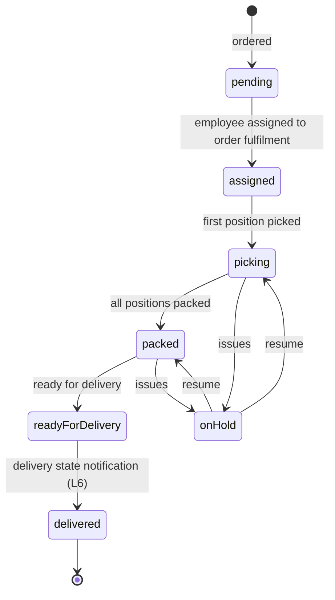

# 02 — OrderProcessing

**Role:** **Process** (stateful, mutable aggregate). Pins one `Order` (Definition, element 01) by `orderHash`, owns every
state in the lane, and is the only object employees mutate. It exists because the order is immutable — the lane's whole
state lives *beside* it (KB `shopping/checkout-order/order.md:27-33`).

**Definition:** the processing of one order: who owns it, how far each position got, whether it is on hold, and which
parcel carries it.

## Example instances

```yaml
processingId: "OP-2026-0001"
orderHash: "sha256:1f3c9d…"
assignee: "employee-42"
state: picking
positions:
  - { productNumber: "75423", quantity: 1, state: picked }
parcel: null
issue: null
```

```yaml
processingId: "OP-2026-0002"
orderHash: "sha256:9ab27e…"
assignee: "employee-17"
state: onHold
positions:
  - { productNumber: "75423", quantity: 3, state: packed }
parcel: null
issue: { issueId: "ISS-2026-0031", kind: LOST, productNumber: "75423", reportedBy: "employee-17" }
```

Position states use the transcript's own words — "we mark those positions basically as packed" `[seg 120]`, board event
`position packed` (`eventstorming.json:129`); `picked` is the second confirmed state `[seg 121]`. **The enum is
`awaitingScan → picked → packed`, forward only** (RULE-3). `awaitingScan` is the pre-scan state, which has no name in any
source (PS1, KB `picking-and-packing.md:26`) and takes the spec's own value rather than borrowing the order-level word
`pending` — named here, once, and used by every payload and screen that shows a position (element 10, element 16,
element 11).

## State machine



Edge provenance (KB `order-assignment.md:50-72`), with this spec's decision where the source is silent:

| Edge | Source status | Spec decision |
| --- | --- | --- |
| `[*] → pending`, `pending → assigned`, `packed → readyForDelivery`, `readyForDelivery → delivered` | supported | as is |
| `picking → onHold`, `packed → onHold` | supported `[seg 139-141]` | as is |
| `assigned → picking` | inferred only | **implicit** on the first position confirmation, no `start picking` command invented (Q-02-1 closed) |
| `picking → packed` | partly supported — `packed` is a position word | order-level `packed` derived from positions |
| `onHold → picking`, `onHold → packed` | not supported | resume to the state held before the hold — a packed order returns to `packed`, which is why both return edges exist (`spec.md` D7, Q-02-2 closed) |
| hold from `pending` / `assigned` | no source | **no edge** — an issue can only be reported once picking started |
| `adjusted` | outside the system `[seg 100-107]` | not a transition here; the adjusted order arrives as a new `Order` |

## Behaviour

- `assign` → exclusive claim; a second claim is refused, never queued (element 07)
- `pick(position)` → position `awaitingScan → picked`, order `assigned → picking`
- `pack(position)` → position `picked → packed`; the last one → order `packed`
- `markReady` → order `packed → readyForDelivery` **and** collection requested on the parcel (element 08)
- `reportIssue` → order → `onHold`, issue recorded (element 09)
- delivery notification → only the L6 leg moves the order to `delivered`; L3–L5 live on `Parcel` (element 03), Q-02-3

## Domain rules

- **RULE-1 Exclusivity.** At most one `assignee`; a claim is granted or refused atomically, never queued `[seg 112-114]`.
- **RULE-2 Command-only transitions.** State changes only through the commands above; nothing writes `state` directly.
- **RULE-3 Positions are complete.** One position per order line, created at intake; Σ position quantities = order
  quantities; a position state never regresses (`packed` never returns to `picked`).
- **RULE-4 Ready precondition.** `readyForDelivery` requires all positions `packed` and no open blocking issue — owned by
  element 08, never re-implemented here.
- **RULE-5 Pinned order.** The aggregate reads the pinned `Order`; it copies no prices (spec.md D5) and never edits it
  (element 01 RULE-2).
- **RULE-6 Idempotent application.** The same delivery notification or warehouse event applied twice leaves state
  unchanged — mandatory, because both sources are polled (KB `dpd-polska/status-polling.md:78`, spec.md R3).
- **RULE-7 Hold is sticky.** Leaving `onHold` requires an explicit resume; no polled event lifts a hold.

## State diff — `picking` → `onHold`

```diff
- state: picking
+ state: onHold
+ issue: { issueId: "ISS-2026-0031", kind: LOST, productNumber: "75423", reportedBy: "employee-42" }
```

## Domain events

Emitted by `OrderProcessing`: `OrderProcessingStarted` (intake, deduped by `orderHash`), `employee assigned to order
fulfilment`, `position packed`, `ready for delivery` — and neither issue-side event: `issues` is owned and emitted by
element 04 (`eventstorming.json:131`), `order is on hold` by element 09 (`:132`), which this aggregate only reflects as
`state = onHold` (09 RULE-2). Consumed from neighbours: `stock changed`, `delivery number generated`,
`delivery state notification`.

## Q / R carried into this element

- **Q-02-1 closed:** `assigned → picking` is implicit on the first position confirmation.
- **Q-02-2 closed:** resume returns to the state held before the hold.
- **Q-02-3 closed:** the order does not mirror carrier legs — `Parcel` (03) carries L3–L5, the order goes
  `readyForDelivery → delivered` on L6.
- **Q-02-4 open:** does a hold block delivery (`UND-22`)? Carried to element 09 `HoldDecision`; until answered, a hold blocks
  `markReady` only.
- **R-02-1 open:** the machine has no failure, cancellation or return leg — the sources describe one happy chain and stop
  (`shipping-and-delivery-states.md:88`). Returns stay deferred (`UND-32`).
