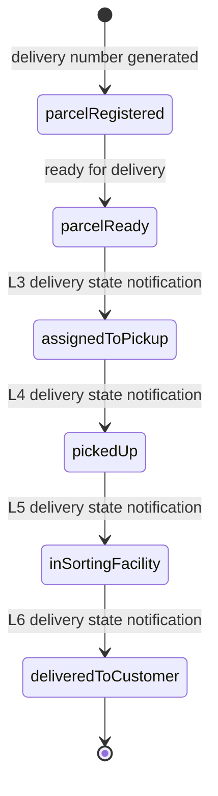

# 03 — Parcel

**Role:** **Process** (stateful, mutable). The carrier-side shipment of one processing. Created *before* anything
physical exists — the parcel is registered "at the very beginning" `[seg 115-116]`.

**Definition:** one consignment of one order, holding our own reference, the carrier's identity and the chain of
delivery legs. Two identities, never merged (KB `integrations/spedition-pl/dpd-polska/waybill-numbers.md:69-81`).

## Example instances

```yaml
# one order, one parcel — the label artifact's own case, PACZKA:1/1
parcelId: "PCL-2026-0007"
processingId: "OP-2026-0001"
reference: "OP-2026-0001-1"          # ours, unique, ≤50 chars
carrier: { code: "DPD", waybill: "0000123456789U", service: "DPD_NEXT_DAY" }
sequence: { index: 1, ofTotal: 1 }
weightGrams: 1000                     # per parcel, never per order
legs:
  - { leg: L1, at: "2026-11-19T11:02:10Z" }
  - { leg: L2, at: "2026-11-19T15:40:00Z" }
legState: parcelReady
```

```yaml
# one package, three parcels — ofTotal fixed before the first label is printed
parcelId: "PCL-2026-0008"
processingId: "OP-2026-0002"
reference: "OP-2026-0002-2"
carrier: { code: "DPD", waybill: "0000123456790U", service: "DPD_NEXT_DAY" }
sequence: { index: 2, ofTotal: 3 }
weightGrams: 4200
legs:
  - { leg: L1, at: "2026-11-19T11:05:00Z" }
legState: parcelRegistered
```

## State machine



Legs from the narration `[seg 125-128]`: **L1** registered, **L2** provider collected, **L3** assigned for pickup,
**L4** picked up, **L5** in the sorting facility, **L6** customer picked it. L1 and L2 are the carrier acknowledging
*our* actions; L3–L6 are carrier-owned facts we cannot compute (KB `shipping-and-delivery-states.md:65-90`).

## Behaviour

- `register(processing, ofTotal)` → carrier returns the waybill; state `parcelRegistered`
- `markReady` → collection requested; state `parcelReady`
- `applyNotification(leg)` → forward move only; a repeated leg is a no-op
- `reprint()` → the label is rendered from stored data; it never re-registers

## Domain rules

- **RULE-1 Registration precedes existence.** A waybill exists before the parcel does; nothing physical is recorded
  before registration returns an identity `[seg 115-116]`.
- **RULE-2 Two identities.** `reference` is ours, unique per parcel, never derived from the waybill; the waybill is only
  ever assigned from a carrier response — never invented, never parsed out of a printed label.
- **RULE-3 `ofTotal` is fixed at registration.** It must be known before the first label is printed, or the first label
  says `1/1` and is wrong once the order is split (KB `fulfillment/documents/consignment-note.md:113-135`).
- **RULE-4 Forward-only legs, carrier-owned only.** No leg is inferred from our own actions beyond L1/L2, no failure,
  cancellation or return leg exists (element 02 R-02-1, KB `shipping-and-delivery-states.md:88`), and an unknown carrier
  status leaves `legState` unchanged while the raw payload is stored.
- **RULE-5 Idempotency.** The key is `(waybill, leg)` — the same notification applied twice changes nothing (spec.md R3,
  polling).
- **RULE-6 Weight is per parcel**, in grams, never per order; the measurement source stays open (`UND-06`, Q-03-2).
- **RULE-7 No money.** COD and declared-value amounts are opaque values on the registration request, never stored or
  compared here (spec.md D5).

## State diff — `parcelRegistered` → `parcelReady`

```diff
- legState: parcelRegistered
+ legState: parcelReady
+ legs: [{ leg: L1, at: … }, { leg: L2, at: "2026-11-19T15:40:00Z" }]
```

## Domain events

Emitted: `delivery number generated` (at registration), `delivery state notification` (per leg, forwarded to the
customer view). Consumed: `ready for delivery`.

## Q / R carried into this element

- **Q-03-1 open:** the label carries **no order reference and no barcode value** in the only artifact
  (`consignment-note.json:54`) — correlation must come from the carrier's response, never from the print. Default: a
  printed label is never read back.
- **Q-03-2 open:** who measures weight and how it is rounded (`UND-06`) — stored as given; 2-decimal kg formatting is the
  adapter's job.
- **Q-03-3 open:** who decides `ofTotal > 1` — default: packing decides, the engine never splits an order on its own.
- **R-03-1 open:** a parcel registered but never shipped has no exit path in any source — carried, not invented.
