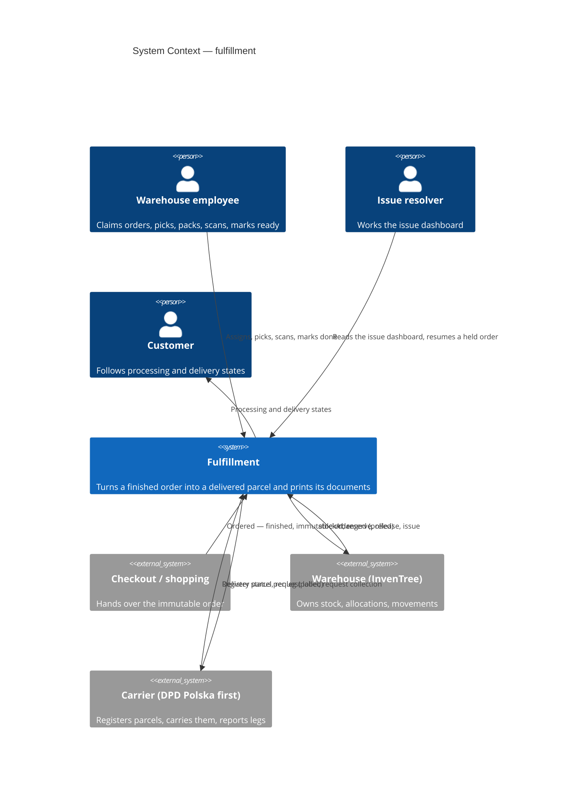

# fulfillment — order processing and the document layer

Session anchor: [issue #3](https://github.com/michal-michaluk/ecommerce-eval/issues/3) · process: `specification` steps 0–7 · folder landed step by step.

## Purpose

Turn a finished, immutable order into a delivered parcel: one employee owns it, a pick list walks the
warehouse, every position is confirmed by scanning, the parcel is registered with a carrier before it
exists, and every delivery state — plus every warehouse problem — is visible and told to the customer.
The context owns the processing, the parcel record and the documents it must print; it does not own
the order content, the stock, the customer master or the carrier's own data.

## Input tiers

| Tier | What | Where |
| --- | --- | --- |
| A — primary | the `ecommerce` knowledge base: `fulfillment/`, `integrations/`, `domain-language/` | `/Users/michal/.agents/knowledge/ecommerce/` — indexed in [`materials/kb-index.md`](materials/kb-index.md) |
| B — provenance | the primitive artifacts the KB cites | [`../../raw/materials/`](../../raw/materials/) — eventstorming board, transcript, DPD label, WZ note |
| C — constraints | service patterns, the one existing context | [`../../arch/microservice-java-spring/`](../../arch/microservice-java-spring/), [`../catalog/`](../catalog/) |

The KB is case-linked by absolute path in `materials/kb-index.md` and is **not** copied here: one source of
truth, still under its own repo and RAG collection. Every KB claim carries `[seg N]` or `path:line`, so any
rule in this spec can be verified against Tier B in one hop.

## Materials index (Step 1, accepted)

| # | Source | Type | What it is | Use for | Status |
| --- | --- | --- | --- | --- | --- |
| A1 | KB `fulfillment/order-processing/README.md` | doc | 6 responsibilities, actors, 8 commands → 9 events, 5 read models, 1 policy, both boundaries | scope, actors, commands, events, views | fact |
| A2 | KB `fulfillment/order-processing/order-assignment.md` | doc | exclusive claim, double-send guard, orders-list states | assignment rules | fact |
| A3 | KB `fulfillment/order-processing/pick-list.md` | doc | list contents, `reserve products`, `stock changed`, the optimisation gap | pick list | fact |
| A4 | KB `fulfillment/order-processing/picking-and-packing.md` | doc | scan-to-confirm, position-level state, one-screen workstation | picking | fact |
| A5 | KB `fulfillment/order-processing/shipping-and-delivery-states.md` | doc | registration-first, `ready for delivery`'s two effects, six legs, push vs poll | delivery states | fact |
| A6 | KB `fulfillment/order-processing/issues-and-hold.md` | doc | issue types, hold, dashboard, out-of-system adjustment | issues | fact |
| A7 | KB `fulfillment/order-processing/sources-and-references.md`, `research-log.md` | doc | source tiers, rejected claims, coverage gaps | verification, known holes | fact |
| A8 | KB `fulfillment/documents/` (7 files) | doc | WZ, consignment note, CMR/e-CMR, invoice+VAT, document landscape | document layer | fact |
| A9 | KB `integrations/warehouse-inventree/` (8 files) | doc | allocation without TTL, no outbound subscription, 4-method port, the state we must own | warehouse port | fact |
| A10 | KB `integrations/spedition-pl/` (20 files) | doc | carrier matrix, DPD reference, polling vs push, label ownership split | carrier port | fact |
| A11 | KB `domain-language/` (3 files) | doc | term status `confirmed`/`ambiguous`/`missing`, glossary, undecided register | naming, Q/R seed | fact |
| A12 | KB `index.md`, `README.md` | doc | taxonomy, coverage per folder, findings | navigation | fact |
| B1 | `../../raw/materials/eventstorming.json:110-150, 169-179` | diagram | lane `fulfillment-order-processing`, boundaries, external systems | board truth, verbatim wording | fact |
| B2 | `../../raw/materials/transcript.json` seg 57, 98–99, 106, 109–153 | transcript | the narration of this lane | rules, states, intent | fact |
| B3 | `../../raw/materials/consignment-note.json`, `goods-issue-note.json` | data | DPD label and WZ, field by field | document fields | fact |
| B4 | `../../api/warehouse-api.md`, `../../api/inventree-openapi.json` | API contract | warehouse stock / reserve / issue surface | warehouse port | fact |
| C1 | `../../arch/microservice-java-spring/*` (20 files) | arch docs | mandatory service patterns | constraints | fact |
| C2 | `../catalog/spec.md` + `services/catalog` | spec + code | the one specified context, spec convention, layout | baseline, shape | fact |

## Scope

- **In scope:** order intake from checkout; exclusive assignment; pick list; reservation at the warehouse;
  scan-to-confirm picking; packing; parcel registration and delivery-state tracking; issues and hold;
  the read models the lane needs; the Polish document layer the context must print — WZ goods issue note and
  the carrier consignment note/label.
- **Out of scope:** order content and immutability (checkout/catalog); stock truth and allocation mechanics
  (warehouse system); customer master (CRM); carrier-side data and legal delivery (carrier); payments;
  basket; returns and refunds (`UND-32`); KSeF/e-invoicing (`UND-28`); CMR/e-CMR for a domestic parcel —
  excluded by the KB's own decision table, KB `fulfillment/documents/cmr-and-ecmr.md:97`.
- **Deferred / detached:** carrier and warehouse **adapter internals** — the KB already documents them
  (`integrations/`), they get their own specs; this spec fixes only our ports and their contracts.
  Pending decision at Step 4: whether a pickup-point read model is deferred (`UND-16`).

## Registers

| ID | Type | Statement | Status | Decision |
| --- | --- | --- | --- | --- |
| F1 | Fact | `README.md:19-24` lists `raw/fulfillment.md` and siblings deleted in `d16a219`; the real materials live in `docs/raw/` | accepted | intake uses `docs/raw/` + KB, README is stale and is corrected separately |
| F2 | Fact | the KB lives outside this repo (`/Users/michal/.agents/knowledge/ecommerce/`, its own git repo, RAG collection `ecommerce`, 878 chunks, 0 stale) | accepted | linked, never copied — `materials/kb-index.md` |
| R1 | Risk | linked KB can move or change under a landed spec | open | cite file + line anchors, and cite Tier B (`docs/raw/materials/*`) for anything a decision depends on |
| R2 | Risk | the 71.2 s transcript gap sits in basket delivery estimation, not this lane — but delivery time and cost are still unformulated (`UND-01`, `UND-05`) | open | checkout owns the promise; this lane only executes the delivery method it receives |
| D1 | Decision | scope = the fulfillment bounded context: order-processing lane **plus** the documents the context prints (WZ, consignment note); CMR/e-CMR excluded | accepted | one context, one service |
| D2 | Decision | integration depth = our ports and their contracts in this spec; carrier/warehouse adapter internals deferred to their own specs | accepted | ports here, adapters there |
| D3 | Decision | carrier-agnostic port with DPD Polska as the first adapter; the port is never named after a carrier (`UND-15`) | accepted | `CarrierPort`, not `DhlPort` |
| Q1 | Question | which order states and which order identifier exist (`UND-20`) — the board carries events, no vocabulary | open | derive a state machine from the 9 board events and present it as a Step-5 element for acceptance; no invented enumerations elsewhere |
| Q2 | Question | pick-route algorithm and warehouse-layout ownership (`UND-23`) | open | documented default: single pass ordered by location code, locations resolved through the warehouse port; algorithmic optimisation deferred |
| Q3 | Question | does a hold block delivery, cancel anything, or release the assignee (`UND-22`) | open | Step 5 element `HoldDecision` (09) must answer it or leave it explicitly undecided |
| D5 | Decision | **no money in this context**: no money is computed, compared or stored; the WZ is *rendered* from data supplied by the invoicing boundary, and COD / declared-value amounts are opaque pass-through values on the carrier request | accepted | element 11 `DocumentAmounts` removed; `Order` carries no prices; VAT and delivery-cost questions (`UND-01`, `UND-02`, `UND-05`, `UND-07`) belong to checkout/invoicing |
| Q4 | Question | `docs/adr/01-strategic-software-architecture.md` absent for this SUD | parked | out of this spec's scope, as in `../catalog/spec.md` Q9 — workspace-level artifact |
| D4 | Decision | `Order` is a **value object** in the shared kernel: content only, no identity, equality by canonical `orderHash`; `OrderProcessing` mints a synthetic `OrderProcessingId` at intake and keeps `orderHash` as the idempotency key | accepted | second delivery of the same order is a no-op, never a second parcel |
| F4 | Fact | the seller party (name, address, NIP) on the WZ is **not** order content — the buyer's invoicing data is, ours is configuration | accepted | `Order` carries no seller; documents read seller from configuration (`ubiquitous-language.md:175` leaves "seller" undefined) |
| D6 | Decision | questions and risks are numbered **per element** — `Q-<element>-n` / `R-<element>-n` — not per spec; the plain sequence collides because 04–09, 11, 12 and 15–18 landed in one parallel batch: `Q16`–`Q24` and `R7`–`R11` were each claimed by two or more files, so an unqualified id resolves to more than one question | accepted | elements 10, 13 and 14 already use the per-element form; 05 and 06 converted to `Q-05-n` / `Q-06-n`; no landed element renumbered; a cross-element reference must name the element and its scoped id (`element 03 Q-03-1`); the Step-3 facts are `F3-n`, so the global register keeps one meaning each for `F3` and `F4` |
| D7 | Decision | an **explicit resume command** exists — `POST /processing/{processingId}/hold/resume`, granted to both `fulfillment-employee` and `fulfillment-resolver` — because no source names any exit from `onHold`; it succeeds only with zero open issues (element 09 H5/H6) and never on a polled carrier signal | accepted | the hole is closed deliberately, not left to an implementer: element 02 RULE-7, element 09 H5/H6, element 11, element 17 `Q-17-1` |
| D8 | Decision | closing an issue is a **fact recorded by the resume command** (D7): the request body is `{ "closedIssueIds": ["ISS-2026-0031"] }`, and any issue left open makes it answer `409 ISSUES_REMAIN` with `openIssues` — the issue dashboard stays read-only, and there is no separate resolve endpoint, resolve command or issue lifecycle | accepted | element 04 RULE-1 (`closedAt` is the record's single mutable fact), element 09 H5/H6, element 11 (the one write path), element 17 (no write side) |
| D9 | Decision | cross-context transport is HTTP — `POST /orders` inbound, no broker, no outbox | accepted | closes spec `Q5` and element 12 `Q-12-1`; `R-11-1` (synchronous call blocks checkout) stays open as a checkout-side risk; a broker path would need `integration-events.md` revised |
| D10 | Decision | **one parcel per processing** — `Parcel.ofTotal = 1`, `sequence.index = 1`; multi-parcel packing is out of scope | accepted | resolves the element 02 `parcel` (singular) vs element 03/06 `ofTotal > 1` contradiction; narrows element 03 `Q-03-3` to "packing never splits" |
| D11 | Decision | write triggers the elements left unnamed: warehouse `reserve` on a **granted claim**, parcel `register` on the **first scan** (`assigned → picking`), warehouse `issue` at **readiness**, `release` **never**; unknown ids in `closedIssueIds` answer `404` | accepted | closes the orphaned capability 4 and the parcel-registration trigger; `Q-13-1` (sweeper duration) still open — the default is "no sweeper until a duration is decided" |
| D12 | Decision | a hold lift publishes the in-process `orderResumed` event | accepted | closes element 09 `Q-09-4`; the resume is otherwise invisible to every read model |
| D13 | Decision | the customer endpoint accepts **any** `fulfillment-customer` token — no ownership check | accepted with risk | `Order` carries no customer identity, so "only their own processing" is unimplementable; element 18 `Q-18-2` and `UND-30` stay open |
| D14 | Decision | warehouse and carrier are **ports plus in-test fakes**; real InvenTree/DPD clients are separate specs | accepted | restates `D2` for the plan; no simulator/CLI and no Pact in this repo, because no consumer service exists |
| D15 | Decision | element 05 (`GoodsIssueNote`) is **out of the implementation plan** | accepted | it cannot be implemented before an invoicing contract exists — no port, DTO or event supplies net/VAT/gross/`amountInWords`, and `RULE-3` forbids reusing buyer or delivery address as `receiver` |

## Step 2 — Goals, actors, capabilities, properties (accepted)

- **We build:** the fulfillment context — a finished order becomes a delivered parcel, with documents.
- **For whom:** warehouse employee, issue resolver, customer.
- **Because:** after checkout the shop must physically deliver and keep the customer informed [seg 109, 126-128].
- **Success looks like:** an order can never be processed twice; every order state change reaches the customer view; the parcel has a carrier identifier before the first delivery leg.
- **Capabilities:**
  1. list current orders with their processing state
  2. claim one order exclusively
  3. produce a pick list: product, quantity, location
  4. reserve the products at the warehouse
  5. confirm each position by scanning it
  6. mark the order done / ready for delivery
  7. register the parcel and obtain the carrier's identifier
  8. follow every delivery leg and notify the customer
  9. report a warehouse problem and put the order on hold
  10. see every open issue in one read-only dashboard
  11. print the goods issue note (WZ) and the consignment note/label
  12. resume an order from hold once every issue is closed (D7, D8)
- **Properties:**
  - **Invariant:** one employee per order — exclusivity, not advisory (KB `order-assignment.md:5`)
  - **Freshness:** read models update after each event [seg 137-138]
  - **Resilience:** carrier status is poll-only for DPD, so a scheduler and idempotent state application are mandatory (KB `dpd-polska/status-polling.md:78`)
  - **Audit:** every state change and issue stays readable to the customer
  - **Security:** warehouse token and carrier credentials are secrets, never in code (KB `dpd-polska/sandbox-and-credentials.md:55`)
  - **Volume/latency:** absent from every source — no numbers to design against

**Assumption to confirm:** the *issue resolver* is **not** a board actor — the board carries only `employee` and `customer`; the KB introduces him from the narration "someone else will see issue on his dashboard" [seg 149], KB `issues-and-hold.md:51`.

### C4 context

Canonical names follow KB `domain-language/ubiquitous-language.md:308-398`: order processing, assignment, pick list, pick, pack, scan, position packed, ready for delivery, delivery number / provider ID, delivery state, delivery state notification, issue, order on hold.

## Step 3 — Current code exploration (accepted)

| ID | Fact | Provenance |
| --- | --- | --- |
| F3-1 | Nothing exists for fulfillment: no code, no Kafka topic, no `fulfillment`/`picker` Keycloak role, no database | repo-wide grep for `Order\|Parcel\|Pick\|Carrier\|Stock` = 0 hits; `services/catalog/k8s/infra/kafka.yaml:1-16`; realm roles `user`/`admin`; `databases.txt` = `catalog:catalog:catalog` |
| F3-2 | **No** `domain/`/`application/`/`infrastructure/` packages — one root package, role by file suffix | `docs/arch/microservice-java-spring/code-structure.md:3-6`, suffix table `:80-97` |
| F3-3 | Events are in-process only: `ApplicationEventPublisher`, "no Kafka topic, no outbox worker, no `@Async`" | `docs/arch/microservice-java-spring/integration-events.md:18` |
| F3-4 | Ports are package-private with an inner adapter, lifecycle `get/save`; a `*Policy` is never a bean and does no I/O; one `{Context}Exception` with a nested `Error` enum | `ports.md:9,33`, `domain-model-policy.md:150`, `error-handling.md:3,72` |
| F3-5 | `WarehouseStock` is documented, not implemented — 0 implementations | `docs/api/warehouse-api.md:27-39`, value objects `:42-44`, adapter rules `:48-52` |
| F3-6 | No root build, no justfile; each service is self-contained with its own wrapper, `k8s/`, quality gates | `README.md:38`, `services/catalog/settings.gradle:1`, `.sqt.yaml` ×3 (3 + 51 + 6 checks) |
| R3 | The blueprint has in-process events only, yet `ordered` crosses contexts and carrier/warehouse state arrives from outside — the only transport the arch docs allow is synchronous HTTP | `integration-events.md:18` vs board boundary `eventstorming.json:169-172` |
| Q5 | Cross-context transport: `POST /orders` handover + polled warehouse/carrier, or is `integration-events.md` stale for a multi-service repo | open — Step 5 decision, blocks element 03 |

## Step 4 — Key elements (accepted)

| # | Element | Type | File |
| --- | --- | --- | --- |
| 01 | `Order` | business concept — value object, shared kernel | [01-order.md](01-order.md) |
| 02 | `OrderProcessing` | business concept — process aggregate | 02-order-processing.md |
| 03 | `Parcel` | business concept | 03-parcel.md |
| 04 | `FulfillmentIssue` | business concept | 04-fulfillment-issue.md |
| 05 | `GoodsIssueNote` | business concept — document | 05-goods-issue-note.md |
| 06 | `ConsignmentNote` | business concept — document | 06-consignment-note.md |
| 07 | `AssignmentGuard` | automated decision | 07-assignment-guard.md |
| 08 | `ReadyForDeliveryDecision` | automated decision | 08-ready-for-delivery-decision.md |
| 09 | `HoldDecision` | automated decision | 09-hold-decision.md |
| 10 | `PickListCalculation` | calculation | 10-pick-list-calculation.md |
| 11 | `FulfillmentHttpApi` | external API we expose | 11-fulfillment-http-api.md |
| 12 | `shopping ↔ Fulfillment` | component integration | 12-order-handover.md |
| 13 | `Fulfillment → Warehouse` | existing external API we consume | 13-warehouse-port.md |
| 14 | `Fulfillment → Carrier` | existing external API we consume | 14-carrier-port.md |
| 15 | `employee → OrdersListView` | UI view | 15-orders-list-view.md |
| 16 | `employee → PickWorkstation` | UI view | 16-pick-workstation.md |
| 17 | `resolver → IssueDashboard` | UI view | 17-issue-dashboard.md |
| 18 | `customer → OrderProcessingStateView` | UI view | 18-order-processing-state-view.md |

One-liners, per type, are kept with the associated `Q`/`R` they depend on:

- **concepts:** `Order` — the immutable document from checkout, no identity, equality by content; `OrderProcessing` — processing state beside it (Q1 states); `Parcel` — carrier-side shipment, `paczka i/n`, provider ID, state history; `FulfillmentIssue` — warehouse reality gap + the hold it causes (Q3); `GoodsIssueNote` — WZ; `ConsignmentNote` — the label print, ownership split 22/11/6/1.
- **decisions:** `AssignmentGuard` — one employee per order, exclusivity; `ReadyForDeliveryDecision` — all packed + no blocking issue → mark done and request collection; `HoldDecision` — issue → hold, and what a hold blocks (Q3).
- **calculation:** `PickListCalculation` — positions + locations → ordered pick list (Q2). No money calculation exists in this context (D5).
- **integrations:** `FulfillmentHttpApi` — our surface; `shopping ↔ Fulfillment` — inbound handover (Q5); warehouse port; carrier port — contracts only.
- **views:** orders list; pick workstation; issue dashboard; customer processing-state view.

**Deferred / detached** (not numbered, no element file): carrier and warehouse adapter internals (D2); pick-route optimisation algorithm (Q2); pickup-point read model (`UND-16`); returns and refunds (`UND-32`); KSeF/e-invoicing (`UND-28`); CMR/e-CMR (KB `fulfillment/documents/cmr-and-ecmr.md:97`).

## Steps

| Step | State |
| --- | --- |
| 0 Book & claim | done — issue #3 claimed `2026-11-19T09:20:33Z`, [start comment](https://github.com/michal-michaluk/ecommerce-eval/issues/3#issuecomment-7004968795) |
| 1 Raw material intake | accepted — this file, `materials/kb-index.md` |
| 2 Goals, actors, capabilities, properties | accepted |
| 3 Current code exploration | accepted — F3-1…F3-6, R3, Q5 |
| 4 Key elements | accepted — 18 in scope, 6 deferred (element 11 `DocumentAmounts` removed by D5) |
| 5 Element specification | in progress — 01–18 written; 05 and 06 re-checked against the KB (per-element `Q`/`R` ids per D6, anchors re-verified); consistency review pending |
| 6 Consistency review | pending |
| 7 Close-out & booking | pending |

---

## Prove Definition of Done

Executed row by row by the `prove-dod` node; a row that is not executed is a failure.

| # | Row | Command | Pass |
| --- | --- | --- | --- |
| 1 | service builds, static analysis and coverage | `cd services/fulfillment && ./gradlew build --no-daemon` | exit 0, SpotBugs 0, JaCoCo ≥ 80 % |
| 2 | architecture rules | `cd services/fulfillment && ./gradlew test --tests '*Architecture*'` | 0 failures |
| 3 | domain/architecture style gates | `cd services/fulfillment && sqt check .` | 0 violations |
| 4 | the whole HTTP contract of element 11 | `cd services/fulfillment && ./gradlew e2eHurl --no-daemon` | every request in `e2e/fulfillment-api.hurl` passes |
| 5 | spec id namespace | `cd docs/specs/fulfillment && python3 prototypes/check-ids.py` | exit 0 |
| 6 | one employee per order | hurl: two claims by different employees | second → `409 ALREADY_ASSIGNED` |
| 7 | an order is never processed twice | hurl: same `orderHash` twice | `201` then `200 duplicate:true`, one row in `GET /orders` |
| 8 | pick list carries product, quantity, location | hurl: `GET …/pick-list` | every stop has `productNumber`, `quantityToTake`, `location` |
| 9 | a reservation is placed at claim and consumed at readiness | hurl: claim, then readiness; fake warehouse records both calls | exactly one `reserve` on the granted claim and one `issue` on readiness |
| 10 | every position confirmed by scanning, idempotently | hurl: same confirmation twice | `200`, same state |
| 11 | readiness refused while a position is open | hurl: `POST …/readiness` with an open position | `409 NOT_READY` + `reasons[]` |
| 12 | the parcel has a carrier identifier before the first leg | hurl: `POST …/readiness` | `200`, `parcel.waybill` non-empty |
| 13 | every delivery leg reaches the customer view | hurl: legs L3–L6 applied, then `GET …/state` | legs present, `assignee` and `issue` absent |
| 14 | an issue holds the whole order and blocks readiness | hurl: `POST /issues`, then scan and readiness | `201`, state `onHold`, both refused `409` |
| 15 | a hold is lifted only with zero open issues | hurl: resume with one open, then with none | `409 ISSUES_REMAIN`, then `200` with the pre-hold state |
| 16 | the issue dashboard is read-only and resolver-scoped | hurl: `GET /issues` as resolver and as employee | `200` / `403` |
| 17 | no money anywhere | hurl asserts `jsonpath "$..price" not exists` and the same for `amount`, `currency`, `vat` | all pass |

## Tickets

- Spec ticket: [#3](https://github.com/michal-michaluk/ecommerce-eval/issues/3)
- Plan ticket: [#66](https://github.com/michal-michaluk/ecommerce-eval/issues/66)

---

## Implementation Plan

### Available Infrastructure

- **Build:** Gradle 9.5.1 wrapper, Java 25, Spring Boot (blueprint `microservice-java-spring`), `./gradlew build` = assemble + `test` + SpotBugs + JaCoCo ≥ 80 % instruction.
- **Test:** JUnit Platform; `@IntegrationTest` + Testcontainers (PostgreSQL, Kafka, Keycloak); ArchUnit 1.4.2.
- **e2e:** `hurl 7.1.0` driven by a Java fixture, mirroring `services/catalog` on `feat/catalog-domain-model` (`build.gradle:81-90`, `src/test/java/shop/catalog/e2e/HurlSuiteFixture.java`, `CatalogRealmFixture`, `CatalogTopicFixture`, `CatalogE2eVariables`) — `./gradlew e2eHurl` boots the service and runs one hurl file. The scaffold does **not** generate this task; the `scaffold-service` node adds it.
- **Static:** SpotBugs 4.9.8 + findsecbugs; `sqt` (3 root checks + 51 main + 6 test checks, metric bands); PITest; Trivy fs (`./gradlew trivyScan`, needs Docker-on-podman).
- **Language:** Java 25, checked `void`-free aggregates, package-private ports with inner adapters.
- **Baseline branch:** implementation branches from `feat/catalog-domain-model` — it is the only branch where the ArchUnit suite is green (verified `BUILD SUCCESSFUL`) and where a real context (`offer`, `pricing`, `quality`, `reads`, `review`) exists to copy. `main` carries the bare scaffold and a failing `ArchitectureTest` (verified 1 of 2 failed).
- **Verification skills available:** `scaffold` (generate/update/docs/example), `review` + its procedures, `contract-testing`, `implement`, `demo`, `knowledge`, repo-local `run-apps`.
- **Architecture docs:** `docs/arch/microservice-java-spring/*` — 19 files, **generated and gitignored** (`.gitignore:19-21`); regenerate with `scaffold docs microservice-java-spring`. Read `index.md` first in every node.

### Clarification Decisions

| # | Issue | Decision |
| --- | --- | --- |
| 1 | spec not accepted (Steps 5–7 open, #3 open) | plan written now; the `spec-consistency` node executes the consistency review (Step 6) as executable work |
| 2 | baseline branch | docs stay on `feat/fulfillment-spec` off `main`; code branches from `feat/catalog-domain-model` |
| 3 | external integrations (plan reference wants simulator + CLI + Pact) | port + package-private adapter + in-test fake; real InvenTree/DPD clients are their own specs (D2); no Pact — no consumer service exists and the repo precedent is hurl e2e |
| 4 | element 05 (WZ) has no amount source | out of this plan; registered as `D15` |
| 5 | views 15–18 | backend read models + JSON only; the Storybook gallery stays a specification artifact |
| 6 | `reserve`/`register`/`issue` had no trigger | `D11` |
| 7 | hold lift emitted no event | `D12` |
| 8 | customer ownership check unimplementable | `D13` |

### Plan

**1. Order processing core**
 - spec-consistency (spec.md F1 + D9–D13), scaffold-service, security-scopes -> order-value-object -> processing-aggregate -> intake-endpoint -> assignment -> orders-list-projection.
 - gate at the end of the phase: `./gradlew build` and `./gradlew e2eHurl`.

**2. Warehouse, pick list, picking and packing**
 - warehouse-port -> pick-list-calculation -> pick-pack-commands, pick-workstation-read.
 - gate: `./gradlew build`, `./gradlew e2eHurl`.

**3. Delivery, parcel, legs and the customer view**
 - parcel-aggregate -> readiness-decision -> carrier-port, label-serving, customer-state-projection.
 - gate: `./gradlew build`, `./gradlew e2eHurl`.

**4. Order processing — the rest**
 - issues-hold -> issue-dashboard-projection.
 - gate: `./gradlew build`, `./gradlew e2eHurl` (the whole contract).

**5. Prove of done** — prove-dod.

**6. Evidence** — demo-recording, review-branch.

---

#### spec-consistency

- **Goal:** remove every wire-level contradiction the executable contract exposes, and land the register entries D9–D13 plus the `Prove Definition of Done` table, so later nodes inherit one contract.
- **Executor:** general
- **Docs:** `spec.md` F1 cluster; elements 02, 07, 09, 10, 11, 16, 18; `prototypes/fulfillment-api.hurl` (authoritative for the wire, `11-fulfillment-http-api.md:5`)
- **IN / OUT:** IN: the 18 element files + `spec.md`; OUT: the same files; keeps `check-ids.py` green and does **not** rename ids.
- **checks:**
  - `cd /Users/michal/workspace/bottega-ai-mind/eval/ecommerce/docs/specs/fulfillment && python3 prototypes/check-ids.py`
  - `cd /Users/michal/workspace/bottega-ai-mind/eval/ecommerce/docs/specs/fulfillment && grep -q '| D13 ' spec.md`
  - `cd /Users/michal/workspace/bottega-ai-mind/eval/ecommerce/docs/specs/fulfillment && grep -q '## Prove Definition of Done' spec.md`
- **review_prompt:** Review the work in `/Users/michal/workspace/bottega-ai-mind/eval/ecommerce`; do not inspect any other repository; if a premise below is false, say so and stop. Compare `docs/specs/fulfillment/10-pick-list-calculation.md`, `11-fulfillment-http-api.md`, `02-order-processing.md`, `07-assignment-guard.md`, `09-hold-decision.md`, `16-pick-workstation.md`, `18-order-processing-state-view.md` against `prototypes/fulfillment-api.hurl`: every jsonpath and status the hurl asserts must be producible by the element spec, and every error code the hurl names must appear in the element that owns it. Report every remaining mismatch. Do not edit files — report only.

#### scaffold-service

- **Goal:** generate `services/fulfillment` from the blueprint, add the `e2eHurl` task and the Java hurl harness, seed `e2e/fulfillment-api.hurl` from the spec prototype, and register the service in the repo (README row, run-apps `databases.txt` line, k8s base/overlays, `fulfillment-db` secret).
- **Executor:** general
- **Docs:** `spec.md` D1/D2; `docs/arch/microservice-java-spring/index.md`, `code-structure.md`, `testing.md`, `tech-update.md`; `scaffold` skill; `services/catalog` on `feat/catalog-domain-model` as the e2e precedent
- **IN / OUT:** IN: `blueprints/microservice-java-spring`, the spec prototype hurl; OUT: `services/fulfillment/**` (root package `shop.fulfillment`), `README.md` service table row, `.agents/skills/run-apps/manifests/infra/postgres.yaml`
- **checks:**
  - `cd /Users/michal/workspace/bottega-ai-mind/eval/ecommerce/services/fulfillment && ./gradlew build --no-daemon`
  - `cd /Users/michal/workspace/bottega-ai-mind/eval/ecommerce/services/fulfillment && sqt check .`
  - `test -f /Users/michal/workspace/bottega-ai-mind/eval/ecommerce/services/fulfillment/e2e/fulfillment-api.hurl`
  - `cd /Users/michal/workspace/bottega-ai-mind/eval/ecommerce/services/fulfillment && ./gradlew tasks --all | grep -q e2eHurl`
- **review_prompt:** Review the work in `/Users/michal/workspace/bottega-ai-mind/eval/ecommerce`; do not inspect any other repository; if a premise below is false, say so and stop. Check that `services/fulfillment` is a faithful `microservice-java-spring` scaffold — one root package, no `domain/ application/ infrastructure/` sub-packages, `guardrail_mode=strict` gates present (jacoco ≥ 80 %, SpotBugs failing, three sqt configs) — and that the `e2eHurl` task + fixture actually boot the service rather than skipping. Report structural drift from `docs/arch/microservice-java-spring/code-structure.md`. Do not edit files — report only.

#### security-scopes

- **Goal:** provision the four scopes `fulfillment-employee`, `fulfillment-resolver`, `fulfillment-customer`, `shopping-service` in the test realm, the k8s Keycloak manifest and `AuthFixture`, and record one authN/authZ decision per endpoint of element 11.
- **Executor:** general
- **Docs:** `11-fulfillment-http-api.md:24-36`; `docs/arch/microservice-java-spring/security.md`
- **IN / OUT:** IN: generated realm/`AuthFixture`; OUT: `src/test/resources/iot-realm.json`, `k8s/infra/keycloak.yaml`, `src/test/java/shop/fulfillment/auth/AuthFixture.java`, `docs/security-decisions.md` in the service
- **checks:**
  - `cd /Users/michal/workspace/bottega-ai-mind/eval/ecommerce/services/fulfillment && ./gradlew build --no-daemon`
  - `cd /Users/michal/workspace/bottega-ai-mind/eval/ecommerce/services/fulfillment && grep -c 'fulfillment-' src/test/resources/iot-realm.json` ≥ 6 (3 scopes × 2 occurrences)
- **review_prompt:** Review the work in `/Users/michal/workspace/bottega-ai-mind/eval/ecommerce/services/fulfillment`; do not inspect any other repository; if a premise below is false, say so and stop. Check `docs/security-decisions.md` against `docs/specs/fulfillment/11-fulfillment-http-api.md:24-36`: every endpoint has exactly one decision, `permitAll` appears nowhere, `POST /orders` is scoped to `shopping-service` and `POST …/hold/resume` to both employee and resolver. Report gaps. Do not edit files — report only.

#### order-value-object

- **Goal:** `Order` as a shared-kernel value object (`OrderLine`, `Delivery`, `Location`, `Address`, `Payment`, `Invoicing`) with RULE-1…RULE-8 enforced in compact constructors and equality by canonical `orderHash`.
- **Executor:** general
- **Docs:** `01-order.md`; `docs/arch/microservice-java-spring/domain-model-value-object.md`; `src/main/java/.sqt.yaml` `vo.*` rules
- **IN / OUT:** IN: `01-order.md`; OUT: `src/main/java/shop/fulfillment/**/Order*.java`, its fixture and unit tests
- **checks:**
  - `cd /Users/michal/workspace/bottega-ai-mind/eval/ecommerce/services/fulfillment && ./gradlew build --no-daemon`
  - `cd /Users/michal/workspace/bottega-ai-mind/eval/ecommerce/services/fulfillment && ./gradlew test --tests '*Order*' --no-daemon`
- **review_prompt:** Review the work in `/Users/michal/workspace/bottega-ai-mind/eval/ecommerce/services/fulfillment`; do not inspect any other repository; if a premise below is false, say so and stop. Check the `Order` type against RULE-1…RULE-8 of `docs/specs/fulfillment/01-order.md`: no identity, price-free, every invariant rejected in the constructor, one location kind enforced, and a canonical form whose ordering is defined by content and not by the caller. Report every invariant that is unenforced or enforced in the wrong layer. Do not edit files — report only.

#### processing-aggregate

- **Goal:** `OrderProcessing` aggregate — id minting, `ProcessingState`/`PositionState` machine, positions derived from order lines, domain event list, command methods that own every transition.
- **Executor:** general
- **Docs:** `02-order-processing.md` (RULE-1…RULE-7, edges `:40-64`); `domain-model-aggregate.md`, `domain-model-events.md`, `error-handling.md`
- **IN / OUT:** IN: `02`; OUT: `src/main/java/shop/fulfillment/**/OrderProcessing*.java`, `ProcessingState`, `PositionState`, unit tests
- **checks:**
  - `cd /Users/michal/workspace/bottega-ai-mind/eval/ecommerce/services/fulfillment && ./gradlew build --no-daemon`
  - `cd /Users/michal/workspace/bottega-ai-mind/eval/ecommerce/services/fulfillment && ./gradlew test --tests '*OrderProcessing*' --no-daemon`
  - `cd /Users/michal/workspace/bottega-ai-mind/eval/ecommerce/services/fulfillment && sqt check .`
- **review_prompt:** Review the work in `/Users/michal/workspace/bottega-ai-mind/eval/ecommerce/services/fulfillment`; do not inspect any other repository; if a premise below is false, say so and stop. Compare the aggregate with `docs/specs/fulfillment/02-order-processing.md:40-64`: the edge table must match the code one-to-one, no edge may exist from `pending`/`assigned` to `onHold`, `state` may only change through command methods, and position state may never regress. Report each divergence. Do not edit files — report only.

#### intake-endpoint

- **Goal:** `POST /orders` — `shopping-service` scope, incomplete order → `422 ORDER_INCOMPLETE` with `missing[]`, repeat `orderHash` → `200 duplicate:true` with no second processing, success → `201 {processingId,state}` plus `OrderProcessingStarted`.
- **Executor:** general
- **Docs:** `12-order-handover.md`; `11-fulfillment-http-api.md:13-16,42-48`; `http-adapter.md`, `error-handling.md`, `persistence-adapters.md`, `ports.md`
- **IN / OUT:** IN: `order-value-object`, `processing-aggregate`; OUT: controller, command record, `OrderProcessingRepository` port + adapter, Liquibase changelog, hurl intake section
- **checks:**
  - `cd /Users/michal/workspace/bottega-ai-mind/eval/ecommerce/services/fulfillment && ./gradlew build --no-daemon`
  - `cd /Users/michal/workspace/bottega-ai-mind/eval/ecommerce/services/fulfillment && ./gradlew e2eHurl --no-daemon`
- **review_prompt:** Review the work in `/Users/michal/workspace/bottega-ai-mind/eval/ecommerce/services/fulfillment`; do not inspect any other repository; if a premise below is false, say so and stop. Check that the controller is thin (validation, mapping, one service call), that `422` is raised by `Order`'s invariants and translated by the one `FulfillmentException` advice, that `401`/`403`/`422`/`201`/`200` all match `docs/specs/fulfillment/12-order-handover.md:11-21`, and that a duplicate sends no second event. Report mismatches. Do not edit files — report only.

#### assignment

- **Goal:** `AssignmentGuard` decision (DT-07-1…DT-07-6) + `AssignOrder` command + `POST …/assignment` + `employee assigned to order fulfilment`, with `reserve` called on a granted claim (D11).
- **Executor:** general
- **Docs:** `07-assignment-guard.md`; `02-order-processing.md:68-73`; `domain-model-policy.md`
- **IN / OUT:** IN: `processing-aggregate`, `warehouse-port` port interface (stub fake allowed); OUT: `AssignmentGuard*`, command, endpoint, tests, hurl assignment section
- **checks:**
  - `cd /Users/michal/workspace/bottega-ai-mind/eval/ecommerce/services/fulfillment && ./gradlew build --no-daemon`
  - `cd /Users/michal/workspace/bottega-ai-mind/eval/ecommerce/services/fulfillment && ./gradlew e2eHurl --no-daemon`
- **review_prompt:** Review the work in `/Users/michal/workspace/bottega-ai-mind/eval/ecommerce/services/fulfillment`; do not inspect any other repository; if a premise below is false, say so and stop. Check the decision table `docs/specs/fulfillment/07-assignment-guard.md:17-22` against the code and its tests row by row, that the policy is pure (no repository, no clock, no retry), that atomicity is enforced by the service/transaction rather than the policy, and that a refusal never clears an assignee. Report divergences. Do not edit files — report only.

#### orders-list-projection

- **Goal:** the orders-list read model fed by the phase-1 events and `GET /orders` (employee scope, hold marker, position progress, no money).
- **Executor:** general
- **Docs:** `15-orders-list-view.md`; `11-fulfillment-http-api.md:14`; `projection.md`, `persistence-adapters.md`
- **IN / OUT:** IN: the phase-1 events; OUT: projection, read-model records, read controller, tests, hurl list section
- **checks:**
  - `cd /Users/michal/workspace/bottega-ai-mind/eval/ecommerce/services/fulfillment && ./gradlew build --no-daemon`
  - `cd /Users/michal/workspace/bottega-ai-mind/eval/ecommerce/services/fulfillment && ./gradlew e2eHurl --no-daemon`
- **review_prompt:** Review the work in `/Users/michal/workspace/bottega-ai-mind/eval/ecommerce/services/fulfillment`; do not inspect any other repository; if a premise below is false, say so and stop. Check the projection against `docs/specs/fulfillment/15-orders-list-view.md:45-70`: every listed event handled exactly once, find-or-create plus full recompute, the read controller depends on the projection only, and no field of the row comes from the write model. Report gaps. Do not edit files — report only.

#### warehouse-port

- **Goal:** `WarehouseStock` port (five operations), a package-private adapter, `FakeWarehouseStock` for tests, the owned mapping state S1/S3, the stale-allocation sweeper S2 and the stock-change poller raising `stock changed`.
- **Executor:** general
- **Docs:** `13-warehouse-port.md`; `docs/api/warehouse-api.md`, `docs/api/inventree-openapi.json`; `protocol-adapters.md`, `ports.md`
- **IN / OUT:** IN: `13`; OUT: `WarehouseStock`, `StockAtLocation`, `ProductId`, `LocationCode`, `ReservationId`, `PickedItem`, `IssueNote`, `StockCursor`, `StockChangePage`, adapter + fake, sweeper, poller, tests
- **checks:**
  - `cd /Users/michal/workspace/bottega-ai-mind/eval/ecommerce/services/fulfillment && ./gradlew build --no-daemon`
  - `cd /Users/michal/workspace/bottega-ai-mind/eval/ecommerce/services/fulfillment && ./gradlew test --tests '*Warehouse*' --no-daemon`
  - `cd /Users/michal/workspace/bottega-ai-mind/eval/ecommerce/services/fulfillment && sqt check .`
- **review_prompt:** Review the work in `/Users/michal/workspace/bottega-ai-mind/eval/ecommerce/services/fulfillment`; do not inspect any other repository; if a premise below is false, say so and stop. Check the port signatures against `docs/specs/fulfillment/13-warehouse-port.md:21-49` and its RULE-1…RULE-7: no invented retry/backoff/fallback, `release` idempotent, `issue` at-most-once per reservation, no cached stock presented as fresh, and the public-port visibility exception recorded rather than silently taken. Report divergences. Do not edit files — report only.

#### pick-list-calculation

- **Goal:** `PickListCalculation` producing `PickList`/`Stop`/`Shortfall` from positions plus `stockAt` observations, and `GET …/pick-list`.
- **Executor:** general
- **Docs:** `10-pick-list-calculation.md` (RULE-1…RULE-9, DT-1…DT-10, defaults `:97-107`); `11-fulfillment-http-api.md:14`
- **IN / OUT:** IN: `warehouse-port`, `processing-aggregate`; OUT: the calculation, its value objects, query handler, read controller, tests, hurl pick-list section
- **checks:**
  - `cd /Users/michal/workspace/bottega-ai-mind/eval/ecommerce/services/fulfillment && ./gradlew build --no-daemon`
  - `cd /Users/michal/workspace/bottega-ai-mind/eval/ecommerce/services/fulfillment && ./gradlew e2eHurl --no-daemon`
- **review_prompt:** Review the work in `/Users/michal/workspace/bottega-ai-mind/eval/ecommerce/services/fulfillment`; do not inspect any other repository; if a premise below is false, say so and stop. Check the calculation against `docs/specs/fulfillment/10-pick-list-calculation.md`: every `pending` position appears, take + shortfall equals the position quantity, one stop per (position, location), the port result arrives as a parameter rather than being called inside the calculation, and a port failure yields no list. Report each violated rule. Do not edit files — report only.

#### pick-pack-commands

- **Goal:** scan confirmation (`POST …/positions/{productNumber}`) and packing (`POST …/packing`), the `assigned → picking → packed` edges, and the `GET /processing/{id}` snapshot.
- **Executor:** general
- **Docs:** `02-order-processing.md:68-73`; `11-fulfillment-http-api.md:14-16`; `16-pick-workstation.md:43-54`; `http-adapter.md`
- **IN / OUT:** IN: `processing-aggregate`; OUT: command records, service methods, controllers, snapshot DTO, tests, hurl scan/pack/snapshot sections
- **checks:**
  - `cd /Users/michal/workspace/bottega-ai-mind/eval/ecommerce/services/fulfillment && ./gradlew build --no-daemon`
  - `cd /Users/michal/workspace/bottega-ai-mind/eval/ecommerce/services/fulfillment && ./gradlew e2eHurl --no-daemon`
- **review_prompt:** Review the work in `/Users/michal/workspace/bottega-ai-mind/eval/ecommerce/services/fulfillment`; do not inspect any other repository; if a premise below is false, say so and stop. Check that one scan closes one position, a repeat scan is a `200` no-op, packing only accepts `picked` positions and answers `409` otherwise, `packed` is derived from the position set rather than written by the controller, and the snapshot exposes exactly the fields the hurl asserts. Report divergences. Do not edit files — report only.

#### pick-workstation-read

- **Goal:** the pick-workstation read model — positions with line names, counters, locations from the pick list, and the optional stock-per-location panel.
- **Executor:** general
- **Docs:** `16-pick-workstation.md:25-41`; `projection.md`
- **IN / OUT:** IN: `pick-list-calculation`, `pick-pack-commands`; OUT: the read model, its controller, tests
- **checks:**
  - `cd /Users/michal/workspace/bottega-ai-mind/eval/ecommerce/services/fulfillment && ./gradlew build --no-daemon`
  - `cd /Users/michal/workspace/bottega-ai-mind/eval/ecommerce/services/fulfillment && ./gradlew e2eHurl --no-daemon`
- **review_prompt:** Review the work in `/Users/michal/workspace/bottega-ai-mind/eval/ecommerce/services/fulfillment`; do not inspect any other repository; if a premise below is false, say so and stop. Check the workstation payload against `docs/specs/fulfillment/16-pick-workstation.md:25-41`: no money, no field the spec does not name, the unscanned position state is the one the spec settles on, and the screen cannot offer an action of another view's actor. Report gaps. Do not edit files — report only.

#### parcel-aggregate

- **Goal:** the `Parcel` aggregate — registration at the first scan (D11) minting our `reference`, the carrier waybill as the only carrier identity, forward-only legs with `(waybill, leg)` idempotency, `delivery number generated`.
- **Executor:** general
- **Docs:** `03-parcel.md` (RULE-1…RULE-7); `domain-model-aggregate.md`
- **IN / OUT:** IN: `03`, `carrier-port` interface; OUT: `Parcel`, `Leg`, `LegState`, repository port + adapter, tests
- **checks:**
  - `cd /Users/michal/workspace/bottega-ai-mind/eval/ecommerce/services/fulfillment && ./gradlew build --no-daemon`
  - `cd /Users/michal/workspace/bottega-ai-mind/eval/ecommerce/services/fulfillment && ./gradlew test --tests '*Parcel*' --no-daemon`
- **review_prompt:** Review the work in `/Users/michal/workspace/bottega-ai-mind/eval/ecommerce/services/fulfillment`; do not inspect any other repository; if a premise below is false, say so and stop. Check `Parcel` against `docs/specs/fulfillment/03-parcel.md`: no physical record before a waybill returns, the waybill is never invented or parsed from a label, legs move forward only, an unknown status leaves `legState` untouched but stores the raw payload, and re-applying `(waybill, leg)` changes nothing. Report divergences. Do not edit files — report only.

#### readiness-decision

- **Goal:** `ReadyForDeliveryDecision` plus `POST …/readiness` — the decision table in its data-defined order, both effects (local mark and carrier collection request) in one command, `409 NOT_READY` with reasons.
- **Executor:** general
- **Docs:** `08-ready-for-delivery-decision.md` (RULE-1…RULE-6, DT order `:31`); `11-fulfillment-http-api.md:16`
- **IN / OUT:** IN: `parcel-aggregate`, `carrier-port`; OUT: the decision, orchestration in the service, endpoint, tests, hurl readiness section
- **checks:**
  - `cd /Users/michal/workspace/bottega-ai-mind/eval/ecommerce/services/fulfillment && ./gradlew build --no-daemon`
  - `cd /Users/michal/workspace/bottega-ai-mind/eval/ecommerce/services/fulfillment && ./gradlew e2eHurl --no-daemon`
- **review_prompt:** Review the work in `/Users/michal/workspace/bottega-ai-mind/eval/ecommerce/services/fulfillment`; do not inspect any other repository; if a premise below is false, say so and stop. Check that the decision table order at `docs/specs/fulfillment/08-ready-for-delivery-decision.md:31` is preserved as data, that no-undo and replay-idempotency hold, that the carrier call happens once per grant, and that `reason` values are the decision's own rather than a re-derived issue check. Report divergences. Do not edit files — report only.

#### carrier-port

- **Goal:** `CarrierPort` (register, label, requestCollection, status) with a package-private adapter and fake, the status poller, and leg application L3–L6 into `Parcel`.
- **Executor:** general
- **Docs:** `14-carrier-port.md` (RULE-1…RULE-9); `03-parcel.md:70-73`; `protocol-adapters.md`
- **IN / OUT:** IN: `parcel-aggregate`; OUT: port + value objects (`ParcelReference`, `RegistrationRequest`, `Registration`, `CarrierIdentity`, `LabelRequest`, `LabelDocument`, `CollectionRequest`, `CollectionHandle`, `LegObservation`), adapter, fake, poller, tests
- **checks:**
  - `cd /Users/michal/workspace/bottega-ai-mind/eval/ecommerce/services/fulfillment && ./gradlew build --no-daemon`
  - `cd /Users/michal/workspace/bottega-ai-mind/eval/ecommerce/services/fulfillment && ./gradlew test --tests '*Carrier*' --no-daemon`
- **review_prompt:** Review the work in `/Users/michal/workspace/bottega-ai-mind/eval/ecommerce/services/fulfillment`; do not inspect any other repository; if a premise below is false, say so and stop. Check the port against `docs/specs/fulfillment/14-carrier-port.md:28-55`: carrier-agnostic names, our reference and the carrier identity never merged, blind retry of `register` refused, `requestCollection` guarded to one open request per parcel, an unknown status stored and not mapped, and no money stored. Report divergences. Do not edit files — report only.

#### label-serving

- **Goal:** `GET …/documents/label` serving the carrier's stored bytes as `application/pdf`; a reprint reuses the waybill and never registers.
- **Executor:** general
- **Docs:** `06-consignment-note.md` (RULE-2, RULE-9); `11-fulfillment-http-api.md:19`
- **IN / OUT:** IN: `carrier-port`; OUT: the document controller, the stored-bytes adapter, tests, hurl label section
- **checks:**
  - `cd /Users/michal/workspace/bottega-ai-mind/eval/ecommerce/services/fulfillment && ./gradlew build --no-daemon`
  - `cd /Users/michal/workspace/bottega-ai-mind/eval/ecommerce/services/fulfillment && ./gradlew e2eHurl --no-daemon`
- **review_prompt:** Review the work in `/Users/michal/workspace/bottega-ai-mind/eval/ecommerce/services/fulfillment`; do not inspect any other repository; if a premise below is false, say so and stop. Check that the service never authors a carrier-owned field, that the response is the carrier's document rather than a template we render, that a reprint does not call `register`, and that an absent label answers a refusal rather than an empty PDF. Report divergences. Do not edit files — report only.

#### customer-state-projection

- **Goal:** `GET /processing/{processingId}/state` as a separate customer resource — lines, delivery target, state in customer words, the L1–L6 timeline, hold marker, and never `assignee` or `issue`.
- **Executor:** general
- **Docs:** `18-order-processing-state-view.md`; `11-fulfillment-http-api.md:33,76`
- **IN / OUT:** IN: `carrier-port` legs, `processing-aggregate` state; OUT: the projection, read model, controller, tests, hurl customer section (including the absent-field assertions)
- **checks:**
  - `cd /Users/michal/workspace/bottega-ai-mind/eval/ecommerce/services/fulfillment && ./gradlew build --no-daemon`
  - `cd /Users/michal/workspace/bottega-ai-mind/eval/ecommerce/services/fulfillment && ./gradlew e2eHurl --no-daemon`
- **review_prompt:** Review the work in `/Users/michal/workspace/bottega-ai-mind/eval/ecommerce/services/fulfillment`; do not inspect any other repository; if a premise below is false, say so and stop. Check the customer payload against `docs/specs/fulfillment/18-order-processing-state-view.md:26-40` and `11-fulfillment-http-api.md:76`: `assignee` and `issue` are absent from the JSON (not null), the timeline never regresses, one timestamp per state is when we received the event, and no ETA, percentage, raw carrier status or tracking link appears. Report gaps. Do not edit files — report only.

#### issues-hold

- **Goal:** `FulfillmentIssue` (append-only, free-form kind, single mutable `closedAt`), `HoldDecision` (H1–H7), `POST …/issues`, `POST …/hold/resume` with `closedIssueIds`, and the in-process `orderResumed` event (D12).
- **Executor:** general
- **Docs:** `04-fulfillment-issue.md` (RULE-1…RULE-8); `09-hold-decision.md` (RULE-1…RULE-10, H1–H7); `11-fulfillment-http-api.md:15-16`; `spec.md` D7/D8
- **IN / OUT:** IN: `pick-pack-commands`; OUT: the issue record, decision, both commands, endpoints, `orderResumed`, tests, hurl issue/resume sections
- **checks:**
  - `cd /Users/michal/workspace/bottega-ai-mind/eval/ecommerce/services/fulfillment && ./gradlew build --no-daemon`
  - `cd /Users/michal/workspace/bottega-ai-mind/eval/ecommerce/services/fulfillment && ./gradlew e2eHurl --no-daemon`
  - `cd /Users/michal/workspace/bottega-ai-mind/eval/ecommerce/services/fulfillment && sqt check .`
- **review_prompt:** Review the work in `/Users/michal/workspace/bottega-ai-mind/eval/ecommerce/services/fulfillment`; do not inspect any other repository; if a premise below is false, say so and stop. Check H1–H7 of `docs/specs/fulfillment/09-hold-decision.md:18-24` and RULE-1…RULE-8 of `04-fulfillment-issue.md` against the code and tests: an issue never becomes a state, `closedAt` is the only mutable fact, a hold blocks readiness only, resume is the only exit, and a resume that leaves an issue open answers `409 ISSUES_REMAIN`. Report divergences. Do not edit files — report only.

#### issue-dashboard-projection

- **Goal:** `GET /issues` — resolver scope only, read-only, grouped by order, no quantity column, no resolve action, unknown kinds shown verbatim.
- **Executor:** general
- **Docs:** `17-issue-dashboard.md`; `11-fulfillment-http-api.md:32,36`
- **IN / OUT:** IN: `issues-hold`; OUT: the projection, read model, read controller, tests, hurl dashboard section incl. the `403`
- **checks:**
  - `cd /Users/michal/workspace/bottega-ai-mind/eval/ecommerce/services/fulfillment && ./gradlew build --no-daemon`
  - `cd /Users/michal/workspace/bottega-ai-mind/eval/ecommerce/services/fulfillment && ./gradlew e2eHurl --no-daemon`
- **review_prompt:** Review the work in `/Users/michal/workspace/bottega-ai-mind/eval/ecommerce/services/fulfillment`; do not inspect any other repository; if a premise below is false, say so and stop. Check that the dashboard has no write path, that `POST …/hold/resume` is the only close path, that no issue kind is enumerated or rejected, and that an employee token receives `403`. Report gaps. Do not edit files — report only.

#### prove-dod

- **Goal:** execute every row of `spec.md` §Prove Definition of Done and report per row.
- **Executor:** general
- **Docs:** `spec.md` §Prove Definition of Done
- **IN / OUT:** IN: `spec.md`; OUT: `docs/prove-of-done.md` — row → command → observed → pass/fail
- **checks:**
  - `test -f /Users/michal/workspace/bottega-ai-mind/eval/ecommerce/docs/prove-of-done.md`
  - `test "$(grep -c '^| ' /Users/michal/workspace/bottega-ai-mind/eval/ecommerce/docs/prove-of-done.md)" -ge 17`
- **review_prompt:** Review the work in `/Users/michal/workspace/bottega-ai-mind/eval/ecommerce`; do not inspect any other repository; if a premise below is false, say so and stop. Check `docs/prove-of-done.md` against `docs/specs/fulfillment/spec.md` §Prove Definition of Done; report every row missing, unexecuted, or marked pass without an observed result. Do not edit files — report only.

#### demo-recording

- **Goal:** record a chaptered demo of the finished context — apply the `demo` skill (scenarios → one video → chapters), attach the video and its public URL to the spec ticket #3.
- **Executor:** general
- **Docs:** `spec.md` §Prove Definition of Done (the scenarios); `demo` skill
- **IN / OUT:** IN: the running service (`./gradlew e2eHurl` harness or `bootRun` + infra); OUT: `demo/scenarios.md`, `demo/record.js`, `demo/chapters.json`, `demo/fulfillment.webm`, `demo/fulfillment.chapters.mkv`
- **checks:**
  - `test -f /Users/michal/workspace/bottega-ai-mind/eval/ecommerce/demo/scenarios.md`
  - `test -f /Users/michal/workspace/bottega-ai-mind/eval/ecommerce/demo/fulfillment.chapters.mkv`
  - `ffprobe -v error -show_entries chapter=start_time,end_time:chapter_tags=title /Users/michal/workspace/bottega-ai-mind/eval/ecommerce/demo/fulfillment.chapters.mkv | grep -q 'TAG:title='`
- **review_prompt:** Review the work in `/Users/michal/workspace/bottega-ai-mind/eval/ecommerce`; do not inspect any other repository; if a premise below is false, say so and stop. Check the demo chapters against the prove-of-done rows: report every row missing from the chapter list or not demonstrated on screen. Do not edit files — report only.

#### review-branch

- **Goal:** review every change on the feature branch against `spec.md` and the architecture docs; report findings, edit nothing.
- **Executor:** review
- **Docs:** `spec.md`; `docs/arch/microservice-java-spring/index.md` and the docs its task routing names for each touched area
- **IN / OUT:** IN: the branch diff (merge-base → HEAD) plus the spec; OUT: a findings report (issues · risks · gaps, each with `file:line`) as the final message

### Spec Corrections Applied

- register `D9` — transport is HTTP `POST /orders`; closes spec `Q5` and element 12 `Q-12-1`; broker/outbox deferred.
- register `D10` — one parcel per processing; `Parcel.ofTotal = 1`, multi-parcel packing out of scope; narrows element 03 `Q-03-3`.
- register `D11` — write triggers: warehouse `reserve` on a granted claim, parcel `register` on the first scan (`assigned → picking`), warehouse `issue` at readiness, `release` never; unknown ids in `closedIssueIds` answer `404`.
- register `D12` — a hold lift publishes the in-process `orderResumed`; closes element 09 `Q-09-4`.
- register `D13` — the customer endpoint accepts any `fulfillment-customer` token; ownership mapping is out of scope; element 18 `Q-18-2` and `R-11-1` stay open.
- register `D14` — external integrations are ports plus in-test fakes; real InvenTree/DPD clients are separate specs (restates `D2` for the plan).
- register `D15` — element 05 (WZ) is out of this plan; it cannot be implemented before an invoicing contract exists.
- added §Prove Definition of Done (17 rows) and §Tickets.
- element-level contradictions listed in *Open Topics* are fixed by the `spec-consistency` node, not by hand.

### Issues & Resolutions

| Node | Issue | Fix |
| --- | --- | --- |
| — | none yet — the plan has not been executed | — |

### Open Topics

- **F1 wire contract** — `GET /processing/{id}` shape/scope, pick-list `stops[]` vs `lines[].locations`, missing 409 codes, `NOT_READY.reasons[]`, `ORDER_INCOMPLETE.missing[]`, assignment no-op status, pagination (hurl has none, arch mandates `Pageable`, element 15 says "no pagination") — assigned to `spec-consistency`.
- **F2 element 05** — no invoicing contract, no `receiver` source, numbering undecided (`Q-05-1`, `Q-05-2`) — out of plan (`D15`).
- **F3 customer authorization** — no customer identity on `Order` — `D13`.
- **F4 orphan operations** — `reserve`/`release`/`issue`/`register` triggers — `D11`; `release` has no path at all (`R-03-1`).
- **F5 adapter internals** — no polling intervals, no carrier-status mapping, `stockChanges` is an unratified fifth port method (`13-warehouse-port.md:77-80`) — deferred with the adapters.
- **F6 model defects** — `stateBeforeHold` has no field (resume derivation must be written), issue is singular on the aggregate while resume needs a set, `OP-`/`PCL-`/`ISS-` id generation undefined, `assignee`/`reportedBy` JWT claim unmapped — to be settled inside the owning nodes and recorded in the element docs.
- **No Pact** — `plan/references/distributed-system.md` mandates consumer-driven contracts, but no consumer service exists in this repo and the repo precedent is a hurl e2e suite; recorded as a deliberate deviation.
- **No simulator/CLI** — `plan/references/external-system-integration.md` wants them per external system; out of scope per `D14`.
- **`docs/arch/` is generated and gitignored** — every node must run `scaffold docs microservice-java-spring` if it is stale; the source of truth is `blueprints/microservice-java-spring/docs/arch/`.

### Verification Skill Gaps

- `lizard` (arch workflow phase 10, complexity) is not installed — complexity is gated by the sqt metric bands instead.
- `kustomize` is not installed — k8s manifest validation cannot run; `kubectl apply --dry-run=client` is the only local substitute.
- No skill covers hurl suite authoring beyond `contract-testing`, which targets Pact; the e2e harness shape had to be copied from `services/catalog` on `feat/catalog-domain-model`.
