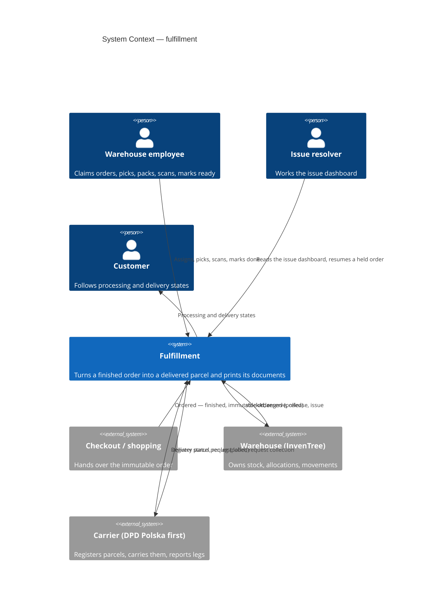

# fulfillment — order processing and the document layer

Session anchor: [issue #3](https://github.com/michal-michaluk/ecommerce-eval/issues/3) · process: `specification` steps 0–7 · folder landed step by step.

## Purpose

Turn a finished, immutable order into a delivered parcel: one employee owns it, a pick list walks the
warehouse, every position is confirmed by scanning, the parcel is registered with a carrier before it
exists, and every delivery state — plus every warehouse problem — is visible and told to the customer.
The context owns the processing, the parcel record and the documents it must print; it does not own
the order content, the stock, the customer master or the carrier's own data.

## Input tiers

| Tier | What | Where |
| --- | --- | --- |
| A — primary | the `ecommerce` knowledge base: `fulfillment/`, `integrations/`, `domain-language/` | `/Users/michal/.agents/knowledge/ecommerce/` — indexed in [`materials/kb-index.md`](materials/kb-index.md) |
| B — provenance | the primitive artifacts the KB cites | [`../../raw/materials/`](../../raw/materials/) — eventstorming board, transcript, DPD label, WZ note |
| C — constraints | service patterns, the one existing context | [`../../arch/microservice-java-spring/`](../../arch/microservice-java-spring/), [`../catalog/`](../catalog/) |

The KB is case-linked by absolute path in `materials/kb-index.md` and is **not** copied here: one source of
truth, still under its own repo and RAG collection. Every KB claim carries `[seg N]` or `path:line`, so any
rule in this spec can be verified against Tier B in one hop.

## Materials index (Step 1, accepted)

| # | Source | Type | What it is | Use for | Status |
| --- | --- | --- | --- | --- | --- |
| A1 | KB `fulfillment/order-processing/README.md` | doc | 6 responsibilities, actors, 8 commands → 9 events, 5 read models, 1 policy, both boundaries | scope, actors, commands, events, views | fact |
| A2 | KB `fulfillment/order-processing/order-assignment.md` | doc | exclusive claim, double-send guard, orders-list states | assignment rules | fact |
| A3 | KB `fulfillment/order-processing/pick-list.md` | doc | list contents, `reserve products`, `stock changed`, the optimisation gap | pick list | fact |
| A4 | KB `fulfillment/order-processing/picking-and-packing.md` | doc | scan-to-confirm, position-level state, one-screen workstation | picking | fact |
| A5 | KB `fulfillment/order-processing/shipping-and-delivery-states.md` | doc | registration-first, `ready for delivery`'s two effects, six legs, push vs poll | delivery states | fact |
| A6 | KB `fulfillment/order-processing/issues-and-hold.md` | doc | issue types, hold, dashboard, out-of-system adjustment | issues | fact |
| A7 | KB `fulfillment/order-processing/sources-and-references.md`, `research-log.md` | doc | source tiers, rejected claims, coverage gaps | verification, known holes | fact |
| A8 | KB `fulfillment/documents/` (7 files) | doc | WZ, consignment note, CMR/e-CMR, invoice+VAT, document landscape | document layer | fact |
| A9 | KB `integrations/warehouse-inventree/` (8 files) | doc | allocation without TTL, no outbound subscription, 4-method port, the state we must own | warehouse port | fact |
| A10 | KB `integrations/spedition-pl/` (20 files) | doc | carrier matrix, DPD reference, polling vs push, label ownership split | carrier port | fact |
| A11 | KB `domain-language/` (3 files) | doc | term status `confirmed`/`ambiguous`/`missing`, glossary, undecided register | naming, Q/R seed | fact |
| A12 | KB `index.md`, `README.md` | doc | taxonomy, coverage per folder, findings | navigation | fact |
| B1 | `../../raw/materials/eventstorming.json:110-150, 169-179` | diagram | lane `fulfillment-order-processing`, boundaries, external systems | board truth, verbatim wording | fact |
| B2 | `../../raw/materials/transcript.json` seg 57, 98–99, 106, 109–153 | transcript | the narration of this lane | rules, states, intent | fact |
| B3 | `../../raw/materials/consignment-note.json`, `goods-issue-note.json` | data | DPD label and WZ, field by field | document fields | fact |
| B4 | `../../api/warehouse-api.md`, `../../api/inventree-openapi.json` | API contract | warehouse stock / reserve / issue surface | warehouse port | fact |
| C1 | `../../arch/microservice-java-spring/*` (20 files) | arch docs | mandatory service patterns | constraints | fact |
| C2 | `../catalog/spec.md` + `services/catalog` | spec + code | the one specified context, spec convention, layout | baseline, shape | fact |

## Scope

- **In scope:** order intake from checkout; exclusive assignment; pick list; reservation at the warehouse;
  scan-to-confirm picking; packing; parcel registration and delivery-state tracking; issues and hold;
  the read models the lane needs; the Polish document layer the context must print — WZ goods issue note and
  the carrier consignment note/label.
- **Out of scope:** order content and immutability (checkout/catalog); stock truth and allocation mechanics
  (warehouse system); customer master (CRM); carrier-side data and legal delivery (carrier); payments;
  basket; returns and refunds (`UND-32`); KSeF/e-invoicing (`UND-28`); CMR/e-CMR for a domestic parcel —
  excluded by the KB's own decision table, KB `fulfillment/documents/cmr-and-ecmr.md:97`.
- **Deferred / detached:** carrier and warehouse **adapter internals** — the KB already documents them
  (`integrations/`), they get their own specs; this spec fixes only our ports and their contracts.
  Pending decision at Step 4: whether a pickup-point read model is deferred (`UND-16`).

## Registers

| ID | Type | Statement | Status | Decision |
| --- | --- | --- | --- | --- |
| F1 | Fact | `README.md:19-24` lists `raw/fulfillment.md` and siblings deleted in `d16a219`; the real materials live in `docs/raw/` | accepted | intake uses `docs/raw/` + KB, README is stale and is corrected separately |
| F2 | Fact | the KB lives outside this repo (`/Users/michal/.agents/knowledge/ecommerce/`, its own git repo, RAG collection `ecommerce`, 878 chunks, 0 stale) | accepted | linked, never copied — `materials/kb-index.md` |
| R1 | Risk | linked KB can move or change under a landed spec | open | cite file + line anchors, and cite Tier B (`docs/raw/materials/*`) for anything a decision depends on |
| R2 | Risk | the 71.2 s transcript gap sits in basket delivery estimation, not this lane — but delivery time and cost are still unformulated (`UND-01`, `UND-05`) | open | checkout owns the promise; this lane only executes the delivery method it receives |
| D1 | Decision | scope = the fulfillment bounded context: order-processing lane **plus** the documents the context prints (WZ, consignment note); CMR/e-CMR excluded | accepted | one context, one service |
| D2 | Decision | integration depth = our ports and their contracts in this spec; carrier/warehouse adapter internals deferred to their own specs | accepted | ports here, adapters there |
| D3 | Decision | carrier-agnostic port with DPD Polska as the first adapter; the port is never named after a carrier (`UND-15`) | accepted | `CarrierPort`, not `DhlPort` |
| Q1 | Question | which order states and which order identifier exist (`UND-20`) — the board carries events, no vocabulary | open | derive a state machine from the 9 board events and present it as a Step-5 element for acceptance; no invented enumerations elsewhere |
| Q2 | Question | pick-route algorithm and warehouse-layout ownership (`UND-23`) | open | documented default: single pass ordered by location code, locations resolved through the warehouse port; algorithmic optimisation deferred |
| Q3 | Question | does a hold block delivery, cancel anything, or release the assignee (`UND-22`) | open | Step 5 element `HoldDecision` (09) must answer it or leave it explicitly undecided |
| D5 | Decision | **no money in this context**: no money is computed, compared or stored; the WZ is *rendered* from data supplied by the invoicing boundary, and COD / declared-value amounts are opaque pass-through values on the carrier request | accepted | element 11 `DocumentAmounts` removed; `Order` carries no prices; VAT and delivery-cost questions (`UND-01`, `UND-02`, `UND-05`, `UND-07`) belong to checkout/invoicing |
| Q4 | Question | `docs/adr/01-strategic-software-architecture.md` absent for this SUD | parked | out of this spec's scope, as in `../catalog/spec.md` Q9 — workspace-level artifact |
| D4 | Decision | `Order` is a **value object** in the shared kernel: content only, no identity, equality by canonical `orderHash`; `OrderProcessing` mints a synthetic `OrderProcessingId` at intake and keeps `orderHash` as the idempotency key | accepted | second delivery of the same order is a no-op, never a second parcel |
| F4 | Fact | the seller party (name, address, NIP) on the WZ is **not** order content — the buyer's invoicing data is, ours is configuration | accepted | `Order` carries no seller; documents read seller from configuration (`ubiquitous-language.md:175` leaves "seller" undefined) |
| D6 | Decision | questions and risks are numbered **per element** — `Q-<element>-n` / `R-<element>-n` — not per spec; the plain sequence collides because 04–09, 11, 12 and 15–18 landed in one parallel batch: `Q16`–`Q24` and `R7`–`R11` were each claimed by two or more files, so an unqualified id resolves to more than one question | accepted | elements 10, 13 and 14 already use the per-element form; 05 and 06 converted to `Q-05-n` / `Q-06-n`; no landed element renumbered; a cross-element reference must name the element and its scoped id (`element 03 Q-03-1`); the Step-3 facts are `F3-n`, so the global register keeps one meaning each for `F3` and `F4` |
| D7 | Decision | an **explicit resume command** exists — `POST /processing/{processingId}/hold/resume`, granted to both `fulfillment-employee` and `fulfillment-resolver` — because no source names any exit from `onHold`; it succeeds only with zero open issues (element 09 H5/H6) and never on a polled carrier signal | accepted | the hole is closed deliberately, not left to an implementer: element 02 RULE-7, element 09 H5/H6, element 11, element 17 `Q-17-1` |
| D8 | Decision | closing an issue is a **fact recorded by the resume command** (D7): the request body is `{ "closedIssueIds": ["ISS-2026-0031"] }`, and any issue left open makes it answer `409 ISSUES_REMAIN` with `openIssues` — the issue dashboard stays read-only, and there is no separate resolve endpoint, resolve command or issue lifecycle | accepted | element 04 RULE-1 (`closedAt` is the record's single mutable fact), element 09 H5/H6, element 11 (the one write path), element 17 (no write side) |

## Step 2 — Goals, actors, capabilities, properties (accepted)

- **We build:** the fulfillment context — a finished order becomes a delivered parcel, with documents.
- **For whom:** warehouse employee, issue resolver, customer.
- **Because:** after checkout the shop must physically deliver and keep the customer informed [seg 109, 126-128].
- **Success looks like:** an order can never be processed twice; every order state change reaches the customer view; the parcel has a carrier identifier before the first delivery leg.
- **Capabilities:**
  1. list current orders with their processing state
  2. claim one order exclusively
  3. produce a pick list: product, quantity, location
  4. reserve the products at the warehouse
  5. confirm each position by scanning it
  6. mark the order done / ready for delivery
  7. register the parcel and obtain the carrier's identifier
  8. follow every delivery leg and notify the customer
  9. report a warehouse problem and put the order on hold
  10. see every open issue in one read-only dashboard
  11. print the goods issue note (WZ) and the consignment note/label
  12. resume an order from hold once every issue is closed (D7, D8)
- **Properties:**
  - **Invariant:** one employee per order — exclusivity, not advisory (KB `order-assignment.md:5`)
  - **Freshness:** read models update after each event [seg 137-138]
  - **Resilience:** carrier status is poll-only for DPD, so a scheduler and idempotent state application are mandatory (KB `dpd-polska/status-polling.md:78`)
  - **Audit:** every state change and issue stays readable to the customer
  - **Security:** warehouse token and carrier credentials are secrets, never in code (KB `dpd-polska/sandbox-and-credentials.md:55`)
  - **Volume/latency:** absent from every source — no numbers to design against

**Assumption to confirm:** the *issue resolver* is **not** a board actor — the board carries only `employee` and `customer`; the KB introduces him from the narration "someone else will see issue on his dashboard" [seg 149], KB `issues-and-hold.md:51`.

### C4 context

Canonical names follow KB `domain-language/ubiquitous-language.md:308-398`: order processing, assignment, pick list, pick, pack, scan, position packed, ready for delivery, delivery number / provider ID, delivery state, delivery state notification, issue, order on hold.

## Step 3 — Current code exploration (accepted)

| ID | Fact | Provenance |
| --- | --- | --- |
| F3-1 | Nothing exists for fulfillment: no code, no Kafka topic, no `fulfillment`/`picker` Keycloak role, no database | repo-wide grep for `Order\|Parcel\|Pick\|Carrier\|Stock` = 0 hits; `services/catalog/k8s/infra/kafka.yaml:1-16`; realm roles `user`/`admin`; `databases.txt` = `catalog:catalog:catalog` |
| F3-2 | **No** `domain/`/`application/`/`infrastructure/` packages — one root package, role by file suffix | `docs/arch/microservice-java-spring/code-structure.md:3-6`, suffix table `:80-97` |
| F3-3 | Events are in-process only: `ApplicationEventPublisher`, "no Kafka topic, no outbox worker, no `@Async`" | `docs/arch/microservice-java-spring/integration-events.md:18` |
| F3-4 | Ports are package-private with an inner adapter, lifecycle `get/save`; a `*Policy` is never a bean and does no I/O; one `{Context}Exception` with a nested `Error` enum | `ports.md:9,33`, `domain-model-policy.md:150`, `error-handling.md:3,72` |
| F3-5 | `WarehouseStock` is documented, not implemented — 0 implementations | `docs/api/warehouse-api.md:27-39`, value objects `:42-44`, adapter rules `:48-52` |
| F3-6 | No root build, no justfile; each service is self-contained with its own wrapper, `k8s/`, quality gates | `README.md:38`, `services/catalog/settings.gradle:1`, `.sqt.yaml` ×3 (3 + 51 + 6 checks) |
| R3 | The blueprint has in-process events only, yet `ordered` crosses contexts and carrier/warehouse state arrives from outside — the only transport the arch docs allow is synchronous HTTP | `integration-events.md:18` vs board boundary `eventstorming.json:169-172` |
| Q5 | Cross-context transport: `POST /orders` handover + polled warehouse/carrier, or is `integration-events.md` stale for a multi-service repo | open — Step 5 decision, blocks element 03 |

## Step 4 — Key elements (accepted)

| # | Element | Type | File |
| --- | --- | --- | --- |
| 01 | `Order` | business concept — value object, shared kernel | [01-order.md](01-order.md) |
| 02 | `OrderProcessing` | business concept — process aggregate | 02-order-processing.md |
| 03 | `Parcel` | business concept | 03-parcel.md |
| 04 | `FulfillmentIssue` | business concept | 04-fulfillment-issue.md |
| 05 | `GoodsIssueNote` | business concept — document | 05-goods-issue-note.md |
| 06 | `ConsignmentNote` | business concept — document | 06-consignment-note.md |
| 07 | `AssignmentGuard` | automated decision | 07-assignment-guard.md |
| 08 | `ReadyForDeliveryDecision` | automated decision | 08-ready-for-delivery-decision.md |
| 09 | `HoldDecision` | automated decision | 09-hold-decision.md |
| 10 | `PickListCalculation` | calculation | 10-pick-list-calculation.md |
| 11 | `FulfillmentHttpApi` | external API we expose | 11-fulfillment-http-api.md |
| 12 | `shopping ↔ Fulfillment` | component integration | 12-order-handover.md |
| 13 | `Fulfillment → Warehouse` | existing external API we consume | 13-warehouse-port.md |
| 14 | `Fulfillment → Carrier` | existing external API we consume | 14-carrier-port.md |
| 15 | `employee → OrdersListView` | UI view | 15-orders-list-view.md |
| 16 | `employee → PickWorkstation` | UI view | 16-pick-workstation.md |
| 17 | `resolver → IssueDashboard` | UI view | 17-issue-dashboard.md |
| 18 | `customer → OrderProcessingStateView` | UI view | 18-order-processing-state-view.md |

One-liners, per type, are kept with the associated `Q`/`R` they depend on:

- **concepts:** `Order` — the immutable document from checkout, no identity, equality by content; `OrderProcessing` — processing state beside it (Q1 states); `Parcel` — carrier-side shipment, `paczka i/n`, provider ID, state history; `FulfillmentIssue` — warehouse reality gap + the hold it causes (Q3); `GoodsIssueNote` — WZ; `ConsignmentNote` — the label print, ownership split 22/11/6/1.
- **decisions:** `AssignmentGuard` — one employee per order, exclusivity; `ReadyForDeliveryDecision` — all packed + no blocking issue → mark done and request collection; `HoldDecision` — issue → hold, and what a hold blocks (Q3).
- **calculation:** `PickListCalculation` — positions + locations → ordered pick list (Q2). No money calculation exists in this context (D5).
- **integrations:** `FulfillmentHttpApi` — our surface; `shopping ↔ Fulfillment` — inbound handover (Q5); warehouse port; carrier port — contracts only.
- **views:** orders list; pick workstation; issue dashboard; customer processing-state view.

**Deferred / detached** (not numbered, no element file): carrier and warehouse adapter internals (D2); pick-route optimisation algorithm (Q2); pickup-point read model (`UND-16`); returns and refunds (`UND-32`); KSeF/e-invoicing (`UND-28`); CMR/e-CMR (KB `fulfillment/documents/cmr-and-ecmr.md:97`).

## Steps

| Step | State |
| --- | --- |
| 0 Book & claim | done — issue #3 claimed `2026-11-19T09:20:33Z`, [start comment](https://github.com/michal-michaluk/ecommerce-eval/issues/3#issuecomment-7004968795) |
| 1 Raw material intake | accepted — this file, `materials/kb-index.md` |
| 2 Goals, actors, capabilities, properties | accepted |
| 3 Current code exploration | accepted — F3-1…F3-6, R3, Q5 |
| 4 Key elements | accepted — 18 in scope, 6 deferred (element 11 `DocumentAmounts` removed by D5) |
| 5 Element specification | in progress — 01–18 written; 05 and 06 re-checked against the KB (per-element `Q`/`R` ids per D6, anchors re-verified); consistency review pending |
| 6 Consistency review | pending |
| 7 Close-out & booking | pending |
