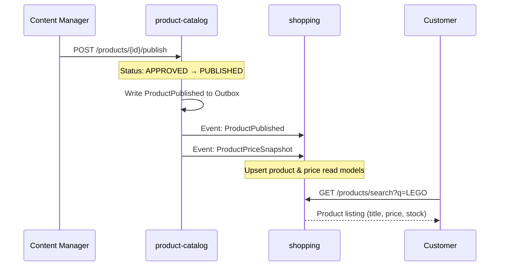
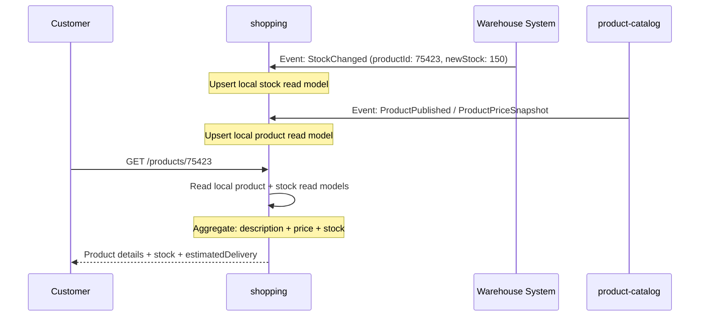
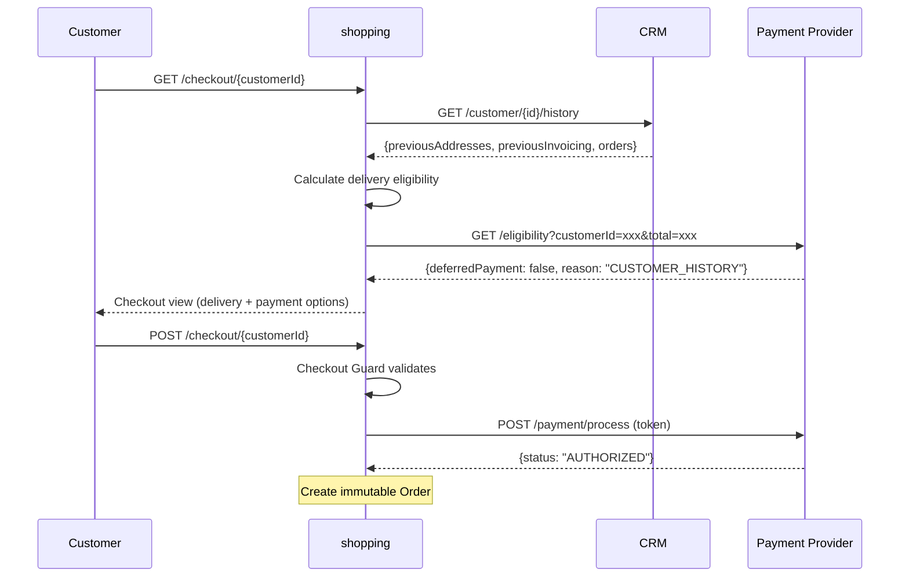
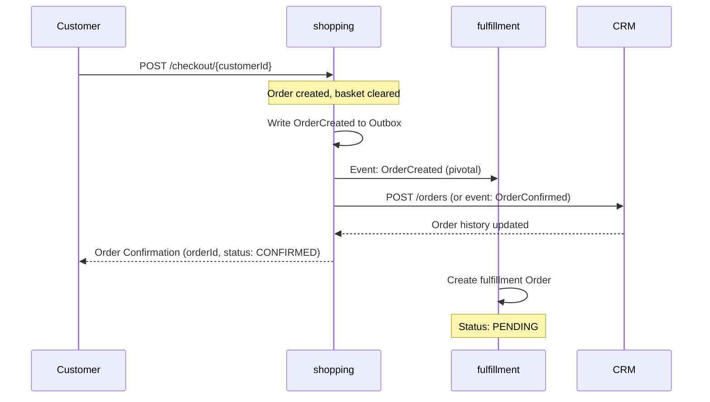
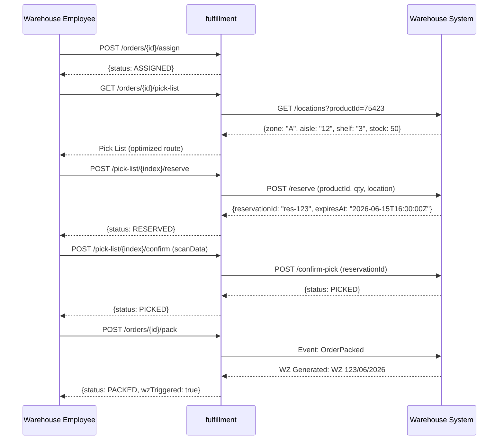
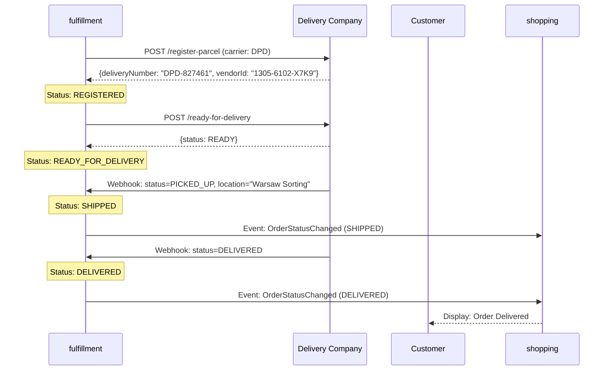
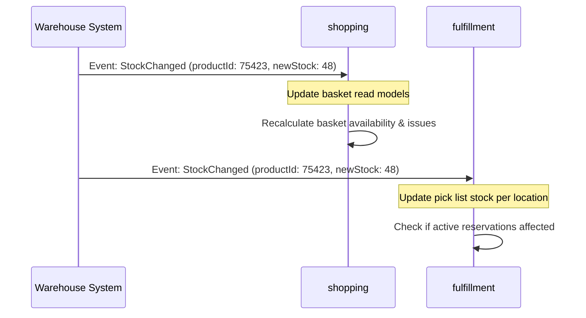

# E-Commerce Platform — Domain Specification

**Platform Slice:** A) Product Catalog, B) Shopping, C) Fulfillment
**Tech Stack:** Java, Spring Boot, Hexagonal Architecture, DDD
**Created:** 2026-06-15

---

## 1. Business Context

Event Storming session (~32 min) and supporting artifacts define the business domain for an e-commerce platform spanning product catalog management, shopping experience, and order fulfillment.

### Input Materials
- Event Storming transcript (`ecommerce-eventstorming.improved.srt`)
- Event Storming summary (`ecommerce-eventstorming.md`)
- Product Description (LEGO set 75423 — `product-description.json`)
- Goods Issue Note template (`goods-issue-note.json`)
- Consignment Note template (`consignment-note.json`)

### External Systems
- **Warehouse System** — off-the-shelf, provides stock data, short-term reservations, product locations, and stock change notifications
- **CRM** — existing system, stores customer data, invoicing data, order history; receives new order events
- **Delivery Company** — multiple carriers (e.g., DPD), registers parcels, provides tracking updates
- **Payment Provider** — third-party, handles payment processing and eligibility checks

---

## 2. Business Goals

1. Streamline product catalog creation with draft → review → publish workflow
2. Enable scheduled publishing of offers and prices with future availability dates
3. Provide customers with responsive, always-scalable browsing across channels
4. Provide delivery time, cost, and payment methods visible throughout shopping & checkout
5. Process checkout with basket-dependent delivery and payment eligibility rules
6. Fulfill orders via warehouse pick + pack, delivery company tracking, and issue handling

---

## 3. Stakeholders

- **Content Team** — creates product descriptions and reviews them
- **Sales Department** — sets pricing policies and discounts
- **Warehouse** — picks, packs, ships
- **Customers** — browse, buy, track orders
- **Operations** — resolves fulfillment issues

---

## 4. Actors

### Human Actors
- **Content Manager** — creates and edits product drafts, requests review
- **Photo Personnel** — uploads product photos
- **Reviewer (Content Manager)** — validates and approves descriptions
- **Sales Personnel** — sets prices and discount schedules
- **Customer** — browses, adds to basket, checks out
- **Warehouse Employee** — assigns to order, picks items, packs, reports issues
- **Issue Resolver** — handles warehouse problems (e.g., finds missing items)

### External Systems
- **Warehouse System** — stock data, reservations, locations
- **CRM** — customer data, invoicing history
- **Delivery Company** — parcel registration, tracking events
- **Payment Provider** — payment processing, deferred payment eligibility

---

## 5. Actor Interactions

### Content Manager
- **→ System**: create product draft / create new version
- **→ System**: edit product description (title, marketing text, structured content)
- **→ System**: request review
- **→ System**: schedule publication date
- **← System**: private draft (not visible externally)
- **← System**: quality gate feedback (missing fields, policy issues)
- **← System**: read model of current reviews and drafts

### Photo Personnel
- **→ System**: upload high-resolution product photos
- **→ System**: associate photos with product drafts
- **← System**: photos stored, not published yet

### Reviewer
- **→ System**: validate description
- **← System**: draft description with quality gate results
- **→ System**: approve / reject
- **← System**: pending review notifications

### Sales Personnel
- **→ System**: set product price (with date range)
- **→ System**: set discount rules
- **← System**: price history, scheduled price changes
- **→ System**: publish price
- **← System**: event emitted to outside world

### Customer
- **→ System**: search products
- **→ System**: view product details (description + price + stock)
- **→ System**: add to basket
- **→ System**: change quantity / remove from basket
- **→ System**: proceed to checkout
- **→ System**: select delivery method
- **→ System**: select payment method
- **→ System**: fill customer data
- **→ System**: process checkout
- **← System**: product details (with current price, stock status)
- **← System**: basket summary (price, discounts, delivery time, stock issues)
- **← System**: delivery options (filtered by basket content)
- **← System**: payment options (filtered by customer history)
- **← System**: order confirmation
- **← System**: order tracking (processing → packing → shipped → delivered)

### Warehouse Employee
- **→ System**: assign to order
- **→ System**: reserve picked product
- **→ System**: scan product (pick confirmation)
- **→ System**: mark position as packed
- **→ System**: mark order ready for delivery
- **→ System**: report issue (lost item, wrong location)
- **← System**: order list with status
- **← System**: optimized pick list
- **← System**: stock info per product location
- **← System**: current issues read model

### Warehouse System
- **→ System**: stock change notifications
- **→ System**: reservation confirmations
- **← System**: stock queries
- **← System**: reservation requests

### Delivery Company
- **→ System**: delivery state updates
- **← System**: parcel registration requests

### CRM
- **→ System**: customer data (for pre-filled checkout)
- **→ System**: order history updates
- **← System**: new order events

---

## 6. Key Calculations / Decisions

| Name | Trigger | Inputs | Output |
|------|---------|--------|--------|
| **Description Quality Gate** | review request | description content + policy rules | pass / fail / rejection reasons |
| **Basket Calculation** | basket change | items + prices + discounts + stock status | price summary + estimated delivery + issues |
| **Delivery Time Estimation** | basket change / delivery selection | basket content + delivery method + stock availability + warehouse location | estimated delivery date/window |
| **Delivery Method Eligibility** | checkout view | basket content (dimensions, weight, item types) | feasible delivery methods |
| **Payment Method Eligibility** | checkout view | customer history + partner checks + order total | allowed payment methods |
| **Checkout Guard** | checkout action | all selections + basket validity + customer data | proceed / blocked + reasons |
| **Pick Route Optimization** | order assignment | order items + warehouse layout | optimized walking path |
| **Product Visibility** | scheduled date reached | product description + price + availability date | visible / hidden in catalog |
| **Price Activation** | schedule date reached | price + date range | active price + price changed event |

---

## 7. Artifacts

| Artifact | Producer | Contains | Consumer |
|----------|----------|----------|----------|
| **Product Description** | Content Manager | title, marketing text, structured content, photos | Customers (via channels) |
| **Price Schedule** | Sales | price, currency, effective date range | Catalog (publishes at date) |
| **Order** | Checkout | customer data, items, delivery, payment, status | Fulfillment, CRM |
| **Pick List** | System | optimized items + warehouse locations | Warehouse Employee |
| **Goods Issue Note (WZ)** | System | shipped items, warehouse, sender, receiver | Warehouse, Accounting |
| **Consignment Note** | System | carrier info, sender, recipient, parcel details | Delivery Company |
| **Delivery Tracking Events** | Delivery Company | parcel status, location, leg | System, Customer |

---

## 8. Feature Slices

The platform is cut into three separate features for specification and implementation:

### A. Product Catalog (creation → review → publish)
- **Bounded Context:** Product Catalog
- **Actors:** Content Manager, Photo Personnel, Reviewer, Sales
- **Domain:** Product descriptions, versioning, review workflow, quality gates, photos, price scheduling
- **Microservice:** `catalog-service`

### B. Shopping (basket → checkout)
- **Bounded Context:** Shopping
- **Actors:** Customer
- **Domain:** Browsing, basket, delivery/payment options, checkout guard, order creation
- **Microservice:** `shopping-service`

### C. Fulfillment (pick → pack → ship)
- **Bounded Context:** Order Fulfillment
- **Actors:** Warehouse Employee, Issue Resolver
- **Domain:** Order assignment, picking, packing, shipping, warehouse integration, issue handling, delivery tracking
- **Microservice:** `fulfillment-service`

---

## 9. Inter-Microservice Sequence Diagrams

### 9.1 Product Publish & Price Sync

### 9.2 Product Browse with Stock Query

### 9.3 Checkout & Payment

### 9.4 Order Creation (Pivotal Handoff)

### 9.5 Order Picking & WZ Generation

### 9.6 Delivery Tracking

### 9.7 Stock Change Notifications

---

## 10. Gap Analysis Summary

| Area | Status | Notes |
|------|--------|-------|
| Description quality policy | Skeleton | Rules need definition (mandatory fields, grammar, image resolution) |
| Photo management | Skeleton | Upload, store, associate. Organization details (albums, variants, alt text) unclear |
| Price scheduling | Partial | Single vs overlapping periods, multi-currency, history unclear |
| Review workflow | Partial | Mandatory vs optional, rework cycle details unclear |
| Discount application | Missing | Types, stacking, coupon vs automatic unclear |
| Delivery time estimation | Outline only | Inputs (stock, warehouse, method, calendar) need definition |
| Delivery eligibility | Outline only | Exact rules beyond "fits in Paczkomat" need definition |
| Payment eligibility | Outline only | Concrete checks (credit, order limits, partner score) need definition |
| Customer data / CRM | Outline only | Guest checkout allowed? Pre-filled fields? Need definition |
| Checkout guard rules | Outline only | Cart validation, price change, stock drop scenarios need definition |
| Warehouse layout | Missing | Our system vs warehouse API responsibility unclear |
| Pick route optimization | Outline only | Algorithm and ownership (our system vs WMS) unclear |
| Short-term reservation | Outline only | Duration, timeout, release mechanism unclear |
| Issue management | Outline only | Types, resolution workflow, escalation unclear |
| WZ generation | Template given | Trigger timing (pack completion vs shipment) unclear |
| Carrier tracking | Outline only | Webhook vs polling, number of carriers, event model unclear |
| Scheduled publishing | Partial | Cancel/edit while waiting unclear |

---

*Next: Phase 3 — Definition of Ready analysis for each feature slice.*
